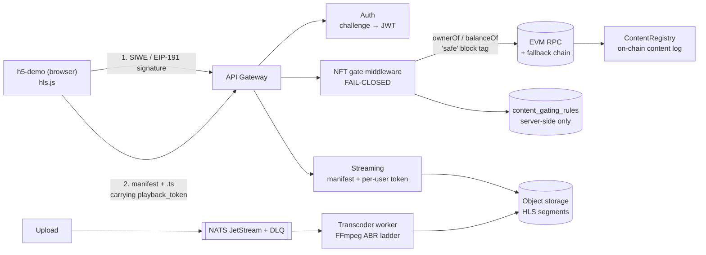

# StreamGate — Token-Gated Video Streaming for Web3

> **Token-gated video delivery.** Users prove NFT ownership to watch — no password, no piracy, no middleware.
>
> English: [Overview](#-project-overview) · [Quick Start](#quick-start) · [API Docs](docs/api/API_DOCUMENTATION.md)
>
> 中文: [一句话介绍](#-一句话介绍) · [快速开始](#quick-start)

[](https://go.dev/)
[](LICENSE)
[](CONTRIBUTING.md)
[](Dockerfile)
[](docs/api/openapi.yaml)
[](VERSION)
[](https://discord.gg/streamgate)

---

> 🚀 **One-command demo**: `make demo` — starts infra, builds, runs, ready to test in 60 seconds

---

## Quick Start

```bash
make fullchain-deploy             # Postgres + Redis + MinIO + NATS + Anvil(+DemoNFT) + monolith + microservices + h5-demo
open http://localhost:18000       # connect wallet → sign in → mint DemoNFT → verify → play
```

Confirm the gate is actually closed before you authenticate:

```bash
curl -i http://localhost:18080/api/v1/streaming/demo/manifest.m3u8    # → 401 Unauthorized
```

For API-level work with no chain involved, `make demo` starts Postgres + Redis + MinIO and runs the
monolith on `:8080` (h5-demo then served at `http://localhost:8080/demo`). See [DEPLOY.md](DEPLOY.md).

That is the entire loop: **wallet sign-in → on-chain NFT ownership check → protected HLS playback.**
`make fullchain-deploy` starts Anvil and deploys `DemoNFT` for you — no chain setup needed to try it.

### Architecture



Two properties worth knowing before you read the code:

- **Authorization subject is server-side only.** The NFT contract, token id and chain come from
  `content_gating_rules` via `RuleResolver` — never from request query parameters.
- **The gate fails closed.** No rules → `403 GATING_REQUIRED`; rule resolution error → `500`;
  gate disabled → `503`. The permanent regression tests live in `pkg/gateway/authz_regression_test.go`.

---

## 💡 The Problem

Content creators lose revenue to piracy. Access control is usually one of:
- **Passwords** (shared, stolen, phished)
- **Manual whitelists** (doesn't scale, no transparency)
- **DRM** (proprietary, requires licensing fees, locked to platforms)

StreamGate replaces the first two with **on-chain NFT ownership**: hold the token, watch the video.
No shared passwords, no manual whitelists — programmable, transparent, permissionless.

> **Scope note — this is access authorization, not DRM.** DRM protects content against the
> *endpoint* (hardware trust root, keys that never leave the trusted execution environment).
> StreamGate's HLS delivery uses short-lived, content-bound playback tokens, which stops direct
> segment scraping and link sharing, but does **not** stop a determined viewer from capturing
> playback. It is not a DRM substitute; see [What StreamGate Is Not](#-what-streamgate-is-not).

## 🎯 一句话介绍

**持有特定 NFT 才能观看视频的内容分发平台**

```
用户持有 NFT → 验证所有权 → 获得观看权限 → 播放视频
```

---

## 📖 四个核心环节

### 1. 钱包签名登录
- 用户不需要密码，通过钱包签名登录
- 服务端做 `EIP-191` 验签、`nonce`、过期校验和防重放（challenge 用 Redis Lua 原子消费）

### 2. NFT 所有权校验
- 服务端通过真实链上调用校验持有权（`ownerOf`/`balanceOf`，ERC-721/1155，ERC-165 自动探测）
- 只有持有 NFT，才允许访问受保护内容
- 读链固定用 `safe` block tag；检测到重组自动失效缓存；正结果缓存 TTL 上限 15 秒

### 3. 受保护的 HLS 投递
- 通过校验后才下发 manifest；分片用内容绑定、短 TTL 的 playback token 投递
- 令牌绑定钱包与客户端指纹，跨用户复用会被拒绝；链上 RPC 不进播放热路径

### 4. 转码 Worker
- 视频上传后通过 FFmpeg 转码为 HLS（4 档 ABR 阶梯 + 实时进度解析）
- 任务经 NATS JetStream 分发，带重试、超时与卡死 worker 回收，失败任务进 DLQ

### 主链路

```text
钱包签名登录 -> NFT 所有权校验 -> 放行 manifest -> 播放 HLS 视频
```

---

## 📖 Project Overview

StreamGate is a Go-based NFT-gated streaming backend. It combines a video distribution pipeline you would expect in a media backend with Web3 capabilities such as wallet sign-in, NFT ownership verification, and RPC reliability handling.

### 🎯 Why StreamGate?

**Token-based access replaces passwords and manual whitelists.**

| Problem | Traditional approach | StreamGate |
|---------|---------------------|------------|
| Password sharing | Rate limiting, MFA | Access requires a wallet signature — no shared secret to leak. Sharing the wallet itself still works; the platform rate-limits per wallet. |
| Manual access management | Admin dashboards, CSV exports | Own the NFT → access is derived from on-chain state, no per-user admin work |
| Cross-platform | Multiple SDKs per platform | **One API** — REST/gRPC/OpenAPI |

> DRM solves a different problem (content protection at the endpoint), not this one more cheaply.
> StreamGate does not claim to replace it — see the scope note above.

### 🚫 What StreamGate Is Not

| Not this | Because |
|----------|---------|
| **Decentralized video network** | StreamGate is self-hosted infrastructure, not a peer-to-peer network. For decentralized transcoding, see Livepeer. |
| **Traditional DRM (Widevine/FairPlay)** | DRM requires proprietary licensing. StreamGate uses on-chain ownership as an alternative. |
| **Managed SaaS / Cloud** | Community edition is self-hosted. A hosted version may be added in a future release. |
| **No-code platform** | StreamGate is API-first. A Web UI is planned but not yet available. |

### 👥 Who Is It For?

| Role | Goal | Quick Start |
|------|------|-------------|
| **Platform Developer** | Integrate NFT-gated video via API | Read the [OpenAPI spec](docs/api/openapi.yaml) — no Go required |
| **Content Creator** | Upload video, set NFT rules, go live | Use `make demo` (single-binary, no blockchain needed for code-level experimentation) |
| **Node Operator** | Deploy and scale StreamGate | Use `make deploy-monolith` (7 containers) or `make deploy-microservices` (10 service binaries, 16 containers), or K8s manifests in `deploy/k8s/`. See [DEPLOY.md](DEPLOY.md) for the 5-minute guide. |

### 📦 Product Roadmap

#### P0 — Core Flow (Implemented, hardening)

Core authentication, NFT verification, and streaming pipeline — implemented and covered by tests. The authorization path went through a fail-closed security audit and is now pinned by permanent regression tests (`pkg/gateway/authz_regression_test.go`). Known gaps are listed under [Project Status](#-project-status).

- [x] **Wallet Sign-In** — EIP-191 / EIP-712 / SIWE (EIP-4361) + Solana ed25519
- [x] **NFT Ownership Verification** — ERC-721, ERC-1155, ERC-165 auto-detect
- [x] **NFTOwnershipsApproval (TOCTOU Protection)** — CheckApproval + CheckApprovalAutoDetect
- [x] **HLS Streaming** — Manifest generation + per-user playback tokens
- [x] **Video Upload** — Chunked resumable upload with integrity checks
- [x] **FFmpeg Transcoding** — Multi-profile HLS/DASH with worker pool
- [x] **Multi-chain EVM** — Ethereum, Polygon, BSC, Arbitrum, Optimism with RPC failover
- [x] **Solana Integration** — Multi-endpoint RPC failover, Metaplex NFT
- [x] **JWT Auth** — HS256/RS256 with key rotation support
- [x] **Rate Limiting** — Global + per-wallet (10 req/min)
- [x] **Configuration Management** — Viper YAML + env vars with hot reload
- [x] **Graceful Shutdown** — Context-aware with 30s timeout

#### P1 — Usability & Operations (Mostly complete)

Production operations and developer experience — deployed pieces are listed below; observability is partial (metrics endpoint only, no scrape stack).

- [x] **Dual-mode Deployment** — Monolith (dev) + 9 microservices (prod)
- [x] **Docker + Docker Compose** — Full stack with health checks
- [x] **Kubernetes Manifests** — Deployments, services, config maps, secrets
- [~] **Prometheus Metrics** — `/metrics` endpoint (RED metrics) on every service; scrape stack (Grafana/Jaeger) removed during simplification, see docs/ARCHITECTURE.md
- [x] **gRPC API** — Full proto definitions + interceptors + health protocol
- [~] **OpenTelemetry Tracing** — Gin + gRPC instrumented; Jaeger export removed during simplification
- [x] **gRPC TLS** — Certificate-based server-side TLS
- [x] **Structured Logging** — Zap with request ID correlation
- [x] **Health Check Aggregation** — `/health`, `/ready`, `/health/live`
- [x] **Database Migrations** — 35 versioned migrations with paired rollback (19 `.down.sql`)
- [x] **CI/CD Pipeline** — GitHub Actions: lint → test → build → security → docker (security and docker are enforcing gates; coverage floor 60%)
- [x] **Multi-stage Docker Build** — Builder + distroless runtime support
- [x] **Blues/Green + Canary Deployment** — K8s rollout strategies
- [x] **SLO Alerts** — Prometheus alerting rules with burn rate

#### P2 — Ecosystem & Advanced (Planned)

Features planned for future releases.

- [ ] **Web Admin UI** — Browser-based content and gating management
- [ ] **JS / Python SDK** — First-party client libraries
- [ ] **Account Abstraction (ERC-4337)** — Gasless wallet login
- [ ] **Social Login** — Email/OAuth → embedded wallet
- [ ] **NFT-gated Live Streaming** — WebRTC → HLS real-time
- [ ] **Analytics Dashboard** — Viewer metrics, revenue tracking
- [ ] **IPFS Pinning Service** — Decentralized content storage
- [ ] **Commercial License** — Enterprise support, SLA, SSO

## 📊 Performance Metrics

> **These are design targets, not measured results.** No load, soak, or capacity test has been
> run against this repository. They describe the shape of the design; they are not evidence.

| Metric | Design target |
|--------|---------------|
| API response time (P95) | < 200ms |
| Video playback startup | < 2 seconds |
| Concurrent users | 10,000+ |
| Cache hit rate | > 80% |
| Service availability | > 99.9% |
| RPC uptime | > 99.5% |
| Transaction confirmation | < 2 minutes |

### Monitoring & Observability

**Prometheus Metrics** (http://localhost:9090)
- HTTP request count and latency
- Cache hit/miss rate
- Transcoding task status and duration
- NFT verification request count
- System resource usage (CPU, memory, disk)
- Service health status

**Jaeger Tracing** (http://localhost:16686)
- Distributed request tracing
- Service dependency visualization
- Performance bottleneck identification
- Error tracking

**Consul UI** (http://localhost:8500)
- Service registration status
- Health check results
- Service discovery
- Key-value store

**Grafana Dashboards** (http://localhost:3000)
- Real-time metrics visualization
- Custom alerts
- Performance trends
- Resource utilization

## 🤝 Contributing

Contributions are welcome! Please see [Contributing Guide](CONTRIBUTING.md).

### Development Workflow

1. Fork the repository
2. Create a feature branch (`git checkout -b feature/amazing-feature`)
3. Commit your changes (`git commit -m 'Add amazing feature'`)
4. Push to the branch (`git push origin feature/amazing-feature`)
5. Open a Pull Request

### Code Standards

- Follow Go conventions and best practices
- Write tests for new features
- Update documentation
- Run `make fmt` and `make lint` before committing

## 📄 License

This project is licensed under the MIT License - see [LICENSE](LICENSE) file for details.

## 🙏 Acknowledgments

- [go-ethereum](https://github.com/ethereum/go-ethereum) - Ethereum Go client
- [solana-go](https://github.com/gagliardetto/solana-go) - Solana Go SDK
- [FFmpeg](https://ffmpeg.org/) - Video processing
- [NATS](https://nats.io/) - Message queue
- [Consul](https://www.consul.io/) - Service discovery
- [OpenTelemetry](https://opentelemetry.io/) - Observability

## 📈 Project Status

> Core flow (wallet sign-in → NFT ownership check → protected HLS playback) is implemented
> end-to-end and pinned by regression tests. The authorization path was audited and reworked to
> fail closed; CI is green on `master`.

### Current Priorities

| Priority | Focus | Status |
|----------|-------|--------|
| **P0** | Wallet sign-in + NFT verification + protected HLS access | Implemented, tested |
| **P1** | Redis cache + RPC failover + metrics | Implemented |
| **P1** | Worker + FFmpeg pipeline | Implemented |
| **P2** | Further microservice split and polish | Deferred — not a current proof point |

### Known Limitations

| Area | Current state |
|------|---------------|
| **Account abstraction (ERC-4337)** | Not implemented — `pkg/web3/account_abstraction.go` returns an explicit error |
| **Observability stack** | `/metrics` (RED) on every service; the Grafana/Jaeger scrape stack was removed during simplification |
| **IPFS** | Not wired into the upload path |
| **Decentralization** | Self-hosted infrastructure, not a peer-to-peer network — ownership checks read the chain, the platform itself is centralized |
| **Load testing** | No load or soak test has been run; the metrics table above is design targets only |

See `TRANSITION_PLAN.md` for the engineering plan and `docs/ARCHITECTURE.md` for the architecture.

## 📬 Support & Community

| Channel | Purpose |
|---------|---------|
| **Documentation** | [docs/](docs/) — architecture, API reference, deployment, runbook |
| **Examples** | [examples/](examples/) — signature verify, NFT verify, streaming, upload |
| **GitHub Issues** | Bug reports, feature requests |
| **GitHub Discussions** | Q&A, ideas, show and tell |
| **Discord** | Real-time discussion: [Join](https://discord.gg/streamgate) |
| **Security** | [Private vulnerability report](https://github.com/rtcdance/streamgate/security/advisories) |
| **Commercial** | [COMMERCIAL.md](COMMERCIAL.md) — licensing, SLA, custom deployment |

---

⭐ If this project helps you, please give it a Star!

**Repository**: https://github.com/rtcdance/streamgate
