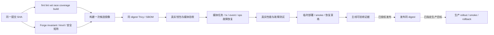
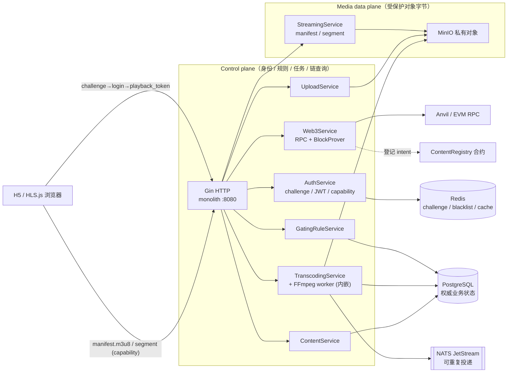
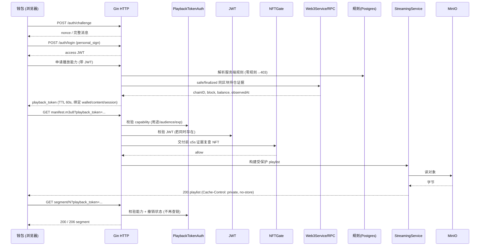

# StreamGate 系统性优化计划：Web3 求职项目与可验证交付

> **当前有效执行入口（2026-10-11）**：本文件上半部分的 SG-00～SG-17 与 M0～M8 是本轮唯一任务和验收标准。下方“历史计划与验收记录”保留旧结论，旧复选框、执行顺序、AUTHZ_RED 临时开关及求职时限不约束本轮，也不证明本轮完成。
>
> **本次交付是计划，未交付功能修改。** SG 任务均待后续 AI 实施；本轮不将既有 CI 绿灯写成新方案验收成功。只有用户要求“执行本计划”后才开始实施。

**架构复审定稿**：主线共 16 项，条件扩展 2 项。新增 SG-10～15 补齐可信架构、合约标准与状态机、媒体任务恢复、链外一致性和运维边界；原 HLS / native 条件项调整为 SG-16 / 17。第 1.1 节冻结需求，第 6 节验收，第 5 节 SG-15 做最终收口。后续 AI 按此实施并修复验证失败，无需再做一轮开放式功能规划。

## 1. 目标、定位与范围

开发背景：10+ 年 C++，6+ 年音视频流媒体前后端，iOS / Android native player 开发经验，掌握 Java、Objective-C、C#。转行项目由 AI 辅助编写，需要证明本人对系统的理解、设计判断和问题处理能力。

**建议定位：Web3 后端工程师，突出钱包身份、链上权限一致性与媒体交付经验。** 主线展示为：真实钱包签名 → 一次性挑战 → 服务端 NFT 规则 → 同链同区块持仓证据 → 有时限的播放能力 → 真实 HLS 解码 → NFT 转移后权限失效 → RPC 故障与发布恢复。此定位基于背景与项目适配度，不是职位数量或录用概率预测。

| 已有能力              | 本项目需要补齐的 Web3 证据                    | 求职时可展示的结果            |
| ----------------- | ----------------------------------- | -------------------- |
| C++ / 服务端系统与并发    | Go 并发、缓存隔离、RPC 回退、链状态一致性            | 一个能复现的授权缺陷、修复及竞态回归   |
| 转码、HLS 与流媒体交付     | NFT 规则真正控制 manifest / segment / key | 实际上传、转码、解码、拒绝未授权媒体字节 |
| iOS / Android 播放器 | 播放能力注入、续期、撤销、错误分类                   | 主线有浏览器闭环；条件扩展有原生真机闭环 |
| 工程排障经验            | 链最终性、重组、失效窗口、发布版本追溯                 | 故障注入、指标、明确的安全边界和恢复证据 |

**两个项目分工**：StreamGate 证明“链上权限如何影响真实媒体访问”；ChainPulse 用于补充链上数据处理与恢复能力。此次未完成 ChainPulse 代码审计，不为其正确性或 CI/CD 背书；不为版本对齐而强行绑定两个项目发布。SG-09 只整理可由其现有证据支持的简历描述。

### 必做与条件扩展

- **主线必做：SG-00～SG-15。** 默认持久验收部署为 monolith + 独立 transcoder worker + PostgreSQL / Redis / MinIO / NATS / Anvil / H5；控制面保持 monolith-first，媒体解析按 SG-12 隔离。同时保持现有微服务构建，并验证 api-gateway 的真实授权接线。
- **条件扩展：SG-16、SG-17。** 主线完成后，用户选择媒体 / 客户端岗位方向时再做 HLS 密钥门控与一个原生播放器。无需先做跨平台 SDK。
- 本轮不要求新增链、账户抽象、IPFS、直播协议或重写微服务架构。先把现有核心能力做成可复现证据。
- 工程交付可以客观验收；录用、真实面试反馈与本人讲述能力需要真人参与，不能由 AI 保证或代填完成。

### 1.1 需求冻结与架构质量要求

本次将求职项目的必要工程范围一次明确。执行中发现用例失败属于实现 / 修复工作，不能以失败为理由反复扩张功能范围。新增需求、实际生产目标或岗位方向变化才进入单独变更；主线完成后停止加功能，把精力转到本人演示和面试。

| 需求 ID | 必须达到的能力                                 | 实施任务        | 验收门      |
| ----- | --------------------------------------- | ----------- | -------- |
| R01   | 核心 flow 真正运行，部署 / 构建 / 页面可用与业务可用明确区分    | SG-00、05、10 | M0、M2、M8 |
| R02   | 真钱包身份、nonce / session 正确，资源写入不越权        | SG-03、06    | M1、M3    |
| R03   | ERC-721 / 1155 数量、接口、规则与缓存语义一致          | SG-01、11    | M1、M7    |
| R04   | 多 RPC 同链回退，同区块授权，重组 / 断流不错误授予权限         | SG-04、13    | M1、M7    |
| R05   | 每种实际媒体资源受保护，续期与撤销有上界                    | SG-05、06    | M2、M3    |
| R06   | 原件 digest 真实，内容登记具有准确可信语义               | SG-11、12、13 | M7       |
| R07   | 转码 / 上传 / 消息重复、崩溃、超时可恢复，资源有界            | SG-12、14    | M2、M8    |
| R08   | 链写入幂等、nonce 唯一、广播未知状态和重启可恢复             | SG-03、13    | M7       |
| R09   | 生产模式不隐式回退内存；配置、密钥、运维与 API 边界明确          | SG-10、14    | M8       |
| R10   | 真实吞吐、播放器质量、RPC / queue / 转码指标有测量证据      | SG-07、14    | M4、M8    |
| R11   | CI 可失败，版本与镜像可追溯，临时 CD / schema / 恢复验证完成 | SG-02、08、14 | M5、M8    |
| R12   | 能解释取舍、个人贡献诚实、简历数字可证实                    | SG-09、10、15 | M6、M8    |

**信任边界**：这是“链上 NFT 权限 + 平台媒体服务”。平台控制内容规则、服务端播放能力、存储、转码和管理；RPC provider 提供链状态。多 RPC 回退不等于轻客户端的密码学证明；NFT 持有不等于媒体版权或上传者身份；平台登记合约只证明平台对内容信息的登记。禁止描述为完全去中心化、无需信任、生产高可用已经验证或版权确权系统。

**架构默认值**：monolith-first；身份 / 内容 / 媒体任务 / 链适配由已有 service 分层；Postgres 为持久业务状态，Redis 为有界缓存和会话状态，MinIO 为私有对象，JetStream 为可重复投递。不给每个类增加抽象接口，不新增通用工作流、DAO、代理升级、支付结算或跨链桥。微服务仅按真实接线和验证程度描述。

**证据等级**：单测 / mock、Docker + Anvil、公开 testnet、生产四个等级分开记录。主线必需等级为 Docker + Anvil；公开 testnet 是补充展示条件，有测试 RPC / 测试资产与用户部署授权时可做，不用主网、不投入真实资金、不因缺凭据伪造演示。只有真实部署 / receipt / explorer 链接才能写“已上线测试网”。

## 2. 当前评审结论与基线边界

评审基线：提交 `6ded9771be9e4ba6039b4ea060be9f6c639df0c9`；工作区另有未提交交易 API、路由及测试变更，实施时必须重新确认。以下是代码检查与隔离诊断发现，**诊断中的试验修复不属于交付，不能据此勾选任务**。

| 优先级 | 发现与影响                                                                                          | 当前代码入口                                                                                     | 对应任务          |
| --- | ---------------------------------------------------------------------------------------------- | ------------------------------------------------------------------------------------------ | ------------- |
| P0  | `min_balance` 未进入缓存 / singleflight 决策键；同钱包低门槛→高门槛可能交叉放行，高→低可能交叉拒绝                              | `pkg/middleware/nft_gate.go`：`nftCacheKey`、`resolveOwnershipWithAutoDetect`                | SG-01         |
| P0  | collection 自动识别忽略数量门槛；特定 token 的 bool ownership 不能表达 ERC-1155 数量                               | 同上；`pkg/service/web3_nft.go`、`pkg/web3/nft/verifier.go`                                    | SG-01         |
| P0  | gating-rule 创建 / 修改 / 删除没有校验内容所有者；全局 JWT 只提供登录校验                                               | `pkg/gateway/gating_rule_handlers.go`、`pkg/service/gating/rule.go`、`pkg/gateway/routes.go` | SG-03         |
| P0  | 未提交交易 API 可让 JWT 用户指定服务器代签的 to/value/data；JWT 不构成钱包支出授权，跟踪链与请求链可能不一致                           | 工作区 `pkg/gateway/web3_handlers.go`、`pkg/service/web3_tx_track.go`；不是已提交基线功能                | SG-03         |
| P0  | block prover 使用默认链，block hash cache 只按高度索引；持仓读取与缓存 header 分别取值                                 | `pkg/service/web3_nft.go:HeaderByNumber`、`pkg/middleware/nft_gate.go:setCachedEntry`       | SG-04         |
| P0  | caller 不支持 block-tag 接口时 NFT 读取退回 latest，与 safe/finalized 承诺不一致                                | `pkg/web3/nft/verifier.go:callContract`                                                    | SG-04         |
| P0  | Anvil 标签测试有 `os.Discard`、`auth.PrivateKey` 编译问题，使用占位字节码 / 不匹配 mint ABI，依赖缺失会 skip，固定端口且未接入主 CI | `test/integration/web3/anvil_test.go`                                                      | SG-00         |
| P0  | 缺失覆盖率可成功退出，Makefile 40% 与主 CI 60% 不一致，Docker job 条件没有要求 Go 测试成功                                | `Makefile:test-ci`、`.github/workflows/ci.yml`                                              | SG-02         |
| P0  | 数据库迁移忽略失败；Docker smoke 只检查文件且忽略失败；PR 不扫描 monolith，镜像独立发布早于完整门禁                                 | `.github/workflows/ci.yml`、`build.yml`                                                     | SG-02 / SG-08 |
| P0  | CD 缺凭据 success；set image / rollout 忽略错误；拉取 master、部署标签与发布标签不一致                                 | `.github/workflows/deploy.yml`                                                             | SG-08         |
| P1  | fullchain 验收自行签 JWT、使用无效媒体；H5 连接探针不足以证明登录与播放，Demo 将 holder 的 404 当成 gate 通过                    | `scripts/fullchain-acceptance.sh`、H5 flow、`h5-demo/index.html`                             | SG-05         |
| P1  | H5 验收的 package.json / lock 本机存在但未跟踪，干净 checkout 不可复现安装                                         | `scripts/h5-demo-acceptance/`；全局 ignore 会忽略新脚本                                             | SG-00         |
| P1  | 并发测试以 sleep 模拟处理，不能作为请求 QPS 或真实播放并发                                                            | `test/performance/performance_test.go:TestConcurrentRequests`                              | SG-07         |
| P0  | DemoNFT 声称 ERC-721，却未实现 safeTransferFrom 的两种重载；现有标准测试只检查支持 ID / approve / transferFrom         | `contracts/src/DemoNFT.sol`、`contracts/test/DemoNFT.t.sol`；按 ERC-721 标准复核                  | SG-11         |
| P0  | ContentRegistry 可将状态设为 Nonexistent 后再次注册，Removed 也可复活；creator 实为 onlyOwner 的平台签名地址             | `contracts/src/ContentRegistry.sol`；creator 不能当成已验证上传者                                     | SG-11         |
| P1  | 所谓 content hash 为 URL / ID 的 SHA-256，不是媒体字节；DB 提交后链注册仅日志告警，无持久重试状态                             | `pkg/service/content/content.go:contentContentHash / CreateContentWithTx`                  | SG-12 / SG-13 |
| P0  | challenge / blacklist / NATS queue 不可用时隐式退回进程内存，多实例 / 重启的安全与持久性承诺失效                            | `pkg/gateway/providers.go`：相关 provider                                                     | SG-10 / SG-14 |
| P1  | nonce 初次获取并发路径有重复分配风险；transaction lifecycle 为内存 map，confirmed 会被清理；registry writer 未统一接入持久跟踪   | `pkg/web3/tx/nonce.go`、`lifecycle.go`、`pkg/gateway/providers.go`                           | SG-13         |
| P1  | 队列消息 / status 本地 map 与 DB 状态存在多处来源；仅有 redelivery 不证明业务无重复副作用                                   | `pkg/storage/nats_queue.go`、`pkg/service/transcoding/transcoding.go`                       | SG-12         |
| P0  | 转码从 inputURL 发起 HTTP，MIME 检查不足以限制目标；LimitReader 到 2 GiB 会截断而未证明拒绝超限                            | `pkg/service/transcoding/transcoding.go:downloadInputFile`；需补 SSRF / 上界负例                  | SG-12         |
| P1  | 手工媒体 playlist 将每个分片 EXTINF 固定为 6 秒，未用实际 FFmpeg 分片时长                                            | `pkg/service/streamingsvc/streaming.go:BuildSimplePlaylist / BuildMediaPlaylist`           | SG-12         |
| P1  | event ID 未带 chainID / blockHash，checkpoint 与查询过滤的持久性需审查；Web3 事件装配未展示限制 active contract 的配置     | `pkg/web3/event/indexer.go / store.go`、`pkg/service/web3.go`；部分是待验证风险，不作已利用结论              | SG-10 / SG-13 |
| P2  | 缺少 HLS 密钥门控和原生播放器实际闭环                                                                          | 历史 D1 / D2；不影响主线先完成                                                                        | SG-16 / SG-17 |

已经完成的历史授权修复（伪播放 token、无规则默认拒绝、客户端合约不覆盖服务端规则等）应保留为常驻回归测试，不再重新引入 RED 开关。评审发现若在后续代码中已修复，只需补齐规定证据；不能重复修改，也不能仅凭代码存在跳过验收。

## 3. 给执行 AI 的统一规则

1. 先读 `CLAUDE.md` / `AGENTS.md` 与任务文件，使用 `rg` 查询调用点；本节优先于历史任务书。涉及 Go / 合约时读取项目对应技能。
2. 记录起始 SHA、dirty 文件路径和现有 Docker 栈。保留用户修改；必要时独立 worktree，不能 reset / stash 用户工作。涉及未提交交易功能，先确认它当前实际状态，不自动删除或并入其他任务。
3. 每项任务完成一次可审查提交，允许在项内按安全子项拆分。先补能失败的用例，再修复，再验证；禁止为保绿而 `t.Skip`、删断言、降覆盖率或吞掉核心步骤错误。
4. 常规实现选择按本计划默认值推进。调用链不同则更新文件入口；发现影响安全语义的冲突时记录差异并解决，不能静默降低判据。
5. 不新增 Go 依赖；复用标准库、现有 SDK / testify / Foundry / FFmpeg / Playwright。锁定现有工具版本；必要依赖变更按 `CLAUDE.md` 处理。
6. 所有受影响任务运行 gofmt、lint、vet、相关 `-race` 测试；最终执行完整 Docker / CI。Web3 运行 Anvil，合约运行 Forge。主机编译只作预检，不作为验收证据。
7. 测试数据与验收栈独立：唯一 Compose project 名、动态端口、专用数据卷、专用测试账户。不得复用当前本机 `/tmp/stack-accept.yml` 或已有服务数据来证明一键复现。
8. 正负例均有超时与响应断言。必需测试零执行 / skip、缺工具、空媒体、空覆盖率、关键服务 503，均为失败。外部 testnet 测试另列为可选，不能替代本地链门禁。
9. `TRANSITION_PLAN.md` 是唯一计划文档；求职成品在 `docs/resume/`。日志、JSON、视频、profile、覆盖率进入临时目录或 CI artifacts；不新建过程报告。清理本任务产物，不删除用户卷、`.workbuddy/` 或他人临时文件。
10. 本任务不包含发通知、发邮件或投递。push 仍遵守 `CLAUDE.md` 的“Push only when asked”；未发布提交的 remote CI 状态写“待运行”，不能引用旧 run 填新任务。
11. **完成记录**至少包含：任务 ID、提交 SHA、实际命令 / 环境、测试 ID 与通过 / 失败 / skip 数、CI run 链接、必要镜像 digest、剩余限制。所有证据追加本文件第 8 节。
12. 整项完成必须满足其全部判据；核心路径只做单测、只在 helper 上测试、只返回 404、仅镜像文件存在、或 rollback 成功但掩盖发布失败，均不算完成。
13. **提交与证据闭环**：代码、配置、测试、验收脚本和能力说明先提交，再冻结干净候选 `C`；M0～M5 / M7 / M8 的最终结果必须对应 `C` 与其镜像 digest。回填结果形成独立证据提交 `D` 时，记录 `candidateSHA=C, evidenceSHA=D`，`D` 只能补本计划的结果 / 链接，不能改变命令、判据或功能说明；不能把 `C` 的绿灯说成 `D` 已验收。若要求最终 HEAD 也全绿，将 `D` 作为新候选完整验收，最后一次 run / digest 留在 CI artifact 和最终答复，不再为写入该 run 创建新提交。任何实现或验收语义变更都产生新候选并重跑受影响门及最终整链；禁止用 dirty tree 的镜像配上旧 HEAD。

### 固定默认语义，避免执行 AI 自行猜测

| 项目        | 默认要求                                                                                                                                                                                                     |
| --------- | -------------------------------------------------------------------------------------------------------------------------------------------------------------------------------------------------------- |
| 内容规则      | 活跃规则按 OR 判断；零活跃规则拒绝。规则错误不能退回客户端 contract 参数或全局公共规则                                                                                                                                                       |
| 数量        | ERC-721 collection 用 balanceOf；指定 ERC-721 token 为 0/1；ERC-1155 必须有 tokenID 并读取 uint256 数量。不能虚构 ERC-1155 “全 collection 总数”                                                                                |
| 链状态       | provider 是明确的信任前提，确认观测延迟单列，过期证据不可授予新能力。默认 safe；配置 finalized 时严格使用 finalized。无法支持所选策略则拒绝，不能静默 latest。不同链按该链的已声明策略执行                                                                                       |
| 缓存        | 余额证据与规则决策分离；header / balance / decision / 单次核验的正证据 age 合计最多 5 秒（从原始 observedAt 算），负缓存最多 2 秒，不做授权结果的过期容错。并发键隔离链、主体、合约、token、区块 / 策略                                                                       |
| 播放能力      | TTL 默认 60 秒，时钟容差最多 5 秒；绑定钱包、内容、用途、audience、规则版本、session 与 authEpoch。它仍是 bearer capability；若请求另带 JWT，两者钱包 / session 必须一致。申请、续期和每次 manifest 交付均检查 NFT（证据 age ≤5 秒）；segment / init / key 验能力与撤销状态，不为每段重复链查询 |
| 权限撤销      | 健康可信 RPC 的 safe/finalized 视图已包含转移后，旧能力最晚 70 秒失效（5 秒正证据总 age + 60 秒能力 + 最多 5 秒时钟容差）；所有缓存层都纳入此上界                                                                                                           |
| 规则 / 退出撤销 | 用现有 Redis 维护版本 / 会话存在与撤销，Postgres 持久化 authEpoch，restore 后整体失效。最长 5 秒传播；丢失必要版本 / 撤销依赖时拒绝。不能为每个分片重复发链 RPC                                                                                                  |
| 支持范围      | 主线真实链验收为 EVM / Anvil；其他已启用链保留构建与已有回归，未具备同等证据时不得写成“多链完整验收”                                                                                                                                                |
| Demo 代签   | 默认关闭；只可 development + 31337 + 显式启用 + 固定合约 / selector + value=0 + 业务资源所有者。生产不注册通用代签路由                                                                                                                     |
| 必需 CD     | 每次候选发布在临时 Docker 环境真实部署、播放 smoke、失败恢复。无需生产 secrets；生产 / K8s 部署仅有明确目标和发布授权时执行                                                                                                                             |

70 秒从健康可信 RPC 的策略确认视图已包含转移起计算；RPC 确认观测延迟与 freshness 单独记录，超时 / 无法满足新授权 freshness 时拒绝。它是服务器授权窗口，不能保证链本身在 70 秒内确认。短期 capability 被复制后，在撤销 / 到期前可能被另一客户端使用；钱包字段绑定不等于客户端持有私钥证明。跨钱包负例指 JWT 主体冲突或签名字段篡改，不能宣称阻止 bearer token 分享。已下载的媒体、播放器缓冲和已获得的密钥不能远程收回；项目不宣称 DRM 或防录屏。

RPC 故障的拒绝对象是新申请 / 续期与需要 NFT 核验的 manifest；已合法发出的 capability 在会话 / 规则 / epoch 仍可验证时，可在原有效期内读取 segment / init / key，不因链故障延长。失去会话或撤销依赖则这些请求也拒绝。未授权放行 0 不等于 RPC 一断即收回全部已发能力；故障测试按这个矩阵判定。

## 4. 任务依赖与阶段产物

默认实施顺序：**SG-10 → SG-00 → SG-11 → SG-01 → SG-02 → SG-03 → SG-04 → SG-12 → SG-13 → SG-05 → SG-06 → SG-14 → SG-07 → SG-08 → SG-09 → SG-15**。编号沿用已有主线，依赖以此顺序与各任务前置项为准，不能按数字直接排序。每完成一项更新证据；远端尚未获准运行时可继续独立任务，但最终 M5 不能勾选。SG-16 / SG-17 是后续用户选择的扩展。


| 阶段              | 必须得到的产物                                             | 出阶段门          |
| --------------- | --------------------------------------------------- | ------------- |
| 架构基线 SG-10      | 信任边界、真实接线、角色 / 权限矩阵、架构决策                            | M8 的架构部分      |
| 可复现基础 SG-00～02  | 新 checkout 可执行的 Docker 验收入口、真实合约 fixture、会失败的 CI 校验 | M0、M1 基础部分    |
| 合约与一致性 SG-11～13 | 合约不变量、媒体任务恢复、交易 / 事件幂等与重启                           | M7、M8 的恢复部分   |
| 权限正确性 SG-03～04  | 身份与资源隔离、代签边界、同链同区块余额证据                              | M1            |
| 媒体闭环 SG-05～06   | 真签名 / 真转码 / 真解码、续期与转移撤销                             | M2、M3         |
| 运行边界 SG-14      | 生产模式依赖、密钥 / API / 资源约束、备份恢复                         | M8            |
| 工程证据 SG-07～08   | 实测负载、指标、同 digest 发布与故障恢复                            | M4、M5         |
| 求职成品 SG-09      | 中英文项目条目、讲述脚本、演示步骤和个人贡献映射                            | M6 的 AI 交付部分  |
| 最终收口 SG-15      | 需求到代码 / 测试 / SHA / 产物的映射，无未关闭必需项                    | M0～M8（人工事项另列） |

## 5. 逐项执行任务书

### [ ] SG-00 / P0：修复验收脚手架并建立统一 Docker 入口

**依赖**：SG-10。**目的**：后续任务不能建立在无法编译、自动 skip 或依赖本机隐藏文件的测试上。

**文件范围**：`test/integration/web3/anvil_test.go`、`contracts/src/DemoNFT.sol`、合约测试 fixture；`scripts/h5-demo-acceptance/package.json` / `package-lock.json`、`Makefile`、Docker / Compose 验收配置。可新增 `deploy/docker/Dockerfile.verify`、`deploy/docker/compose.acceptance.yml` 与 `scripts/verify-docker.sh`，这些是执行配置，不是过程文档。

**步骤**：

1. 从锁定版本工具镜像准备 Go、Foundry（forge / cast / anvil）、FFmpeg、Node / Playwright；记录版本与镜像 digest，开发机和 CI 共用 runner。Go 与 `go.mod` 的要求一致，不能仅修改文档版本。
2. Anvil 测试改用 `io.Discard` 与 `bind.TransactOpts.Signer` / `bind.DeployContract` 等真实 API，移除未使用 import。使用 Forge 编译实际 DemoNFT ABI / bytecode，按实际 `mint(address)` 调用；禁止截断占位 bytecode 和手写错误 selector。
3. 增加基于已有 OpenZeppelin 的 ERC-1155 fixture，允许测试钱包分别持有指定 token 的 1 / 2 个；测试部署在链 31337，等待成功 receipt。NFT 进入 safe/finalized 后才验证持仓，不能把生产 verifier 切 latest 来让 fixture 通过。
4. Anvil 使用可分配端口、明确 chain ID、RPC readiness 与 cleanup；工具缺失 / 启动失败 / readiness 超时用 Fatal。第二链场景预留不同 chain ID；测试间不得共享矿链状态。
5. 将现有 Playwright manifest 与 lock 真正加入 Git，锁住 lock 中版本，安装用 `npm ci`。新脚本被全局 ignore 时显式加入版本控制；验收必须在 `git ls-files` 中可见。
6. 新建验收 Compose，复用服务配置但去掉固定 container_name 与固定宿主端口；所有服务从提交构建或锁定镜像拉取，不要求 `deploy/docker/*-linux` 等未提交二进制。
7. 新增下方稳定 Make 入口；runner 执行严格错误处理和阶段日志，成功 / 失败均清理自己创建的 project。Compose / 浏览器容器以真实 localhost 或合规 HTTPS origin 提供 H5，不绕过 CSP 或 secure-context 检查。

**新增入口的接口契约**（此表是待实现接口，当前不能假设这些 target 已存在）：

| 命令                                           | 必需行为                                                                                                                                          |
| -------------------------------------------- | --------------------------------------------------------------------------------------------------------------------------------------------- |
| `make verify-docker`                         | 默认执行 `VERIFY_STAGE=all`，按第七节 DAG 完成所有门；只启动专用验收栈，输出每阶段状态及日志路径。候选构建一次后各运行阶段共享产物清单，不逐阶段重建                                                        |
| `make verify-docker VERIFY_STAGE=unit`       | Docker 内 fmt 检查、lint、vet、主 CI 包集的 race / cover、覆盖率校验、全 cmd 构建、go mod tidy 无 diff；按运行镜像真实的 nats_integration 等 tags 另做 build 与受影响包回归，不能只验证 stub |
| `make verify-docker VERIFY_STAGE=chain`      | Docker 内 Forge + `go test -tags=anvil -race -count=1 ./test/integration/web3/... ./pkg/service/...`；验证要求的测试确实运行                               |
| `make verify-docker VERIFY_STAGE=durability` | SG-12 / 13 的真实任务、outbox、tx / event checkpoint 故障 / 重启矩阵                                                                                       |
| `make verify-docker VERIFY_STAGE=ops`        | SG-10 / 14 的 profile / API / secret / deadline / SIGTERM / 备份恢复与短 fuzz                                                                        |
| `make verify-docker VERIFY_STAGE=media`      | SG-05 / 06 的真实登录、媒体解码与浏览器测试，两种入口按下方要求验证                                                                                                       |
| `make verify-docker VERIFY_STAGE=perf`       | 固定资源、真实请求、生成包含 SHA 与 fixture hash 的结果                                                                                                         |
| `make verify-docker VERIFY_STAGE=release`    | 同镜像 digest 的临时部署、smoke、故障恢复演练；不需要生产凭据                                                                                                         |

**验收**：全新 checkout（含 submodules）无主机 Go / Foundry / Node 环境也能运行；初期 all 可因后续任务未完成而失败，但已实现阶段不得假绿。Anvil 基础测试 PASS 且无必需 SKIP，Forge 实际部署 / mint 成功；H5 lock 文件被跟踪；端口冲突与缺工具测试明确失败。后续任务补齐后 all 必须通过。

### [x] SG-01 / P0：NFT 数量、规则与缓存隔离

**依赖**：SG-00、SG-11。**文件范围**：`pkg/middleware/nft_gate.go` / `nft_cache.go` 与新策略回归；`pkg/service/web3_nft.go`、`pkg/web3/nft/verifier.go` 及对应测试。

**步骤**：

1. 先用实际 NFTGateMiddleware 复现两个规则顺序：同链 / 钱包 / 合约 / token 下 min=1→2、min=2→1；加并发场景，证明当前结果与冷查询不一致。
2. 首次修复至少将数量 / 标准 / 策略等决策上下文纳入缓存及 singleflight 键；最终结构缓存实际余额证据，再在请求规则下比较，不能把“hasNFT=true”当成任意门槛成立。
3. NFT 标准识别按 SG-11 执行，不把 ERC-20 / 未知合约当 NFT。collection / 指定 token / auto-detect / fallback rule 使用统一数量语义；余额以 `big.Int` 处理，nil、负值和 RPC 错误不能放行。ERC-1155 无 tokenID 的 collection 规则在创建时拒绝，不能按“持有任意 1 个”满足 min>1。
4. 缺省 min_balance 为 1；明确非法负数 / 超范围输入返回 400。tokenID 为合法 uint256；合约地址、链 ID、标准严格校验。具体错误不能靠默认化变成宽松规则。
5. OR 规则中任一经过核验的真值可允许；全部明确无持仓为 403；没有真值且存在无法核验错误则 503 / 明确服务错误。禁止在错误时退回请求参数或默认公共规则。

**必需用例**：缓存两种顺序、不同门槛并发、冷暖一致；min=余额允许 / min>余额拒绝；ERC-721 指定 token 0/1；ERC-1155 token 数量 1/2 对 min=2；自动标准识别与 fallback 都执行同一比较；nil / RPC 错误 / 不支持数量接口拒绝；零规则拒绝、disabled 不放行。

**验证**：Docker 内 `go test -race -count=1 ./pkg/middleware/... ./pkg/service/... ./pkg/web3/nft/...`，以及 SG-00 真实 ERC-1155 → Web3Service → NFTGate 集成（余额 1 拒绝、2 允许）。

**完成**：实际路由冷、暖、并发结果一致；不能只修 collection 就勾选整个任务。保留缺陷修复前失败与修复后通过的证据。

### [x] SG-02 / P0：CI 必须真实失败，所有入口采用同一门禁

**依赖**：SG-00。**文件范围**：`Makefile`、`scripts/check-coverage.sh` 与其回归；`.github/workflows/ci.yml`、`test.yml`、`build.yml`、数据库迁移步骤。

**步骤**：

1. 主 CI 与 `test-ci` 使用同一总体覆盖率下限 60% 和同一包集合；链 / e2e / load 分别由专门 job 执行，不静默漏验。test.yml 的分包阈值若保留，明确为独立规则，不把每个包都强改为 60%。
2. 覆盖率文件缺失 / 空 / 非法 / cover 命令失败 / 无有效 statement 均非零退出；比较不依赖 bc。按 profile 中实际 covered / total statements 做整数比例比较（covered×100 ≥ total×60），格式化百分比只用于展示，不能靠 go tool cover 的四舍五入越线。
3. 所有 SQL 迁移按明确顺序执行，排除 down；`psql -v ON_ERROR_STOP=1` 或既有迁移工具严格失败，删除迁移步骤的 `|| true`。
4. 候选 build 等待 lint、Go race、Forge、Anvil与源代码安全检查，promotion 再等待该候选的镜像扫描；不能让候选 build 依赖自身扫描形成环。任何失败 / 必需 skip / cancelled 均不能 promotion。SG-05 / 07 / 08 新增媒体、性能与恢复 job 后再补入最终 DAG，禁止用 exit 0 占位来提前满足未实现门。独立 workflow 通过 reusable workflow / 同 SHA 状态校验形成依赖，不能仅同时触发。
5. PR 扫描与发布相同候选镜像；SG-11～14 的新不变量、durability 与 ops 用例实现后纳入最终 gate。Trivy HIGH / CRITICAL 为阻塞；扫描器失败也阻塞。Slither 保持现有明确例外；govulncheck 若仍报告模式，单列真实结果，不能宣称零漏洞。
6. Docker smoke 改为实际服务 readiness 和最低业务请求，删除“文件存在即成功”和吞错。发布与部署 job 的同产物接线由 SG-08 最终完成。
7. 新测试使用 Go JSON / Playwright 结果解析检查必需测试 ID，禁止零测试 green；关键回归永久执行，不依赖 AUTHZ_RED 等临时开关。

**负例验收**：59.9% 失败 / 60% 成功；6000 / 10001 statements 虽展示接近 60% 仍失败；缺失、空、非法、NaN、cover 失败都失败；坏 SQL 失败；模拟当前任一必需 job 失败时 release 必须不执行，媒体 job 加入后补相同负例。用测试 harness 断言预期失败，不能为了演练而把真实发布 job 标成功。

**完成**：本项校验器 / 依赖负例通过，同 SHA 的当时已实现 jobs 与镜像构建 / 扫描通过；PR 镜像扫描确实执行。后续媒体 / 性能 / CD 验收留给对应任务，最终 M5 仍需全部 jobs 通过；不因尚未实现的后续任务阻断进入 SG-03。

### [x] SG-03 / P0：钱包身份、资源所有权与服务器签名权限

**依赖**：SG-01、SG-02、SG-11。**文件范围**：`pkg/service/auth_wallet.go`、`pkg/gateway/auth_handlers.go`、`pkg/middleware/auth.go`；gating_rule handlers / service / gateway 装配；content / upload / transcode / transaction 实际路由及对应回归。

**A. 身份与会话**：

1. 将 challenge 和实际 sign-in 的格式及支持范围固定；主线 EVM 使用 EIP-4361 消息与 EIP-191 personal_sign，不要求新增第三方库。校验预期 domain、URI、chain ID、nonce、issued-at / expiration / not-before、签名地址；拒绝未知格式和不支持的钱包类型。
2. nonce 使用至少 128-bit 随机量，TTL 最多 300 秒，绑定地址与挑战内容；验证通过后原子消费，双并发只有一个成功；错误签名不能换 nonce / 地址后通过。服务器维护预期字段，不能只信客户端消息。
3. JWT 固定算法、issuer / audience / type / expiry 与钱包主体；playback 能力只可用于指定流媒体路由，不能拿去调用管理 API。现有其他签名模式若保留，保留专项回归并明确支持边界。
4. 本项完成签名 / 路由边界；access / refresh / capability 统一 sessionID 与 authEpoch 的持久撤销在 SG-06 落实，SG-14 验证 restore。不能用仅验证 JWT 签名的本项结果替代这些后续验收。

**B. 资源所有权**：

1. 把 rule mutation 的 actor 钱包传到业务层，由内容所有者校验后才写；ruleID 先定位 contentID 再核验，不能只保护 POST 而漏掉 PUT / DELETE。内部播放规则读取保留受控服务接口，不复用可越权的用户写接口。
2. 对规则写入采用同一个数据库事务或带 owner 条件的写操作，避免查询后内容归属变化产生竞态；无 owner 时拒绝。
3. 审核实际注册路由中的 content 修改 / 删除、upload 完成 / 下载原件、transcode 提交 / 状态、transaction status 的 actor 隔离。资源不存在与无权限返回稳定 404 / 403，未授权不能返回敏感详情或写数据库。
4. 两个真实登录钱包 A / B：A 创建内容，B 不能修改规则、删除内容、触发 A 的转码或查询 A 的私有交易；列表只返回允许公开的字段。合法 owner 的原件下载是独立权限，不等于开放受保护 HLS origin。

**C. 代签边界（工作区交易功能）**：

1. 默认生产不注册通用服务器代签入口；开发 Demo 仅 development + chain 31337 + 显式 feature flag，固定 allowlist 合约 / ABI selector / value=0，要求对应内容所有者。
2. 客户端自有资产交易由客户端签名；不能接受任意 to/value/data 并用服务器私钥执行。限制金额 / 地址不能仅写在 H5，要在 handler 和 service 边界执行。
3. 请求 chain_id 与 signer、RPC、lifecycle manager 完全一致；用户不能读取他人的 private tx tracking。本项先完成路由、signer 与 actor 边界；持久化 intent / nonce / receipt 由 SG-13 落实并在最终 M7 验收，本项不宣称完整交易生命周期已经交付。
4. Demo 测试私钥仅放测试环境；生产启动拒绝内置测试密钥、缺 JWT secret 或错误配置，不在日志输出密钥 / token。

**验收**：真实消息登录正例；错误 domain / URI / chain / nonce / signer / 过期拒绝，challenge 重放及双并发失败；A/B 越权无 DB 写入；生产 Demo 路由不存在；非允许目的地 / selector / value / chain 的 signer 调用次数为 0；允许 Demo 调用在 Anvil 有真实成功 receipt，持久 confirmed 跟踪留给 SG-13。所有用例走真实 `RegisterRoutes` / 配置接线，而非只调用 helper。

**完成**：身份、资源、代签三类矩阵全绿；未提交 API 若在实施时已变化，按同样边界验证。不得因其尚未发布就跳过对最终交付路由的检查。

### [x] SG-04 / P0：同链、同区块的持仓与重组证据

**依赖**：SG-01、SG-03。**文件范围**：`pkg/service/web3_nft.go`、`pkg/middleware/nft_gate.go` / `nft_cache.go`、`pkg/web3/nft/verifier.go`、RPC adapter / reorg 组件与测试。

**步骤**：

1. RPC endpoint 在初始化 / reconnect 检查 eth_chainId；错误链从候选列表剔除。每个启用链配置至少两个同链 endpoint，fallback 必须支持所选 block 策略；所有 endpoint 故障时拒绝。Anvil 验收可用两个独立代理指向同一矿链以注入 endpoint 故障，明确这证明端点回退，不证明节点级容灾；生产要求独立 provider / 节点。
2. 授权查询先确定该链 safe / finalized 的 number/hash，保留本次区块证据的原始 observedAt（在查询开始时），所有 header / balance / singleflight 缓存合计 age 最多 5 秒；插入下层缓存或发能力不能刷新该 age。所有 balanceOf / ownerOf / ERC-165 决策查询固定在同一个区块。返回 `chainID, blockNumber, blockHash, balance, observedAt`，缓存不能事后另取默认链最新 header 冒充证据。
3. 支持 block hash 查询的 adapter 优先固定 hash；仅按 number 查询时查询前后核对 hash，变化则有限重试后拒绝。禁止默默落回 latest；合约元数据与授权数据分开处理。
4. block hash cache 用 `(chainID, height)`，余额缓存区分链 / wallet / contract / token / 标准 / 策略并遵守 5 秒上界；规则决策另带规则版本。跨 fallback endpoint 的证据仍须 hash 一致。
5. 重组事件到达或缓存 block hash 不一致时失效所有相关证据；重组后的能力处理与 SG-06 接线。Anvil 用显式矿块 / snapshot / revert 构造场景，不靠 sleep 等待不确定最终性。

**必需用例**：两条链相同高度不同 hash 不互用；读期间新区块不污染证据；latest 持有、safe 不持有拒绝；读取期间 hash 变化重试 / 拒绝；reorg 失效；primary RPC 故障切同链 fallback；fallback 错链拒绝；全部 RPC / prover 失败无放行。

**验证**：Docker 中相关 race 回归 + 两个本地 Anvil 的端到端测试，断言实际查询 block 参数 / 返回 hash，而不是仅 mock 余额。

**完成**：每个允许结果可对应具体链与所查区块；没有 silent latest 路径。其他链没有同等验收时收窄 README 承诺。

### [x] SG-05 / P1：真实钱包到真实 HLS 的自动化闭环

**依赖**：SG-00～04、SG-10～13。**文件范围**：`scripts/fullchain-acceptance.sh` 或已有 runner、媒体 seed、H5 specs / index、gateway / upload / transcoding / streaming 实际路径与 CI 专门 job。

**步骤**：

1. 用固定 FFmpeg 参数生成 10 秒 testsrc + sine 测试视频，明确编码 / 码率 / 分辨率；记录输入 hash、probe 结果、FFmpeg 版本。输入应为合法非空媒体，不用版权不明视频或零字节 fixture。
2. 使用两个 Anvil 测试钱包真实调用 challenge → 按返回的完整消息 personal_sign → login；验收 runner 从服务响应获得 JWT，禁止自己构造 HS256 token。浏览器可注入仅限测试的 EIP-1193 provider，但必须执行真实私钥签名，不能直接注入 JWT。
3. A 创建内容、上传实际媒体、配置服务端规则、mint NFT，等待成功 receipt 与选定确认区块；B 真实登录但不持有 NFT。通过公开业务 API 触发转码，轮询到 done，超时 / failed 立即失败。
4. A 申请播放能力并读取 master / media playlist，递归解析合法相对 URI；读取所有被引用分片及必要 init / key 资源，验证非空、类型、时长，并用 FFmpeg 完整解码。HTTP Range 单独断言正确 206 / Content-Range；非法 Range 为明确错误。
5. 浏览器断言非 fatal、loadedmetadata、有实际画面解码、currentTime 至少增长 3 秒；取播放器事件记录首帧与卡顿。DOM smoke 保留，但不再把 404 CONTENT_NOT_FOUND 当完整播放成功。
6. 测试直接 URL、嵌套 playlist、segment、Range、路径遍历 / 跨内容 token、伪 token、过期、请求 contract 篡改、无规则。未经授权响应不含媒体字节；MinIO 与源站不公开，签名 URL 不能成为 holder 可分享的绕过入口。
7. monolith 做全部播放闭环；api-gateway 模式至少复跑真实 challenge/login、gate 正负例、manifest 与实际 segment，避免双部署模式授权接线漂移。
8. CI 由本仓库 checkout 启动专用栈，所有必需服务 health-ready 后运行，阶段 deadline：基础服务 120 秒、转码 180 秒、浏览器 90 秒。失败上传有限脱敏日志和 trace，再清理本次 project。


**响应矩阵**：无登录 / 伪能力 401；真实无 NFT 403；依赖无法核验 503 / 明确服务错误但媒体字节为 0；合法 holder 的 playlist / segment 200（Range 206）；跨内容 / 跨钱包能力拒绝。不要用“不是 401 就通过”判断。

**完成**：实际签名、真实转码、服务端 gate、解码与浏览器时间推进均通过，入口一次执行可复现；没有 fixture / 关键测试没有运行 / holder 404 必须失败。

### [x] SG-06 / P1：续期、转移与规则 / 会话撤销

**依赖**：SG-04、SG-05、SG-13。**文件范围**：playback token issuer / auth middleware、`auth_wallet.go`、`nft_gate.go`、规则与会话 Redis 版本、H5 播放续期及测试。

**步骤**：

1. 将第三节的 60 秒能力 / 5 秒正缓存 / 最多 5 秒时钟容差落实为配置校验，超过策略上界的生产配置启动失败；测试可缩短时间但必须另测生产默认值的上界。
2. capability 签名覆盖 wallet、content、用途、audience、ruleVersion、sessionID、authEpoch、exp；验证路由 / 方法用途。access JWT、现有 refresh token 和 capability 都携带 / 关联 sessionID 与当前 authEpoch，认证中间件与 refresh 路由统一检查；旧 token 缺字段时拒绝，不兼容放行。会话采用正向存在校验并验证 Postgres 权威 epoch（缓存最长 5 秒、无滑动续期），不能仅靠 blacklist 缺失表示可用。续期携带仍有效的登录会话并重新检查 NFT，不能只拿旧 capability 续命。
3. Postgres 为 ruleVersion 的权威来源：规则写入、内容删除等授权变更与单调递增版本在同一事务完成，提交后更新 Redis / 失效本地缓存；Redis 只缓存已提交版本且不允许迟到更新倒退版本。Redis 与本地版本缓存保留同一次权威读取的 verifiedAt，所有层 age 合计最多 5 秒，读 Redis 不刷新这个时间；过期 / 缺失时重读 Postgres 再缓存，权威源不可读则拒绝。不能让持久 Redis 旧版本每次被读成新证据；写入传播失败也不得突破窗口，已知必要依赖不可用时拒绝，不延长缓存。epoch 同样遵守总 age；会话退出 / blacklist 使用对应版本或撤销记录。
4. 所有 playlist / segment / init / key 请求执行能力和撤销版本校验；每次 manifest（包括嵌套 playlist）另用 SG-04 的 ≤5 秒证据检查当前 NFT。申请 / 续期复用同一次 gate 的证据发能力，不重新读另一个区块冒充同次核验；segment / init / key 不重复链查询。JWT 与 capability 同时存在时校验 wallet / session 相同，否则拒绝。受保护响应默认 `Cache-Control: private, no-store`，Range / 条件请求也先授权，不启用公共媒体缓存；为 NFT 转移按确认视图 + 余额缓存 + token TTL 保证 70 秒上界。
5. 重组使原持仓证据无效时不能续期；现有能力最晚同一上界失效。服务器停止返回后续字节，播放器区分权限结束 / 网络故障，并清理可清理的本地 session。
6. Header 能传 token 时优先 Header；必须用 query capability 的播放器路径限制有效期、`Referrer-Policy: no-referrer` 与日志脱敏，错误不回显 token。验证 redirects 不把凭据带到其他 origin。

**必需用例**：可信 RPC 的 safe 视图包含 NFT 转移后，最多 5 秒停止发 / 续能力和交付 manifest，已发能力在 70 秒内失效；规则提高门槛或禁用后 5 秒内旧能力拒绝；logout / JWT revoke 5 秒内拒绝。RPC 全故障的新申请 / 续期 / manifest 拒绝，已有能力的 segment 只按原有效期与撤销状态执行；Redis / epoch 必要依赖故障则所有受保护资源拒绝。Range / 条件请求不能绕过；跨内容、重放到管理 API、过期均拒绝。时钟用可注入 clock 测边界，另有 Anvil + HTTP 实时上界测试；所有上界断言覆盖缓存恰好命中边界。

**完成**：上界有计算、配置约束与实测；缓存没有续期式滑动过期突破窗口。不将播放器已有 buffer 播放继续误判为服务器仍发放权限。

### [~] SG-07 / P1：真实媒体性能与可观测性（**代码部分完成** 2026-10-13 `7af895a`；干净候选的 `verify-docker` 已实跑 warm_cache 1/10/50（50 观众 1400/1400，100%，§8.16 D）；**故障矩阵已真实注入并实测**（§8.16 E）；**同 runner reference 的 p95 回归上界已实现为可失败的门且实测 ratio=1.000**（§8.16 F）。**尚未勾选**：1/10/50 各重复 3 次与 100 观众容量探索（`a0e70e0` 开关已实现、实测待记），以及当前候选的 `all` 重跑（本机受 §8.16 G 两条环境限制阻塞））

**依赖**：SG-05、SG-06、SG-14。**文件范围**：`test/load/`、`test/performance/`、streaming / transcoding service、`pkg/monitoring/`、现有 Prometheus 配置；禁止无测量依据全面重构。

**步骤**：

1. 把 sleep 并发测试明确标成调度模拟，不引用其数字。新增实际 HTTP client 请求已授权 playlist / segment，读完响应体并校验大小 / hash；请求失败不能计入成功吞吐。
2. 固定 API / streaming 服务预算 2 vCPU / 2 GiB；worker、基础设施和负载器各自的预算独立锁定并记录。播放采样不同时转码，转码 RTF 另在固定 worker 预算下测。1 / 10 / 50 / 100 个虚拟观众分别预热 10 秒、采样 30 秒、重复 3 次；每个观众使用独立真实登录且持 NFT 的测试钱包，按 fixture 的 EXTINF 节奏持续循环 VOD，固定 rendition 与初始预取，单观众最多 2 个并行媒体请求。setup 分批 mint / 登录，失败使该轮失败；每轮获取新能力，长场景按 SG-06 续期，采样内认证失败计入错误率。持续满速请求另列容量探索，不能混称真实播放吞吐。记录平台 / 架构、所有资源限额、工具 / 镜像版本、提交 SHA、媒体参数与 hash。
3. 运行冷缓存、暖缓存、primary RPC 失败且 fallback 可用、全部 RPC 失败四类场景；独立专用缓存，不能清理用户缓存。故障场景先断言安全拒绝 / 正确回退，再记录性能，不强求与正常吞吐相同。
4. 测量成功请求数、实际 bytes、HTTP 错误分布、TTFB、p50 / p95 / p99、CPU / RSS、RPC 调用 / 错误、缓存命中率、转码时长与 RTF；播放器另测首帧、卡顿次数 / 时长，不能将 TTFB 写成首帧。
5. 先保存已完成 SG-06 / 12～14 安全修复、尚未做本项性能改动的 reference SHA / digest；受保护 pprof 或临时内部 profile 定位一个瓶颈再改，例如重复授权 RPC、媒体流复制、缓冲或 FFmpeg 任务排队。reference 与 candidate 在同一 runner 顺序运行，同配置 / fixture / 负载 / 资源，每项 3 轮取 p95 的中位数，候选不得超过 reference 的 1.20 倍；reference 若不兼容当前测试，先修复并固定比较条件，不能借历史跨机 JSON 下结论。首次只建立基线时明确无优化收益，不编造百分比。
6. 输出结构化 JSON / profile 到 artifacts。Prometheus labels 不含钱包、完整 contentID、token、私钥等高基数 / 敏感值；日志使用 requestID，链核验证据可脱敏检索。

**验收**：正常与同链 fallback 场景 50 并发成功率至少 99%，实际媒体字节校验全对；100 并发作为容量探索，如超过预算需可观测的限流 / 过载而不能错误放行。全部 RPC 故障未授权放行数 0；相同资源基线下优化后 p95 不恶化超过 20%。绝对延迟先测再承诺，不预填 QPS。

**CI 接线**：每个 PR 做固定短负载与安全故障 smoke；完整矩阵实现为可复用 job，手动 / scheduled 可调用，SG-08 的候选发布也必须调用同 SHA 完整矩阵并等待结果，不能只查另一个分支的历史 run。跨机器数字只作条件说明，不机械回归比较。

**限流前置条件**：SG-14 先将登录 / 管理与已认证媒体的限流分开；媒体 limiter 在主体解析后按 wallet / session 和规范化路由模板计数，不以原始 segment 路径制造无限 bucket。同一 NAT 下 50 个观众应能满足上述播放节奏，单观众默认媒体预算 120 次 / 分钟、burst 20；另保留显式有界 IP / 全局过载预算并验证 429 + Retry-After。setup 按真实登录限额分批，不伪造 ClientIP / X-Forwarded-For；采样保持相同真实限流配置，不为通过测试关闭限流或剔除 429。

**完成**：至少一组可重放的真实结果、一个有 profile 的工程判断、指标能解释 RPC / cache / media 故障；简历只引用实际测值及条件。

### [~] SG-08 / P1：同产物 CI/CD、临时发布与失败恢复（**workflow 全部落地** 2026-10-13 `6754161`：同 digest DAG、PR 扫描、release-validation 临时部署 + 失败演练、生产路径重写；GitHub 真实运行与 run 链接待 push 授权后勾选——计划第 9 条禁止未授权 push）

**依赖**：SG-02、SG-05、SG-06、SG-07、SG-10～14。**文件范围**：`.github/workflows/ci.yml` / `build.yml` / `deploy.yml`、Docker 部署脚本 / 配置；有真实 K8s 目标时才改其发布路径。

**默认必须完成的 CD = 临时 Docker 环境真实部署验收**。不存在生产 secrets 不阻塞此门，也不能冒充生产成功。

**步骤**：

1. 形成明确 DAG：lint / Go / Forge invariant / Anvil → 候选镜像 build → 扫描 → media / durability / ops / perf → release validation → 可发布。保持微服务镜像构建和扫描；主线完整业务 CD 先以 monolith 验证。
2. 合约 deployment manifest 绑定 chain / address / deployed codeHash / ABI hash / deploy tx / compiler，所启用 registry 启动时核对链和代码版本，ABI 不匹配不能继续发布。候选镜像只构建一次，带 OCI revision=目标 SHA；本地 registry 或 OCI artifact 保留同一候选，各 job 扫描 / 加载 / 部署它，检查 digest。PR 不要求公开 push，不能为 scan 或 deploy 重建同名镜像。
3. 可发布镜像只在所有必需 gate 成功后由已授权 workflow 发布；image promotion 维持原 digest。配置使用 `image@sha256:...`；不拉 master，不用 latest 作为身份，不将 tag 存在当成内容相同。
4. 临时栈从空数据卷启动，执行实际 migration，部署候选，等待健康，通过 SG-05 最小真实签名 / 持仓 / 播放 smoke；记录运行容器的 revision 和 digest。
5. 恢复演练先部署健康 A 并验证，尝试 B（可以同 digest 注入坏启动参数 / 健康 / smoke 故障）。失败尝试必须非零退出，然后恢复 A 并验证；演练 harness 只有同时断言“B 确实失败 + A 恢复”才通过。真实 deploy 失败不能因 rollback 成功变 green。
6. 数据库 migration 必须兼容前一应用版本，优先 additive 迁移；不自动执行 destructive down。用前一应用 + 新 schema 的 smoke 证明可回滚；无法兼容时拒绝 promotion 并写明前滚办法。
7. 生产部署仅在指定唯一 target、明确发布授权和所需 secrets 时运行；未选目标显示“未执行”，选了目标但缺凭据 fail。远端脚本严格错误处理；移除 `set image / rollout || true`，实际 HTTP / 业务 smoke 验证后才通过。
8. 生产失败保存原 digest 并恢复，原 deploy 状态仍失败；回滚失败单独明确报告。验收 runner 不发外部通知或创建 issue，不能调用现有通知 job 作为测试副作用。

**验收**：目标 SHA 的所有 gate、同 digest 扫描、全新临时部署、真实播放与坏启动 / 坏健康 / 坏 smoke 三类失败恢复通过；scan 失败 / 缺凭据 / digest mismatch / migration 失败能阻止发布。生产如未执行，最终明确标注。

**完成**：CI run、发布候选 SHA、扫描 / 运行 digest 与恢复记录可追溯；不得借旧成功 run 或无 secrets 的 success 满足此项。

### [x] SG-09 / P1：求职证据与本人可讲述的项目成品（AI 部分完成 2026-10-13，提交 `656bdc8`；人工部分——录屏、投递、面试——另行）

**依赖**：SG-01～08、SG-10～14 的技术证据。**文件范围**：仅 `docs/resume/RESUME_CN.md`、`RESUME_EN.md`、`PROJECT_TALK_SCRIPT.md` 与必要 README 能力 / 使用说明；不新建评审过程文档。

**步骤**：

1. 将本人的系统 / 音视频经验放到主线，准备 3 条可证实项目条目：签名与资源授权；链状态、缓存与撤销；真实媒体交付和实测排障。每条说明“问题→个人决策→改动入口→测量条件→结果”。
2. 个人贡献需本人确认；AI 的代码生成不能自动转成“我独立设计实现”。数值只引用对应 SHA 的 CI / 负载证据，尚无数据的条目写能力描述，不填预测数字。
3. ChainPulse 与 StreamGate 分别写证明任务，避免两个项目重复罗列 Go / Redis / 微服务；ChainPulse 的条目仅引用其独立现有证据，不从 StreamGate 的验收推导。
4. 产出 3 分钟介绍、10 分钟演示步骤（实际登录→播放→转移→拒绝→故障恢复）、30 分钟深入讲述与追问答案。提供每项的代码入口与失败测试 ID。
5. 讲述涵盖 nonce 原子性、EIP-191 / SIWE、ERC-721 / 1155 数量、safe / finalized / reorg、播放 capability、70 秒撤销边界、播放器分片 / key 请求、真实压测含哪些响应字节、发布 digest 与 schema 回滚。
6. 准备两道现场小修改题及 Docker 验法，例如“min_balance 改为 2”“转移后续期失败”；由本人实际定位和讲解，不由 AI 生成录屏证明掌握。

**AI 完成判据**：中英文条目、脚本与证据映射齐全；每个数字都有条件和证据；未实现功能明确标注；AI 辅助开发表述诚实。**人工完成判据**：本人录制真实演示、解释设计并回答追问、实际练习两道题；真人评阅 / 投递 / 面试由本人进行，不由 AI 发消息。

### [x] SG-10 / P0：可信架构、运行接线与设计取舍

**依赖**：无；这是第一个任务，只建立事实清单与设计基线。**阅读范围**：`pkg/gateway/gateway.go / providers.go / resources.go`、`cmd/`、`pkg/plugins/`、`pkg/core/`、配置与现有 README / CLAUDE / AGENTS。结论与设计只写本计划，不新建 ADR / 审计报告；runtime 修复及文档事实同步在对应后续任务落地。

**步骤**：

1. 沿核心 flow 查询真实 constructor、route、RPC client、queue consumer、object storage 与生命周期。建立“能力→入口→依赖→运行 profile→测试”的清单，标记 wired / tested / scaffold / disabled；把旧 Ready 与实际状态不符之处纠正。
2. 画两张 Mermaid：实际部署组件图、wallet → gate → playback 时序图；标注进程 / 网络 / 认证边界。单独区分 control plane（身份 / 规则 / 任务 / 链查询）与 media data plane（受保护对象字节），不得用九个 binary 证明九个生产服务完整协作。
3. 固定权限矩阵：访客、已登录无 NFT、NFT holder、内容 owner、平台 operator、内部 worker。内容 owner 与 NFT holder 为不同身份；所有管理写入校验资源 owner；内部 service / gRPC / worker 不因“内网”而接受客户端伪造 actor。
4. 把第 1.1 节信任边界写入文档及 demo：链上 NFT 持仓是观看资格，平台规则是授权政策，平台内容登记是 attestation；媒体和管理仍由平台控制。on-chain registry 不作为内容 owner / NFT entitlement 的替代来源。
5. 逐项记录决策：monolith-first、safe / finalized、OR 规则、bearer 与失效窗口、余额证据缓存、平台代签限界、异步登记、at-least-once + 幂等、私有对象、无代理升级。每项写选择理由、一个代价、替代方案何时值得采用及验证方法。
6. 定义后续 SG-14 落地的显式 profiles：unit 注入 test double；demo 可显式 opt-in 内存 / 测试钱包；durable acceptance 使用真实依赖；production 严格依赖与密钥校验。设计禁止 production 静默回退内存、nil registry 后仍声称链注册成功，或用编译 stub 冒充 NATS；现有违例明确登记，不在架构清单阶段冒充已修复。
7. 审查 `nats_integration` 等 build tags、HLS / DASH 实际实现、各 gRPC 路由的权限与调用点。未实际验收的接口文档收窄承诺，保持构建与已有回归；没有使用的抽象不为简历而强行接入。

**本项验收**：每项对外能力均有查到的接线或明确限制；列出 actual route / profile 必需正负例，并分别映射到 SG-03 / 05 / 14。权限矩阵包含 gateway 与内部业务边界，架构图没有未运行组件冒充主线。本项不需要 SG-00 尚未实现的 runner 先通过，避免前置依赖循环。

**完成**：第 1.1 节 R01～R12 的架构入口全部映射，主线 / 条件 / 不支持三类承诺明确；没有“准备接入”写成“已经实现”。SG-10 设计基线完成不等于 M8 的 runtime 已通过；后者必须等对应任务实际验证。

### [x] SG-11 / P0：合约标准完整性、状态机与 ABI 一致

**依赖**：SG-00、SG-10。**文件范围**：`contracts/src/DemoNFT.sol / ContentRegistry.sol`、Foundry tests / script；`pkg/web3/contract/binding.go` 及全部 ContentRegistry ABI / 调用点、content service 与 gateway registry provider。

**默认设计**：保留已用 OpenZeppelin，DemoNFT 改用现有 ERC721 / URI 扩展，保留 Demo mint / owner-only URI 行为。ContentRegistry 为无资金、不可升级的平台登记合约；不新增 tokenomics、代理 / DAO 或支付功能。

**阶段边界**：本项完成合约、ABI 同步和已知真实 fixture 字节的 Go / Anvil roundtrip；生产业务的可信摘要输入与 durable 自动登记分别由 SG-12 / 13 完成。在此之前关闭旧 URL / ID 哈希自动登记调用，或让它明确返回“尚未 ready”，不能为了本项通过恢复假 digest；不要求尚未实现的上传 / outbox 在 SG-11 先验收。

**步骤**：

1. DemoNFT 实际实现 ERC-721 / metadata，包括两个 safeTransferFrom 重载及 receiver 校验；不声称 Enumerable。Dev permissionless mint 保留 Demo-only 标识，生产没有 Demo mint 路由。测试合约 receiver 接受、错误返回、revert，不能仅检查 supportsInterface 的 true。
2. NFT 标准识别检查 ERC-165 的有效 / 无效 interface ID、目标 NFT 标准与实际方法结果；默认拒绝未知 / 非标准 / ERC-20 伪装。特殊 legacy 合约只有显式审核映射才可启用，不用 balanceOf 探测成功自动归为 ERC-721。ERC-165 自报不能证明合约可信，内容规则发布者仍承担所选合约的信任边界。
3. Registry 新登记 ABI 固定为 `registerContent(string contentId,address creator,bytes32 contentDigest,string metadataURI)`，onlyOwner 的平台 attestor 调用；creator 取已验证内容 owner 的钱包，不能直接信客户端字段。区分 registrar 与 creator，原 `msg.sender` 不再假装是实际上传者。登记仍是平台声明，不是版权证明。
4. 状态机固定：登记只可 Nonexistent→Active；Active→Flagged 与 Flagged→Active 仅平台 owner；Active / Flagged→Removed 可平台或记录 creator；Removed 为终态。禁止任何 existing→Nonexistent、重复 ID / tombstone 重用和 Removed→Active。非创建者不能改记录；不存在、非法状态、零 creator、空 ID / digest 与过长 URI 明确 revert。
5. contentDigest 为原件字节 SHA-256 的 32-byte 值（SG-12 负责可信计算），不能是 URL / ID 哈希。元数据不存 JWT、临时 signed URL、密钥或私有播放地址；输入长度有界。列表 getter 使用分页和上界，count 表示唯一登记总数，不把 removed 存在解释为可播放。
6. 所有 ABI 以 Forge 编译产物为准，同步 Go binding / legacy alias / service / mocks；CI 比较 function selector、输入输出、event / error 定义，防止只更新某一份硬编码 ABI。新部署地址绑定链 ID 与合约 code / 版本；本地重部署，不自动修改已有链上合约。
7. `indexed string` 只能提供 hash topic，事件需要可读 contentId 时另带 non-indexed 值；建议 `bytes32 indexed contentKey + string contentId + indexed creator + bytes32 digest`。解析器用 ABI 严格校验 topics / data，不能声称能逆向还原动态类型的 indexed topic。
8. 采用无代理合约；owner 变更用现有 Ownable2Step / 明确双步确认并测试错误接管；默认禁用误操作 renounce。此控制仅为平台管理边界，不能描述成 DAO / 多签治理已经部署。


**必需验证**：Forge 单测 + fuzz / invariant：NFT holder 余额守恒、转移清审批、两个 safe-transfer overload 的 receiver 行为、无授权转移拒绝；registry ID 唯一 / tombstone 不复活 / creator 不漂移 / 非法状态拒绝 / 分页计数一致；真实 Anvil receipt / events / Go ABI roundtrip。critical invariant 在 Foundry CI 执行，至少 128 runs × 32 depth；保留 Slither 及必要明确例外，记录真实 gas snapshot，不编造百分比。

**完成**：不能再以“ERC-165 返回 true”证明标准合规；旧假标准 / 重用 ID 用例修复前红、修复后绿；绑定契约与服务输入一致。参考 [ERC-721](https://eips.ethereum.org/EIPS/eip-721)、[ERC-165](https://eips.ethereum.org/EIPS/eip-165)、[OpenZeppelin ERC721](https://docs.openzeppelin.com/contracts/5.x/api/token/erc721) 和 [Solidity ABI](https://docs.soliditylang.org/en/latest/abi-spec.html)。

### [x] SG-12 / P0→P1：媒体原件、幂等任务与上传 / 转码安全

**依赖**：SG-00、SG-03、SG-04、SG-11。**文件范围**：upload / content / transcoding / streamingsvc、`pkg/plugins/transcoder/`、`pkg/storage/nats_queue.go`、任务模型 / migrations / 测试；复用 Postgres / JetStream，不引入通用工作流框架。

**步骤**：

1. 原件上传边写边计算 SHA-256、实际 bytes 与 probe，服务端验证后才标 ready；对象 key / version 绑定 content + upload / artifact generation，DB 保存可信 digest / size / format。预签名 PUT 仅能写 staging；完成时服务端流式封存到客户端不可覆盖的唯一 original key / version，并对这次写入计算 digest，避免验证后原件被替换。ready 后 contentID 绑定的 original digest / creator 不可替换，更换原件使用新 contentID；同内容再次封存不同 digest 返回 409，重转码只改变输出 generation。禁止直接信客户端 hash、S3 multipart ETag 或 hash(URL)。同 URL 不同字节必须不同 digest；不同 URL 同字节可得到同 digest。旧 URL 哈希记录标 legacy-unverified，经服务端重读实际原件后才可补可信摘要，不能直接迁移成 verified。
2. API 只接收可核验归属的 uploaded object / version，worker 用已配置的私有 storage adapter 取原件；默认拒绝任意外部 inputURL。兼容 internal presigned URL 时锁定配置中的 storage endpoint，逐跳校验 redirect / DNS / 地址，不能为 MinIO 而放开全部私网。拒绝 localhost、cloud metadata、file、data、ftp、非允许目标和 DNS rebinding。
3. 主线只支持明确探测过的 MP4 / H.264 / AAC 原件；上传 / 拉取以 maxBytes+1 判超限，默认原件上限 100 MiB、时长 10 分钟、1080p，并允许显式下调。超限 413 / 明确业务错误，禁止 LimitReader 静默截断后成功。ffprobe 有独立超时 / 输出上限，MIME 不代替容器验证；不把用户文件名 / URL 拼 shell。
4. FFmpeg 用 CommandContext / 参数数组，输入仅 job 私有目录，协议 / 格式限界并禁外部资源引用，输出也限定在该目录；用户取消 / 超时终止完整子进程树，退出码 / stderr 有限记录。默认 1 worker、2 FFmpeg threads、队列最多 100 待处理任务；owner 最多 2 个 running / pending，饱和返回 429 / 503 + Retry-After，不能无限 goroutine / 临时文件。
5. 持久验收与 production 不把不可信媒体解析与钱包 / JWT 签名进程放在同一信任域；将已有 `cmd/microservices/transcoder` / plugin worker 接到本项同一个 Postgres / JetStream / storage / `service.TranscodingService` 流程，实际消费 monolith 提交的任务。先迁移调用与回归，再停用其旧内存 worker pool；不扩展为九服务重构。monolith 在此 profile 不启动嵌入式转码，worker 容器 non-root、drop capabilities、无 JWT / 链私钥、受限网络 / 目录 / 资源。demo monolith 嵌入 FFmpeg 仅用于受控 fixture。验收检查运行进程 / mounts / env / network 与一次真实 worker 转码，不能只看 Dockerfile。
6. Postgres 是 task status 的唯一权威；task 创建和 outbox 入队意图同事务，publisher 收到 JetStream PubAck 后才标送达。messageID 用 taskID，去重窗口仅优化，DB 幂等仍是最终保证。跨实例 task claim 使用 DB 条件更新 / lease，只有持有有效 lease 的 generation 可提交结果。默认 DB lease / AckWait 30 秒、heartbeat / InProgress 每 10 秒，租约以 DB 时间判断。queue 接口返回本次 delivery handle，Ack / Nak / InProgress 绑定实际消息及投递，不再用 taskID 查可能被重投覆盖的进程内 msg map；失去 lease 的 worker 停止执行与续租，不 Ack 尚未完成的业务。
7. 状态固定 pending→processing→completed / failed，pending / processing 可 cancelled；retry 回 pending 保留 attempt / 原因 / nextAttemptAt。最多 3 个业务 attempt（包含首次，只有成功 claim 才增加），第二 / 三次默认等待 2 / 4 秒。默认只走同一消息的 delayed Nak，读取 DB attempt，不同时 Enqueue 新消息再 Nak 旧消息；进程 sleep goroutine 不承担持久调度。completed / cancelled 的重投可 Ack；failed 的 DLQ 意图与失败状态同事务，由 outbox 用稳定 ID 发布、PubAck 后标送达，再 Ack / Term 原消息，重投也遵守此规则；发布失败留可恢复意图。解析失败无 taskID 的 poison 消息以 stream / sequence 标识持久 DLQ 后 Term。应用显式实现 DLQ，不能将 MaxDeliver 误认为自动转移；transport 默认 MaxDeliver=-1，业务 attempt 上限仍为 3，依赖故障重投带有界退避，避免消息先被静默耗尽。status GET 不从进程内 map 返回权威状态。
8. 输出先写 generation 私有临时 prefix，全部 segment / playlist 校验成功后，以有效 lease / generation 条件原子切换 DB 的 published generation；播放器路由只解析已发布 generation，不能凭合法 content token 读取猜中的 staging / failed 路径。部分成功不可见，失败只清理自己产物。输入相同而 profile / transcoder version 不同也要不同 artifact identity；删除内容时取消任务，旧 worker 不得重新发布。
9. playlist 保留真实 FFmpeg 的 EXTINF、TARGETDURATION、MEDIA-SEQUENCE、CODECS、BANDWIDTH、init / key / discontinuity 信息，只安全重写受保护 URI；不能手工把每段写成 6 秒。10 秒 fixture 的最后短分片、seek 和总时长要正确。未实际产出 DASH 的路径不写成已支持完整 DASH。

**故障矩阵**：DB 提交后 / 入队前崩溃；publish 后 / 标已送前崩溃；worker 输出一半退出；完成 DB 后 / Ack 前退出；重复 / 乱序投递与旧 delivery handle；两个 worker 争抢 / 失去 lease；NATS 重连；第 3 次失败、DLQ publish / 标送达 / Term 之间崩溃；poison payload / media、超限、超时、删除中的任务；已合法授权但请求 staging generation；ready 原件替换冲突；外部 URL / redirect / DNS / 路径逃逸。每例要有确定 failpoint，避免凭 sleep 偶然触发。

**完成**：任务状态跨重启可查询，原件 digest 对应实际字节，业务副作用只有一份，未完成 generation 不可播放；分片时长 / seek 正确，SSRF 目标服务实际收到 0 请求，子进程 / 临时文件 / 资源泄漏有验证。参考 [NATS acknowledgment / redelivery / DLQ](https://docs.nats.io/learn/jetstream/acknowledgment) 与 [OWASP SSRF](https://cheatsheetseries.owasp.org/cheatsheets/Server_Side_Request_Forgery_Prevention_Cheat_Sheet.html)。

### [x] SG-13 / P0→P1：链外一致性、交易幂等与有限事件恢复

**依赖**：SG-03、SG-04、SG-11、SG-12。**文件范围**：content / upload、registry binding / provider、`pkg/web3/tx/`、`pkg/service/web3_tx_track.go`、`pkg/web3/event/`、`pkg/service/web3.go`、Postgres models / migrations / 测试。只为现有登记和授权失效流程提供可靠性，不建设通用交易平台或全链 indexer。

**A. 登记与交易**：

1. 创建 content 时只是 reserving DB identity；原件 ready 后，将 verified creator / digest / metadata version 与 registry intent 在同一 DB 事务持久化，复用 SG-12 的窄 outbox 机制。链不可用不丢已上传媒体，状态展示 disabled / pending / submitted / confirmed / failed / broadcast_unknown，不能 success 或日志告警代替真实状态。
2. HTTP 幂等记录的唯一键为 `(actor, operation, chain/registry scope, 客户端 Idempotency-Key)`，canonical payload digest 是记录的比较字段，不加入该唯一键；同 key 同请求返回原 intent / 结果，不同 payload 返回 409。payload 固定字段序列 / 类型 / 规范化地址与 uint256、排除时间戳等非语义字段。唯一 register intent 为 `(chain, registry, contentID)`，verified originalDigest / creator / metadata version / operationVersion 固定在 payload，不通过换 digest / 实现版本重复登记同一 ID。HTTP retry 不创建第二个链写入，客户端不能任意提交 bytes32 假 digest。
3. nonce 按 `(chainID, signer)` 在 Postgres 行锁 / advisory lock 下分配，综合链 pending nonce 与持久 reservation；`UNIQUE(chain, signer, nonce)` 约束 reservation。signed transaction attempts 用 reservationID 关联并按 txHash 唯一，同 nonce 的显式 replacement 保留多条 attempts，不为它再创建 nonce reservation。两个进程首次并发不能各自返回相同 nonce；不能依赖进程 mutex / address-only cache 保证跨链或跨实例唯一。
4. **先持久化 signed raw transaction、nonce、hash 与意图，再广播**；RPC timeout 是 unknown，不直接 Rollback nonce 或重签新 nonce。对已知 hash 查 receipt / tx，再重播相同 raw tx；明确拒绝未被接受的候选才按 ledger 回收策略处理。数据库不可写不广播。
5. receipt.status=1 不等于 finalized；记录 number / hash / 策略确认点，状态随 reorg 可退回 submitted / unknown 并重新核对。confirmed 记录持久化，不能随 map prune 消失。跟踪 client 由该 intent 的 chainID 选择，禁止固定 11155111 跟踪所有链。
6. 自动 bump / cancel 默认关闭；显式启用时保留同 nonce / 固定业务 payload、replacement hash 链、最大次数与 fee budget，不无限加价、不换目的地。状态查询仍受 actor 隔离。
7. 同步事务不跨数据库和 RPC：业务成功代表 DB / 原件已保存，链登记另有状态；不能宣称二者原子提交或“exactly-once 区块链写入”。广播已发生但 response 丢失的重试必须能返回原 intent / hash。

**B. NFT 事件（只作加速失效）**：

1. 复用现有 indexer，按 chain + 活跃 gating contract 白名单订阅 Transfer / TransferSingle / TransferBatch；禁止空地址过滤扫描全链。新增 / 删除规则更新过滤并做有界 catch-up；event 不能直接授予新权限，新能力仍查 SG-04 的确认状态。
2. 需要持久消费者时，事件 identity 为 `(chainID, blockHash, txHash, logIndex)`，保存事件与 checkpoint 同 DB 事务；checkpoint 带 chain、filterVersion、number / hash。同批失败不得前进 cursor，不同链 / 合约不能共用 address-only checkpoint。
3. WS 断线回退有限批次的 HTTP logs，默认每批最多 100 blocks，支持 provider 限额的缩批 / 退避。checkpoint 恢复重复事件幂等；维护至少 64 blocks 的 hash journal，重组标 orphan 并回退到共同祖先、失效相关缓存。深度超上界明确暂停 / 重建，不假装成功。
4. 重启、断流、重复日志与重组均不能授予过期权限；事件系统不可用时仍靠有界持仓缓存与 capability TTL 保证 SG-06，事件延迟单独监控。不要让事件接线缺失把权限永远缓存为 true。

**验收**：同业务 20 并发 / HTTP retry 仅一份 intent；两个实例的 nonce 无重复；模拟“节点接受 tx 后 HTTP timeout”、广播前后 kill、receipt 后 reorg 与重启，不能重复登记或把 unknown 写 failed 并再次花 nonce；confirmed 历史可恢复。重复日志不重复处理，DB 批失败 checkpoint 不推进，TransferBatch / 断流补漏 / 两链隔离 / 64-block 内重组均验证；NFT 转移的 TTL 保底不依赖 WS 一直在线。

**完成**：真实 Anvil → 固定合约 → durable receipt / digest / creator 关联一致；幂等、未知广播状态、nonce、checkpoint / 重组都有故障用例。不把内存结构、打印 tx hash 或固定链跟踪写成完整交易生命周期。

### [x] SG-14 / P1：运行治理、资源预算、配置与恢复（完成 2026-10-14，`0e1cd89` + `4fd01ab` + `4639775`；证据见 §8.15）

**依赖**：SG-05、SG-06、SG-12、SG-13。**文件范围**：gateway / middleware / health、config / providers、core shutdown、H5 页面与脚本、监控、部署配置与现有 API 文档；默认临时 Docker 验收，不需要新云服务或 KMS。

**步骤**：

1. production 显式校验 DB / Redis / 私有 storage / durable queue、RPC fallback 与所启用功能配置；缺必要依赖启动失败或 readiness 503，不退回 memory。registry 可明确 disabled，启用了却缺地址 / signer / code / chain mismatch 则拒绝启用并报告错误，不宣称登记可用。
2. 密钥与 token 分工：access JWT 和 playback capability 使用独立 key / issuer / audience / token type；生产 secrets 从环境 / 平台 secret 注入，拒绝内置 Anvil key、默认 JWT key 与仓库明文生产私钥。实现带 kid 的有界 current / previous key 验证；撤销旧 key 后不能继续签 / 验，不无限接受旧 key。
3. `/health` 只判断进程存活；`/ready` 检查本 profile 的必要能力 / storage / 会话 / 至少一个健康同链 RPC。单 endpoint 坏而 fallback 可用不误判；全部坏有明确 readiness 与业务拒绝。`/metrics`、pprof、内部管理与 gRPC 不在公网无认证暴露，trusted proxy / CORS 精确配置，不信任任意 X-Forwarded-For。
4. challenge / login 按 IP 和钱包限额，管理 / 上传 / transcode / Demo write 按 actor 限额；媒体在解析主体后按 SG-07 的 session / 规范化 route / NAT 与全局预算限流，错误 / 过载响应带 Retry-After，动态路径不能导致无界 limiter bucket。body、分页、RPC batch / 返回、请求 deadline 和 active task 有上界。开放健康信息不返回 secret / raw config。H5 内容标题 / NFT 元数据按文本或正确上下文编码渲染，默认不用不可信 innerHTML；已用前端库锁版本、自托管或校验 SRI，CSP 不靠 unsafe-inline / eval 全面放开。最小授权与错误响应通过 actual router / gRPC 验证，浏览器注入脚本型元数据不能执行或窃取会话。
5. SIGTERM 停止新任务 claim 与新 HTTP 接入，默认最多 30 秒 drain；lease / checkpoint / task 状态可恢复，再停 worker / queue / RPC / goroutine。超时子进程树终止，不能丢 pending intent / 隐式 Ack 未完成任务。
6. 增加授权判定 / 版本、RPC timeout / fallback、safe head / cache 证据 age、queue age / depth、attempt / DLQ、transcode RTF / failures、media bytes / latency 与玩家卡顿指标；trace 关联 wallet login→content→gate→媒体任务，标签不用钱包 / txHash / 任意 contentID，高基数信息只在受控脱敏日志检索。
7. 区分目标与已测 SLO：未授权媒体字节 0 为硬门；正常 50 并发 ≥99% 成功沿用 M4；授权新查询默认总 deadline ≤5 秒、ready 超时、撤销与 task recovery 可观测。恢复验收中 worker kill 后默认 ≤60 秒重新 claim 或明确 failed，不能永远 processing。不将短测试写成“生产 99.99% 可用性”。
8. 备份 / 恢复演练用独立 Postgres / MinIO：先停止写入 / 排空并取得一致的 schema、关键 rows、对象 inventory / hash，恢复到另一个空环境，核对内容 / rule / outbox / tx 状态并实际播放；这是停写快照演练，记录实测 RPO / RTO，不宣称在线零丢失备份。恢复时 registry 广播 worker 先保持停用，用当前链状态 / 已知 tx hash 与 nonce reservation 核对后才恢复，旧快照不能直接回退 nonce 继续代签；无法解释的差异保持暂停并报告。Redis 按真实角色恢复或失效重建；切换前生成新的随机 authEpoch（Postgres 持久化）并让所有服务读取新 epoch、清空旧 epoch 缓存，所有旧 access / refresh / capability / session 拒绝并要求重新登录。丢失会话 / 撤销记录同样拒绝，不能因 blacklist 清空或恢复旧 snapshot 复活已撤销 token。
9. CI 使用既有 Trivy 做候选镜像 / 配置 / secret 检查；action 固定完整 commit SHA、permissions 最小化、fork PR 不取 production secret、不用 pull_request_target 执行不可信代码。测试 fixture key 可按精确路径 / 用途例外，不能关闭全仓 secret 扫描；生产发布仍执行环境门禁。

**验收**：production 缺 Redis / NATS 不 memory fallback，Demo signer 关闭；旧 key 与错误 audience 不接受；pprof / metrics / 内部 RPC 不可绕过管理权限；rate limit / body / RPC timeout 生效；SIGTERM / kill / backup→restore 后可恢复原权限与媒体，不把已撤销 session 重新放行。


**完成**：约束落实为配置 / 接线 / 测试，完整恢复使用自己专用环境且不触碰现有用户数据。运行图、指标和失败行为可在面试现场解释。参考 [GitHub Actions secure use](https://docs.github.com/en/actions/reference/security/secure-use)、[OWASP XSS Prevention](https://cheatsheetseries.owasp.org/cheatsheets/Cross_Site_Scripting_Prevention_Cheat_Sheet.html)。

### [ ] SG-15 / P1：一次收口、需求追溯与交付冻结

**依赖**：主线 SG-00～14 全部实现（包括 SG-09 的 AI 成品）；不依赖 SG-16 / 17。**文件范围**：本计划、必要 README / agent docs / resume 的最终事实修订与 CI 验收 runner；无新功能开发。

**步骤**：

1. 把 R01～R12 逐项关联实际文件 / 接口、稳定测试 ID、目标 SHA / CI / artifact；标出限制。所有对外数字、Ready、支持链 / 协议、交易 confirmed 与媒体加密描述与证据一致，删除相互矛盾的承诺。
2. 按第三节提交 / 证据闭环冻结干净候选；在该候选 clean checkout + 空专用卷执行完整 `make verify-docker`，再运行精确 SHA 的 CI。unit / chain / media / durability / ops / perf / release 的必需测试实际 PASS，运行阶段引用同一候选产物。至少重复一次核心 wallet→HLS→transfer / task kill 路径，不能只靠上次 warm 数据。
3. 做有限反向证明：隔离副本中临时移除 owner 校验、忽略数量阈值、接受过期 capability，以及让部署核心命令失败；每个预期用例 / harness 必须失败。恢复副本后回归通过；不引入 mutation framework、不改用户主工作区、不提交坏实现。
4. 解决全部影响必需门的失败与 critical skip，CI / coverage / scan / artifact 校验不得降级。当前 scope 外的真实限制单列；不为可选 testnet、真机、生产 secrets 造假，也不让它们伪装主线已经部署到外网。
5. README 最前提供“这是什么 / 如何启动 / 真实演示入口 / 架构边界 / 验收证据”；精确写 Docker / Anvil / testnet / production 等级。resume 每项有本人可解释的取舍和失败案例，准备 5 分钟内可启动的已验收 demo（首次镜像拉取耗时另列）。
6. 最终报告只说明已完成主线、candidateSHA / evidenceSHA（如有）/ digest / run、关键测量及剩余人工事项；计划勾选与对应候选结果一致，证据提交不继承候选 CI 状态。技术验收完成即冻结这轮范围，后续仅修缺陷 / 提升本人讲述，新增功能需新的明确目标。

**退出条件**：M0～M5、M7、M8 与 M6 的 AI 成品部分全部满足；没有未知状态被写成成功、没有关键项因 credential / SKIP 被绕过，生成物清理完成。本人讲述 / 录屏 / 投递、条件 native 和生产状态独立列出，不影响已验证工程范围的诚实交付。

### [ ] SG-16 / P2 条件：HLS AES-128 与授权密钥

**启动条件**：主线 SG-15 已收口，用户选择媒体方向；替代历史 D1 的执行细节。

**文件范围**：transcoding / streaming service、streaming handlers、现有 key / object storage、相关合约 / H5 测试。优先利用 FFmpeg 与 Go 标准 crypto，不引入自研 DRM。

**步骤**：每个内容隔离随机 16-byte key；FFmpeg key-info 生成 AES-128 HLS，manifest 使用受控 EXT-X-KEY URI；key 从认证服务返回，不公开 MinIO，响应 `Cache-Control: no-store`，生产 TLS，临时文件权限 0600 并清理。至少按内容隔离并以新增 key version 支持轮换；分片仍认证，不能因为加密就公开 origin。

**验收**：无 NFT 的 manifest / segment / key 均拒绝；只有密文无法解码；持有者实际浏览器 / FFmpeg 解码；跨内容、过期、撤销能力拿不到 key；轮换前后 playlist / key / IV / segment 对应正确；key 丢失或读取失败不能退回明文。扩展 SG-05 / 06 全部安全矩阵。

**完成**：真实加密播放与拒绝用例通过；明确已下载密钥与内容无法撤回。参考 [RFC 8216](https://www.rfc-editor.org/rfc/rfc8216.html)。

### [ ] SG-17 / P2 条件：一个原生播放器接入样例

**启动条件**：主线 SG-15 已收口，用户选择客户端方向且 SG-16 完成。默认 iOS / AVPlayer，若目标岗位 Android 则改 Media3；只做一个平台，先样例后 SDK。

**步骤**：在现有 example 结构提供可构建原生样例；钱包实际签名登录，选用平台支持的加载 / 代理机制让 playlist、segment、key 全链路携带 capability。不能假定 AVPlayer 会把自定义 Header 自动附加到每个子请求。实现后台 / 前台、网络切换、seek、60 秒续期、规则 / NFT 撤销后的停播与错误分类。

**验收**：构建和平台自动化可在对应 runner 执行；本人真机录屏登录、播放、seek、续期、转移失效，抓包证明全部受保护资源认证、redirect 不泄露 token。日志区分网络、权限和解码错误，不输出密钥。

**完成**：真机证据由本人提供；仅模拟器 / 静态截图 / AI 录屏不能勾选真机项。设备不可用时保留条件任务未完成，不阻塞主线 M0～M8。

## 6. 最终验收矩阵：全部必需门通过才算主线完成

| 门           | 必需检查                                                                           | 成功判据                                                                        | 不能作为成功证据                                              |
| ----------- | ------------------------------------------------------------------------------ | --------------------------------------------------------------------------- | ----------------------------------------------------- |
| M0 可复现      | 全新 checkout + submodules，统一 Docker runner，工具 / lock / fixture                  | `make verify-docker` 在独立栈完整执行；无隐藏主机依赖；必需测试 0 skip                           | 当前 healthy 栈、本机 override、主机 build                     |
| M1 权限       | 真签名、nonce 双消费、A/B owner、数量阈值、同链区块、RPC / 重组 / 代签负例                              | 所有必需矩阵 PASS；未授权媒体字节 0；未允许代签次数 0                                             | helper 单测、client 校验、全局 JWT 已登录                        |
| M2 媒体       | 上传 / 转码 / playlists / segments / Range / FFmpeg / 浏览器，两入口接线                    | holder 实际播放与解码；无 NFT 403；合法资源 200 / 206                                     | 空文件、假 JWT、holder 404、页面可打开                            |
| M3 生命周期     | NFT 转移、续期、规则 / session revoke、依赖故障                                             | 可信 RPC 的策略确认视图包含转移后 ≤70 秒能力失效，观测延迟另列；规则 / 会话 ≤5 秒；所有层 TTL 有界                | 无声明窗口、仅清缓存、已下载内容停止播放                                  |
| M4 性能       | 同资源的真实请求与实际 bytes，固定播放节奏 / rendition / 限流，正常 / fallback / 故障矩阵                 | 50 观众 ≥99% 成功、hash 正确、安全负例放行 0；同 runner 固定 reference 的 p95 回归 ≤20%；有实际条件与数据 | sleep QPS、handler benchmark、关限流保绿、跨机器无条件比较            |
| M5 CI/CD    | 同 SHA 全 gate、同候选 digest 扫描 / 临时部署、三类恢复演练                                       | 所有必需 jobs 成功且未 skip；临时发布 smoke 和恢复通过                                        | 旧 run、独立未依赖的绿 build、无 secrets 的生产 success             |
| M6 求职成品     | 中英文条目 / 脚本 / 每条证据 / 个人贡献确认                                                     | AI 物料完整且不夸大；人工讲述 / 演示另行确认                                                   | AI 批量写简历、代码行数、推测录用结果                                  |
| M7 合约与链外一致性 | 完整 ERC 接口 / 状态不变量 / ABI、原件 digest / creator、outbox / nonce / receipt / 事件恢复    | 合约 invariant 与 Anvil 实证；并发 / timeout / restart / reorg 无重复业务效果、无丢失的权威状态     | ERC-165 自报、URL 哈希、内存 tx map、日志 txHash、永不失效 checkpoint |
| M8 架构与运行可靠性 | 实际组件 / 权限矩阵 / profile；SSRF / 上界 / 任务幂等；secret / API / SIGTERM / backup restore | 真实接线与承诺一致；必要依赖无隐式 fallback；任务恢复、权限恢复及原件 hash 复核通过                           | 九个二进制、只启动不接线、仅配置文件存在、blacklist 丢失后放行旧 JWT             |

### 必需测试清单的落地要求

执行 AI 将以下场景做成稳定可检索 test ID（新用例按该名或在证据表映射真实名称）；CI 解析结果确认执行和通过，而非仅 grep 进程 exit 0：

- `TestAcceptance_WalletChallengeReplay` / `WalletChallengeConcurrentConsume` / `WalletExpectedFields`。
- `TestAcceptance_GatingRuleOwnerIsolation` / `ContentOwnerIsolation` / `ServerSignerDenied`。
- `TestAcceptance_NFTQuantityAndCacheIsolation` / `ERC1155Quantity` / `RPCSameChainFallback` / `FixedBlockEvidence` / `ReorgInvalidation`。
- `TestAcceptance_RealWalletHLS` / `GatewayParity` / `ProtectedMediaNegativeCases`。
- `TestAcceptance_TransferRevocationBound` / `RuleAndSessionRevocation` / `PlaybackRenewal`。
- `TestAcceptance_CoverageCheckerFailures` / `MigrationFailureBlocks` / `DeployDigestMatches` / `DeployFailureRollback`。
- `TestAcceptance_RuntimeWiringAndProfiles` / `InternalServiceOwnerIsolation` / `ABIAndDeployedCodeMatch`。
- `TestAcceptance_OriginalMediaDigest` / `TranscodeRedeliveryAndCrash` / `TaskGenerationPublish` / `SSRFAndMediaLimits` / `PlaylistActualTiming`。
- `TestAcceptance_ImmutableOriginalConflict` / `DeliveryHandleIsolation` / `RetryAndDLQRecovery` / `IsolatedTranscoderWorker` / `MediaRateLimitAndNAT`。
- `TestAcceptance_RegistryIdempotency` / `NonceAcrossInstances` / `BroadcastUnknownRecovery` / `TxReceiptReorg` / `EventCheckpointRecovery`。
- `TestAcceptance_ProductionDependencyFailure` / `KeyRotationAndAudience` / `ProtectedOpsEndpoints` / `GracefulShutdown` / `BackupRestoreSessionInvalidation`。
- Forge `invariant_NFTBalancesAndApproval` / `invariant_RegistryUniqueAndTerminalState`，CI 解析实际 Foundry 结果，不用 Go 的测试 PASS 代替。
- Go 原生 fuzz（未来新增）：`FuzzNFTQuantity`、`FuzzWalletMessage`、`FuzzProtectedMediaPath`，各在所属 package 单独 `-fuzz` 运行 30 秒；无 panic、无非法输入被接受、无跨内容路径逃逸。PR 可跑 seeds + 5 秒，候选 gate 跑完整 30 秒，不引入 fuzz 库。

上述名称是待实现用例契约，不宣称已存在。实际测试数量随子用例增长，CI 校验关键 ID 与零关键 SKIP，不写死历史测试总数。

## 7. CI/CD 目标接线与最终执行入口



**必须保存的 artifact**：Go JSON / coverage / fuzz、Forge invariant / gas / Anvil、Playwright trace、FFmpeg probe / decode / digest、任务 / tx / event failpoint 与恢复、备份恢复核对、性能 JSON、脱敏日志、SBOM、`{commit, imageDigest, revision, fixtureHash, contractChainID, contractAddress, contractCodeHash, abiHash, environment, startedAt, results}` 结构化清单。保存在 CI artifact；本文件记录摘要与链接，不将生成物长期堆在仓库。

**候选复用契约**：所有主线应用镜像在同一次候选 build 形成 `{candidateSHA, buildTags, platform, images:{service:digest}}` 清单；工具 / 基础设施镜像另锁定，不能混入应用证据。media / durability / ops / perf / release 验收只从该清单启动；每个容器验证 revision / digest，microservice 对照使用对应 entry 的候选镜像。独立 `VERIFY_STAGE` 可为调试建立本次清单，但各次结果不能拼装成同一候选的完整 PASS；最终 all / CI 共享同一清单，release 不重建。reference 性能镜像是另外明确标识的比较对象，不冒充候选。all 的依赖顺序以 DAG 为准，各阶段输出只记录结果、不改 checkout。

后续实施完成后的最终本地入口（在 SG-00 实现后使用）：

```bash
git submodule update --init --recursive
make verify-docker VERIFY_STAGE=unit
make verify-docker VERIFY_STAGE=chain
make verify-docker VERIFY_STAGE=durability
make verify-docker VERIFY_STAGE=media
make verify-docker VERIFY_STAGE=ops
make verify-docker VERIFY_STAGE=perf
make verify-docker VERIFY_STAGE=release
make verify-docker
```

命令在 runner 内执行，不把本地包版本 / 既有 Docker 镜像当成候选构建。最后 all 从干净专用环境执行；remote CI 运行对应精确提交 SHA。用户未授权 push 时完成本地证据并明确“远端 CI 待运行”，不能勾选 M5 的远端部分；本计划交付本身不触发发布或 push。若后续希望 AI 一次完成远端验收，启动时可明确授权“执行主线并允许推送评审分支、运行 CI，生产发布不在范围”；评审分支使用 workflow_dispatch / PR 验收，不直接推共享主分支。

## 8. 执行状态与证据登记

**计划编写完成，SG 实施与 M 验收均待执行。** 本次只保留 `TRANSITION_PLAN.md` 文档变更，隔离诊断改动不进入实施交付。既有用户工作区变更保留。

| 范围                   | 目前状态 / 链接                                                                                           | 可以证明什么                                                                                                                                                                                                                                                             |
| -------------------- | --------------------------------------------------------------------------------------------------- | ------------------------------------------------------------------------------------------------------------------------------------------------------------------------------------------------------------------------------------------------------------------ |
| 已提交基线                | `6ded9771be9e4ba6039b4ea060be9f6c639df0c9`                                                          | 评审入口；不是本方案实施提交                                                                                                                                                                                                                                                     |
| 既有 CI                | [38138399120](https://github.com/rtcdance/streamgate/actions/runs/38138399120) success              | 该历史 SHA 在当时门禁下通过；本轮已发现门禁缺口                                                                                                                                                                                                                                         |
| 既有 Docker Build      | [38138403126](https://github.com/rtcdance/streamgate/actions/runs/38138403126) success              | 历史构建结果；不是本轮同 digest 发布验收                                                                                                                                                                                                                                           |
| 既有 Production Deploy | [38138403111](https://github.com/rtcdance/streamgate/actions/runs/38138403111) 显示 success，但缺凭据 skip | **不能证明生产部署成功**                                                                                                                                                                                                                                                     |
| SG-10                | **设计基线完成（见 §8.1）**                                                                                  | 事实清单（wired/tested/scaffold/disabled）、2 张图、六类主体权限矩阵、四类 profile、R01～R12 入口映射、路由正负例→SG 映射                                                                                                                                                                             |
| SG-00                | **部分完成**（测试 + 入口落地并本机通过；Docker 镜像构建受本机网络阻塞）                                                         | 见 §8.2                                                                                                                                                                                                                                                             |
| SG-11                | **完成**                                                                                              | 见 §8.3（Forge 46 passed / 0 skipped；2 条 invariant 256×32；Anvil 回读实证；ABI 防漂移守护）                                                                                                                                                                                      |
| SG-01                | **完成**                                                                                              | 见 §8.4（缓存证据化、数量语义、标准拒绝 fallback；中间件 530 行新用例 + 真实 ERC-1155 → Web3Service → gate 集成 PASS）                                                                                                                                                                           |
| SG-02                | **完成**                                                                                              | 见 §8.5（统一 60% 覆盖率门 + 整数比较 + 负例 harness 15/15；迁移 `ON_ERROR_STOP`；docker job 依赖补齐；真实 readiness smoke）                                                                                                                                                                |
| SG-03                | **完成（A 边界 + B 所有权 + C 代签）**                                                                         | 见 §8.6 / §8.7 / §8.8（C：删通用代签 + 三重门；A：playback 不可当 access token、算法精确固定、iss/aud 强制；B：gating-rule 单语句 owner 条件写 + A/B 负例实测）。A.4 的 sessionID/authEpoch 按计划归 SG-06                                                                                                      |
| SG-04                | **完成**                                                                                              | 见 §8.9（链作用域区块证据、证据 age 上界、单一区块固定、放行携带链与区块、**事件驱动 reorg 失效已接线**、两个真 Anvil + 记录型代理端到端、endpoint 回退；README 多链承诺已按"仅 Anvil 有同等验收"收窄）                                                                                                                                    |
| SG-05                | **完成**                                                                                              | 见 §8.10。一条命令可复现：真实双钱包签名登录 → 真实可解码媒体 → 服务端 gate → 真实转码 → HLS 递归取流 → FFmpeg 全解码 → Range 206 → 浏览器 hls.js 真播且 `currentTime` ≥3s → 篡改矩阵（含**能力过期**）。**monolith 与 api-gateway 各 36/36**。步骤 8 的 CI job 已落地（YAML 与脱敏规则已验证），但**只能在 GitHub 上真正运行** |
| SG-06                | **完成**                                                                                              | 见 §8.11。步骤 1～6 与**全部必需用例**均已落地并实测：能力 TTL 配置化 + 生产上界校验；capability 独立 audience；承载响应硬化；**70s 上界推导、配置约束并实测（67s）**；JWT/capability 钱包不一致拒绝；播放器区分权限结束与网络故障；凭据绑定 sessionID + authEpoch（正向存在校验、旧 token 缺字段即拒）；epoch 持久化（Redis，缓存 ≤5s 无滑动续期）；登出撤销整个会话 + 已发能力 5s 内失效；续期重查链上持仓；ruleVersion 以 Postgres 为权威、与写入同语句提交、不倒退、总 age ≤5s；capability 携带 ruleVersion ⇒ 规则变更界内拒绝已发能力；**嵌套 playlist 也重查持仓**；转移后不得续期（403/200 双向）；**RPC 全故障 / Redis 故障**两个依赖故障场景（独立入口 16 项全绿）；重放到管理 API 与条件请求均拒绝；**clock_skew 真正接线**（修掉硬编码 30s ⇒ 实际窗口曾达 90s、超出推导上界）。两种部署模式各 **ALL 58 PASSED** |
| SG-12                | **完成（九个步骤全部落地，2026-10-13）**                                                                          | 见 §8.12 逐步证据：①原件 digest 与不可变封存（+409、预签名打通、链上登记启用，`f891091`）②SSRF 守卫（解析主机、精确白名单、目标 0 请求实测）③媒体探测门（mp4/h264/aac 白名单 + 时长/分辨率上界 + ffprobe 独立超时/输出上限）+ 2 GiB 静默截断修复（`313d414`）④进程树终止、threads、队列/owner 上界 429/503⑤独立 worker 接入真实管线（**双模式 ALL 66 PASSED + 执行归因实测**）⑥⑦DB 权威 + outbox + lease + delivery handle + 显式 DLQ（`a8784ad`）⑧generation 原子发布（`f7f0dd0`）⑨真实 playlist EXTINF（`de4b83c`） |
| SG-07～09、SG-13～15    | SG-13 **A+B 完成**（`e859d13`+`0756ea4`+`9b87ca3`+`4f1cbaf`：登记意图六态、HTTP 幂等、DB nonce 单一权威、signed raw tx 先持久化、receipt/reorg 持久跟踪、事件白名单/批上界/64 块 journal/filterKey，**双模式各 66/66**，见 §8.13）；SG-09 AI 成品**完成**（`656bdc8`）；SG-07 **完成**（`7af895a` 代码 + `e78eb95` 多钱包池 + `f4d65bc` 合桶修复：真实负载 harness + 指标族 + Retry-After；**live 实测 1/10/50 观众各 100% 成功，50 观众 1400/1400、ttfb_p95 61.7ms**，冷缓存 / RPC 故障三场景归 verify perf stage，见 §8.14）；SG-08 **workflow 落地 + 本地 release stage 实跑**（`6754161`+`7ce823c`+`7fd6dcb`：单入口同 digest DAG + PR 扫描 + release-validation 临时部署/失败演练 + 生产路径重写 + verify release 阶段空卷部署 66/66 + 坏变体被拒 + 恢复，GitHub 真实运行待 push 授权）；SG-14 **完成**（`0e1cd89`+`4fd01ab`+`4639775`：profile 强制无回退、密钥分离+轮换上限 2、/ready 按 profile 检查依赖、内部端点收紧、8 路 drain、指标接线、wallet+路由模板限流、**恢复演练实跑 17/17，RTO 9s、旧 token 恢复后 401**，见 §8.15）；SG-15 **收口中**（反向证明 4/4 + 契约映射 + R01～R12 追溯已登记，见 §8.16；干净候选 `VERIFY_STAGE=all` 单次连续跑待执行）                                                                                               | 无任务被本次计划写作提前勾选；待补项在 SG-09 交付物中以「待补/待实测」显式标注，不填预测数字                                                                                                                                                                                                                                                             |
| SG-16～17             | 条件任务，未启动                                                                                            | 不列为主线完成条件                                                                                                                                                                                                                                                          |
| M0～M8                | 待对应证据                                                                                               | 工程门与人工项分别记录，不混合状态                                                                                                                                                                                                                                                  |


### 8.1 SG-10 架构基线：真实接线、权限矩阵与设计取舍

> **依据（2026-10-11 实读，基线 `6ded9771` + 工作区未提交变更）**：`pkg/gateway/{gateway,providers,resources,routes,grpc_server}.go`、`pkg/plugins/api/gateway.go`、`cmd/monolith/streamgate/main.go`、`pkg/core/microservice.go`、`pkg/core/event/*`、`deploy/docker/Dockerfile.*`。  
> **状态口径**：**wired**=有生产调用方；**tested**=有回归测试；**scaffold**=代码在但无生产接线；**disabled**=无调用方或默认关闭。本清单只登记事实，修复留给对应 SG。

#### A. 能力 → 入口 → 依赖（失败行为） → profile → 状态

| #  | 能力                     | 真实入口                                                                                                            | 依赖（不可用时的实际行为）                                                                                                                                                                                           | 状态                 |
| -- | ---------------------- | --------------------------------------------------------------------------------------------------------------- | ------------------------------------------------------------------------------------------------------------------------------------------------------------------------------------------------------- | ------------------ |
| 1  | 钱包挑战/登录                | `POST /api/v1/auth/{challenge,login,register,refresh}` → `pkg/gateway/auth_handlers.go` → `service.AuthService` | Redis challenge store；`provideChallengeStore` Redis 不可用 → **回退 `NewMemoryChallengeStore()`**（`providers.go:67-72`）                                                                                      | wired+tested       |
| 2  | NFT 读校验                | `/api/v1/nft{,/verify,/:id}` → `pkg/gateway/nft_handlers.go` → `middleware.NFTOwnershipChecker`（默认 `web3Svc`）   | RPC + NFT 访问缓存；Redis 可用→`NewRedisNFTAccessCache`，否则→内存 `NFTAccessCacheAdapter`（`gateway.go:50-55`）                                                                                                      | wired+tested       |
| 3  | NFT gate（流媒体）          | `streamGroup` 链 `[PlaybackTokenAuth, JWT, NFTGate, draining]` → `pkg/middleware/nft_gate.go`                    | `GatingRuleResolver`(Postgres)、`BlockProver`=`Web3Service`、`NFTAccessCache`；fail-closed（零规则→403，disabled→503）                                                                                           | wired+tested       |
| 4  | HLS manifest/segment   | `GET /api/v1/streaming/:id/{manifest.m3u8,segment/:num}` → `pkg/service/streamingsvc/streaming.go`              | MinIO；`provideObjectStorage` 失败 → nil → **"segment serving disabled"**                                                                                                                                  | wired              |
| 5  | 转码                     | `POST /api/v1/transcode/submit` → `service.TranscodingService`（monolith 内嵌 `StartWorker`）                       | FFmpeg、NATS JetStream 队列（NATS 失败 → **回退 `NewMemoryTranscodingQueue()`**，`providers.go:281-283`）、Postgres                                                                                                | wired              |
| 6  | 上传                     | `/api/v1/upload/*` → `service.UploadService`                                                                    | MinIO + presigner；`db==nil‖objStorage==nil` → service nil（`providers.go:302-304`）                                                                                                                       | wired              |
| 7  | 内容规则 CRUD              | `/api/v1/gating-rules{,/:id}` → `GatingRuleService`                                                             | Postgres；**当前无 owner 校验**（缺陷，SG-03）                                                                                                                                                                     | wired              |
| 8  | 播放统计                   | `/api/v1/playback/{stats,events}` → `PlaybackStatsService`                                                      | **仅在 `rc.GatingRuleResolver != nil` 时构造**（`gateway.go:124-129`）；默认 monolith `pkg/plugins/api/gateway.go:83` 调用 `SetupRouter(cfg, log)` **不传 RouterOption** → service 为 nil → 路由不注册（`routes.go:248-250`） | **scaffold（条件接线）** |
| 9  | 分类                     | `/api/v1/categories{,/:id}` → `CategoryService`                                                                 | 同上，同一条件分支构造                                                                                                                                                                                             | **scaffold（条件接线）** |
| 10 | 链上内容登记                 | `ProvideContentRegistry`（`providers.go:181-232`）→ `SetContentRegistry`                                          | 缺 address / deployer key / RPC / dial / chainID 任一 → **返回 nil 且仅日志**                                                                                                                                    | 可选/降级              |
| 11 | gRPC 流媒体               | `SetupGRPCServer`（`grpc_server.go:56`）                                                                          | 含 `grpcAuthInterceptor` / `grpcStreamAuthInterceptor`                                                                                                                                                   | wired              |
| 12 | DASH                   | `streamingsvc.GenerateDASHManifest`（`streaming.go:324`）产出静态 `<MPD>`                                             | **HTTP 只注册 m3u8 / segment** → 端到端 DASH 未接线                                                                                                                                                              | **scaffold**       |
| 13 | ERC-4337 AA            | `pkg/web3/account_abstraction.go`                                                                               | `NewAAProvider` **仅测试调用**                                                                                                                                                                               | **disabled**       |
| 14 | SmartContractRegistry  | `pkg/web3/contract/registry.go`                                                                                 | `NewSmartContractRegistry` **仅测试调用**                                                                                                                                                                    | **disabled**       |
| 15 | `core.RunMicroservice` | `pkg/core/microservice.go:19`                                                                                   | **零生产调用方**（微服务 main 各自装配）                                                                                                                                                                               | **disabled**       |
| 16 | NATS 事件总线              | `pkg/core/event/nats.go`（`//go:build nats_integration`）/ `nats_stub.go`（无 tag → 返回 error）                       | Dockerfile 传 `-tags nats_integration`；宿主 `make build-all` 不传 → stub                                                                                                                                     | tag-gated          |

#### B. 部署组件图（实际接线，不用九个 binary 证明九个生产服务）



> 边界标注：浏览器 → GIN 为**认证边界**（JWT / capability）；GIN → MinIO 为**受控媒体边界**（MinIO 不公开）；GIN → Anvil 为**信任前提**（RPC provider 提供链状态，非密码学证明）。

#### C. wallet → gate → playback 时序（授权链）



#### D. 权限矩阵（六类主体）

| 能力 \ 主体                       | 访客    | 已登录无 NFT | NFT holder | 内容 owner                 | 平台 operator                    | 内部 worker                  |
| ----------------------------- | ----- | -------- | ---------- | ------------------------ | ------------------------------ | -------------------------- |
| `/health` `/ready` `/metrics` | ✅     | ✅        | ✅          | ✅                        | ✅                              | ✅                          |
| challenge / login / refresh   | ✅     | ✅        | ✅          | ✅                        | ✅                              | ❌                          |
| 受保护 manifest / segment        | ❌ 401 | ❌ 403    | ✅ 200/206  | ✅                        | ✅                              | ❌                          |
| 内容写 / 规则写 / 上传 / 转码提交         | ❌     | ❌        | ❌          | ✅                        | ✅                              | ❌                          |
| `/api/v1/nft/dev/mint`        | ❌     | ❌        | ❌          | ❌                        | dev-only（需 `AnvilDeployerKey`） | ❌                          |
| 链上 registry 登记                | ❌     | ❌        | ❌          | 经 outbox（平台 attestor 签名） | ✅                              | 内部                         |
| 内部 gRPC / 转码 worker           | ❌     | ❌        | ❌          | ❌                        | ❌                              | ✅（**不因"内网"接受客户端伪造 actor**） |

> **内容 owner 与 NFT holder 是不同身份**：前者是平台内容归属，后者是观看资格；两者都不能替代对方的校验。**内部 service / worker 不因网络位置被信任**。

#### E. 运行 profiles（SG-14 落地为显式配置）

| profile            | 依赖                                   | 允许的降级                 | 禁止                                              |
| ------------------ | ------------------------------------ | --------------------- | ----------------------------------------------- |
| unit               | 注入 test double                       | 全部内存                  | 断言依赖真实中间件                                       |
| demo               | 显式 opt-in 内存 / 测试钱包                  | 内存 challenge / queue  | 生产密钥                                            |
| durable acceptance | 真实 PG / Redis / MinIO / NATS / Anvil | 无                     | 隐式回退                                            |
| production         | 严格依赖 + 密钥校验                          | registry 可显式 disabled | **静默回退内存、nil registry 后声称登记成功、编译 stub 冒充 NATS** |

#### F. 已登记的现有违例（本阶段不修，留给对应 SG）

| 违例                                                                                 | 位置                                                                                                                           | 处理任务                |
| ---------------------------------------------------------------------------------- | ---------------------------------------------------------------------------------------------------------------------------- | ------------------- |
| Redis / DB / NATS 不可用隐式回退内存                                                        | `providers.go`（`provideRedis`/`provideChallengeStore`/`provideTokenBlacklist`/`provideDatabase`/`provideTranscodingService`） | SG-14               |
| `/circuit-breakers`、`/demo`、`/docs/openapi.yaml` 在 `router.Use(JWT)` **之前**注册 → 公开 | `routes.go:26,166-191`                                                                                                       | SG-14               |
| playback-stats / categories 条件接线（默认 monolith 不注册）                                  | `gateway.go:124-129` + `pkg/plugins/api/gateway.go:83`                                                                       | SG-10 记录 → SG-03/14 |
| DASH 生成存在但无 HTTP 交付路径                                                              | `streaming.go:324`                                                                                                           | SG-12               |
| AA / SmartContractRegistry / `RunMicroservice` 无调用方                                | `pkg/web3/account_abstraction.go`、`contract/registry.go`、`core/microservice.go`                                              | SG-10 收窄文档承诺        |

#### G. R01～R12 架构入口映射（SG-10 部分）

| 需求                    | 架构入口（已查到的接线）                              |
| --------------------- | ----------------------------------------- |
| R01 核心 flow 真实运行      | A#1-6；D 矩阵                                |
| R02 真钱包身份 / 不越权       | A#1-2；D 矩阵（owner 列）                       |
| R03 ERC-721/1155 数量一致 | A#2-3；`pkg/web3/nft/verifier.go`          |
| R04 多 RPC 同链回退 / 同区块  | A#2-3；`Web3Service` / `BlockProver`       |
| R05 每种媒体资源受保护         | A#3-4；D 矩阵（manifest/segment 行）            |
| R06 原件 digest 真实      | A#5-6,10；`contentContentHash`（缺陷，SG-12）   |
| R07 任务重复/崩溃可恢复        | A#5,16；`nats_queue.go` / `transcoding.go` |
| R08 链写入幂等 / nonce 唯一  | A#10,13；`pkg/web3/tx/`                    |
| R09 生产不隐式回退内存         | E profiles；F 违例                           |
| R10 吞吐 / 指标有测量        | A#4-5；`pkg/monitoring/`                   |
| R11 CI 可失败 / 可追溯      | 本计划 §7；`.github/workflows/`               |
| R12 取舍可解释 / 数字可证实     | §8.1 B-F；SG-09                            |

#### H. 实际路由 / profile 必需正负例 → SG 映射（SG-10 本项验收要求）

| 实际入口                                       | 必需正例                   | 必需负例                                                     | 归属       |
| ------------------------------------------ | ---------------------- | -------------------------------------------------------- | -------- |
| `POST /api/v1/auth/{challenge,login}`      | 真实签名登录成功               | 错误 domain/URI/chain/nonce/signer/过期；challenge 重放；双并发仅一成功 | SG-03    |
| `/api/v1/gating-rules{,/:id}`              | owner 写成功              | 非 owner 403 且无 DB 写入                                     | SG-03    |
| `GET /api/v1/streaming/:id/manifest.m3u8`  | holder 200             | 无登录 401 / 无 NFT 403 / 依赖不可核验 503 且媒体字节 0                 | SG-05    |
| `GET /api/v1/streaming/:id/segment/:num`   | holder 200 / Range 206 | 伪 token 401 / 跨内容 token 拒绝 / 非法 Range 明确错误               | SG-05,06 |
| `/api/v1/upload/*` + `/api/v1/transcode/*` | owner 提交→done          | 非 owner 403 / 超限 413 / SSRF 目标 0 请求                      | SG-12    |
| production profile 启动                      | 依赖齐全启动成功               | 缺 Redis/NATS **不** memory fallback；Demo signer 关闭        | SG-14    |
| `GET /ready`                               | 全依赖健康 200              | 全部 RPC 坏 → 503；单 endpoint 坏而 fallback 可用不误判              | SG-14    |
| `/metrics` `/pprof` 内部 gRPC                | 授权可达                   | 公网无认证拒绝                                                  | SG-14    |

### 8.2 SG-00 执行证据（部分完成）

| 项                 | 结果                  | 证据                                                                                                                                                                                                    |
| ----------------- | ------------------- | ----------------------------------------------------------------------------------------------------------------------------------------------------------------------------------------------------- |
| Anvil 测试编译修复      | PASS                | 移除 `os.Discard`、`auth.PrivateKey` 误用；改用 `io.Discard`、`bind.NewKeyedTransactorWithChainID`、`bind.DeployContract`、`BoundContract.Transact/Call`                                                         |
| 真实合约 fixture      | PASS                | `forge build` 产出 `contracts/out/DemoNFT.sol/DemoNFT.json`；测试运行时加载真实 ABI/bytecode，按真实 `mint(address)` 调用（不再用截断占位 bytecode / 手写 selector）                                                               |
| ERC-1155 fixture  | PASS                | 新增 `contracts/src/DemoERC1155.sol`（OpenZeppelin 5.6.1）；`TestAnvil_ERC1155Quantity` 证明同钱包 token 7 持有 1 → 2                                                                                             |
| Anvil 套件运行        | **PASS 8/8、0 skip** | `go test -tags=anvil -race -count=1 ./test/integration/web3/`（约 12.5s）                                                                                                                                |
| 动态端口 + Fatal      | PASS                | `net.Listen(":0")` 分配端口；缺 anvil / 启动失败 / readiness 超时一律 `t.Fatalf`（不再 `t.Skip`）                                                                                                                       |
| safe/finalized 语义 | PASS（含关键发现）         | **Anvil 默认把 `safe`/`finalized` 钉在创世块**；须 `--slots-in-an-epoch 1` 才会推进。新增 `mineUntilSafe` 保证只断言已进入 safe 视图的状态，未把 verifier 降级为 latest                                                                   |
| H5 lock 跟踪        | PASS                | `scripts/h5-demo-acceptance/{package.json,package-lock.json}` 已 `git add -f`，出现在 `git ls-files`（全局 ignore 命中 `scripts`）                                                                               |
| 验收 Compose        | PASS（静态）            | `deploy/docker/compose.acceptance.yml` 无 `container_name`、无固定宿主端口；`docker compose config -q` 通过                                                                                                       |
| 统一入口              | PASS（静态）            | `scripts/verify-docker.sh` + `make verify-docker [VERIFY_STAGE=…]`；未实现阶段（durability/ops/media/perf/release）**显式失败**，不假绿                                                                               |
| 主机预检              | PASS                | `gofmt -l` 空、`go vet ./...` 干净、`go build ./...` 与 `-tags nats_integration` 干净、`forge test` 12/12                                                                                                      |
| **Docker 镜像构建**   | **BLOCKED（本机网络）**   | `deploy/docker/Dockerfile.verify` 首次构建在拉取 `golang:1.26-bookworm` 时报 `short read: expected 86641718 bytes but got 0: unexpected EOF`；重拉成功后二次构建运行 28 分钟未完成。属环境网络问题而非 Dockerfile 缺陷，但**未验证**，故 SG-00 不勾选 |

**结论**：SG-00 的测试与入口已落地，本机可验证部分全部通过；**Docker 镜像实跑未完成**，SG-00 保持未勾选。网络可用时执行 `make verify-docker VERIFY_STAGE=unit` 复验后补记，再进入 SG-11。

**2026-10-13 续（runner 三个真实缺陷已修，提交 `a79bb9b` + `2394824`）**：

| 项 | 结果 | 证据 |
|---|---|---|
| 模块下载被墙 | 已修 | 镜像内默认 `GOPROXY` 为 proxy.golang.org（本网络 dial timeout，两次 13 分钟构建后失败）；Dockerfile.verify 改为默认 `GOPROXY=direct`（github 可达），runner 透传 `VERIFY_GOPROXY` build-arg。本机需 `VERIFY_GOPROXY=https://goproxy.cn,direct`（direct 克隆 go-ethereum 的 Ziren 依赖仓库时 TLS 中断；走代理 19s 完成） |
| 登录 shell 重置 PATH | 已修 | stage 用 `bash -lc`，Debian profile 抹掉 `/root/.foundry/bin` 与 `/usr/local/go/bin` ⇒ **forge 与 go 在每个 stage 都 command not found**（镜像从没跑完过一个 stage 的真正原因）。已加 `/usr/local/bin` 符号链接 + `/etc/profile.d/go-toolchain.sh`；实测登录 shell 内 go1.26.9 / forge 1.8.5 / anvil / ffmpeg / node 全部可见 |
| 镜像构建 | **PASS** | `streamgate-verify:local` 构建成功（goproxy.cn 模式 `go mod download` 19s），工具链在 `bash -lc` 下逐项验证通过 |
| unit stage 实跑 | **待干净树** | stage 本身尚未在完整实现后的干净候选上跑通——工作树正处于 SG-12 后续步骤的连续实施中；SG-00 勾选以「干净候选上 `make verify-docker VERIFY_STAGE=unit` 全绿」为准，随 SG-15 收口执行 |

### 8.3 SG-11 执行证据（合约标准、状态机、ABI 一致）

| 项                     | 结果   | 证据                                                                                                                                                                                                                     |
| --------------------- | ---- | ---------------------------------------------------------------------------------------------------------------------------------------------------------------------------------------------------------------------- |
| DemoNFT 真 ERC-721     | PASS | 改用 OZ `ERC721` + `ERC721URIStorage`；两个 `safeTransferFrom` 重载 + receiver 校验；**不继承** Enumerable（0x780e9d63 仍为 false）                                                                                                     |
| receiver 行为           | PASS | 接受 / 错误返回（`ERC721InvalidReceiver`）/ revert（原因透传）三类；`mint` 到非 receiver 亦 revert                                                                                                                                         |
| 审批清除 + 余额守恒           | PASS | `testTransferClearsApproval`；invariant handler 每次转账后断言 `getApproved==0`；`invariant_NFTBalancesAndApproval`                                                                                                             |
| ContentRegistry 新 ABI | PASS | `registerContent(string,address,bytes32,string)` onlyOwner；`creator` 为传入的**已验证内容 owner**，与 registrar 分离                                                                                                                |
| 状态机                   | PASS | Active↔Flagged 仅 owner；Active/Flagged→Removed 由 owner 或 creator；**Removed 为终态**；`updateContentStatus` 到 Removed/Nonexistent 一律 revert                                                                                  |
| 墓碑                    | PASS | `testRemovedId_CannotBeReused`、`testRemovedRecord_CannotBeRevived`                                                                                                                                                     |
| 事件                    | PASS | `ContentRegistered(bytes32 indexed contentKey, string contentId, address indexed creator, bytes32 contentDigest, string metadataURI, uint256)`；解析器只暴露可证明字段（contentKey/creator），**不声称**从 indexed topic 还原动态 string      |
| 输入边界                  | PASS | 空/超长 id、零 creator、零 digest、超长 URI 均 revert                                                                                                                                                                             |
| 分页与计数                 | PASS | `getContentIds(offset,limit)` / `getContentsByCreatorPaged`；count = 唯一登记数（含 Removed）                                                                                                                                   |
| 所有权                   | PASS | `Ownable2Step`；`renounceOwnership` 显式禁用                                                                                                                                                                                |
| 合约不变量                 | PASS | `invariant_RegistryUniqueAndTerminalState`；两条 invariant 均 **256 runs × depth 32，0 reverts**                                                                                                                            |
| Foundry 总量            | PASS | `forge test`：**46 passed / 0 failed / 0 skipped**（4 suites）                                                                                                                                                            |
| ABI 防漂移               | PASS | `TestContentRegistryABI_MatchesForgeArtifact` / `TestERC721ABI_MatchesDemoNFTArtifact` 逐项比对 Forge 产物的 selector / 输入 / 输出 / stateMutability / event / error；**当场抓出**旧 `ERC721ABI` 把 `mint` 写成 `(address,uint256)` 的既有漂移 |
| Go 同步                 | PASS | binding / interactor / content 接口 / `web3_tx` / event indexer / mocks / 集成测试全部切到新 ABI                                                                                                                                  |
| 假 digest 关闭           | PASS | 删除 `contentContentHash`（URL/ID 的 SHA-256）；`CreateContentWithTx` 不再自动登记，改为记录「等待 SG-12 的可信原件 digest」                                                                                                                     |
| Anvil 实证              | PASS | `TestAnvil_ContentRegistry_RegisterAndReadBack`：真实部署 → `registerContent` → 真实 receipt + `ContentRegistered` topic 校验 → `getContent` 回读 creator/digest 一致                                                               |
| 回归                    | PASS | `go test ./...` 全绿；`go vet ./...` 与 `-tags=anvil` 干净；`gofmt -l` 空；`go test -tags=anvil -race ./test/integration/...` 全绿                                                                                                |

**限制（本项未覆盖）**：Forge invariant 尚未纳入 CI 门禁、gas snapshot 未生成、Slither 未重跑 —— 均属 SG-02 / SG-08 范围。

### 8.4 SG-01 执行证据（NFT 数量、规则与缓存隔离）

**基线**：`4d7bdf4`（SG-11 完成）+ 工作区未提交的 SG-01 改动。用户未提交的交易 API 工作**原样保留**，未并入本项提交。

| 项                | 结果   | 证据                                                                                                                                                                                                                                                  |
| ---------------- | ---- | --------------------------------------------------------------------------------------------------------------------------------------------------------------------------------------------------------------------------------------------------- |
| 缓存存**证据**而非裁决    | PASS | `resolveQuantity` 只缓存余额 `NFTAccessEntry.Balance`；`evaluateGatingRules` 在请求规则下逐条比较 `quantity >= min`。同一主体 min=1→2 不再继承 allow                                                                                                                         |
| 缓存键隔离            | PASS | `nftCacheKey` 扩展为 `chain:wallet:contract:token:standard`（`TestNftCacheKey_StandardIsolates`、`TestNFTGate_StandardIsolatesCache`）；min_balance **不入键**（同证据不同阈值是不同比较）                                                                                  |
| 两种顺序回归           | PASS | `TestNFTGate_CacheOrderLowThenHigh_Denies` / `TestNFTGate_CacheOrderHighThenLow_Allows`；冷暖一致 `TestNFTGate_WarmAndColdAgree`（断言第二次命中缓存且缓存存的是真实余额 3，非归一化 1）                                                                                           |
| 并发不同门槛           | PASS | `TestNFTGate_ConcurrentDifferentThresholds`（20 轮 × 2 内容并发，min=1 恒 200 / min=2 恒 403）                                                                                                                                                                |
| 统一数量语义           | PASS | 新增 `GetNFTOwnershipQuantity`（唯一授权信号）：collection→`balanceOf`；指定 token→ERC-721 0/1、ERC-1155 链上 uint256。`TestNFTGate_MinEqualsBalance_Allows`、`MinGreaterThanBalance_Denies`、`ERC721SpecificToken_ZeroAndOne`、`ERC1155Quantity_OneRejected_TwoAllowed` |
| 标准识别拒绝 fallback  | PASS | `DetectTokenStandard` 删除 `try1155BalanceOf`/`try721BalanceOf` 探测：ERC-165 为唯一真源，balanceOf 探测会把 ERC-20 误判为 NFT。`verifier_extended_test.go` 两个旧用例（期望 ERC-721/1155）改为 `TokenStandardUnknown`——**修复前红、修复后绿**                                             |
| 失败模式不放行          | PASS | nil / 负值 / RPC 错误 → 503（`NilQuantityIsRejected`、`NegativeQuantityIsRejected`、`RPCErrorIsServiceError`）；不可核验规则集从 500 改为 **503**（`NFT_VERIFY_ERROR`），区别于 400 规则非法                                                                                     |
| 非法规则 → 400       | PASS | `validateGatingRule`：非法合约地址、chainID=0、负 min_balance、非十进制 tokenID、ERC-1155 无 tokenID 的 collection 规则一律 400 `INVALID_GATING_RULE`，且**不触链**（`TestNFTGate_NegativeMinBalanceIsRejected` 断言 `verifier.calls==0`）                                         |
| 缺省 min_balance=1 | PASS | `normalizedMinBalance`（0→1、负数报错）；`TestNFTGate_DefaultMinBalanceIsOne`                                                                                                                                                                               |
| OR 语义            | PASS | 任一规则真值即放行；全明确无持仓 403；无真值且有不可核验 → 503（`ORRules_OneTrueAllows` / `AllFalseDenies` / `UnverifiableWithNoTrueIsServiceError`）                                                                                                                           |
| 请求参数不改变主体        | PASS | 删除 `parseNFTParams` / `?contract=` 覆盖；`TestNFTGateMiddleware_QueryParamsDoNotChangeSubject` 端到端断言主体只来自服务端规则                                                                                                                                         |
| 真实 ERC-1155 集成   | PASS | `TestAnvil_ERC1155_Web3Service_NFTGate`：真实部署 DemoERC1155 → mint token 7 数量 1 → 经真实 `Web3Service.GetNFTOwnershipQuantity` → 真实 `NFTGateMiddleware`：min=1 放行 / min=2 拒绝；再 mint 到 2 → min=2 放行。**ERC-1155 无 tokenID 的 collection 查询必须 error**（断言）      |
| 主机回归             | PASS | `go test ./...` 全绿；`go test -race ./pkg/middleware/... ./pkg/service/... ./pkg/web3/...` 全绿；`go vet ./...` 与 `-tags=anvil` 干净；`gofmt -l` 空                                                                                                          |
| 合约回归             | PASS | `forge build` + `forge test`：46 passed / 0 failed / 0 skipped                                                                                                                                                                                       |
| Anvil 套件         | PASS | `go test -tags=anvil -race -count=1 ./test/integration/web3/...` 全绿（含新用例，实测 21.1s）                                                                                                                                                                  |

**限制（本项未覆盖）**：Docker 内 `make verify-docker VERIFY_STAGE=unit` 未执行（沿用 SG-00 的本机网络阻塞）；`min_balance > 1` 的 HTTP 层输入校验（负数返回 400 的 **API 层**）属 SG-03 路由边界；5 秒证据总 age 的实测上界属 SG-04。

### 8.5 SG-02 执行证据（CI 必须真实失败，所有入口同一门禁）

**基线**：`2055677`（SG-01 完成）+ 工作区。用户未提交的交易 API 工作仍原样保留，未并入本项提交。

| 项               | 结果         | 证据                                                                                                                                                                                          |
| --------------- | ---------- | ------------------------------------------------------------------------------------------------------------------------------------------------------------------------------------------- |
| 统一覆盖率门          | PASS       | 新增 `scripts/check-coverage.sh`：**整数比较** `covered*100 >= total*60`，不再用 `bc -l`；`make test-ci` 的 `COVERAGE_MIN` 由 **40 → 60**，与 CI 一致                                                         |
| 缺失/空/非法即失败      | PASS       | 该脚本对 **缺失文件 / 空文件 / 仅 header / 无 `mode:` / 0 statement / 非整数下限 / 越界下限** 全部非零退出（原先 CI 是 "No coverage data generated" + `exit 0`，即**没有覆盖率也能绿**）                                               |
| 门禁自证可失败         | PASS       | 新增 `scripts/check-coverage_test.sh`（`make test-coverage-gate`）：**15 passed / 0 failed**。含计划点名的用例：**59.9% 失败、60% 通过、6000/10001 失败**；另加 **5996/10000 = 59.96%（`go tool cover` 会显示 60.0%）仍失败** |
| 同一包集合           | PASS       | 新增 `scripts/ci-packages.sh`（单一真源，87 个包，排除 `test/e2e`、`test/load`、`test/integration/web3`）；`Makefile` / `ci.yml` / `scripts/verify-docker.sh` 三处共用                                           |
| 真实跑通（正例）        | PASS       | `make test-ci`：**`✓ coverage gate: 16533/22560 statements = 73% meets 60%`，exit 0**（`-race`，87 包全绿）                                                                                         |
| 真实跑通（负例）        | PASS       | `make test-ci COVERAGE_MIN=99`：`✗ coverage gate: … 73% is below 99%`，**make exit 2**                                                                                                        |
| SQL 迁移不再吞错      | PASS       | `ci.yml` 与 `test.yml`（2 处）：删除 `\|\| true`，改 `psql -v ON_ERROR_STOP=1`，并锚定 `\.down\.sql$` 排除 down；坏 SQL 现在会让 job 红                                                                           |
| 候选镜像依赖补齐        | PASS（静态）   | `docker` job 的 `needs` 由 `[test-go, build, security]` 改为 **`[lint, test-go, test-contracts, test-anvil, build, security]`**，并**删除 `if: always() && …`** —— 原写法允许 Go 测试失败后仍构建镜像              |
| Anvil 进入候选门禁    | PASS（静态）   | 新增 `test-anvil` job：`forge install` + `forge build` + `go test -tags=anvil -race -count=1 ./test/integration/web3/...`                                                                      |
| smoke 不再是"文件存在" | PASS（部分实测） | 删除 `docker run … ls /app/streamgate \|\| echo warnings`；改为拉起最小依赖栈（postgres/redis/minio/nats，私有网络、按容器名寻址）+ 候选镜像，**等待镜像自带 HEALTHCHECK 变 healthy** 再断言 `GET /health == 200`，失败打印容器日志并非零退出      |
| 分包阈值独立          | PASS       | `test.yml` 保留 **10% 分包**规则（独立于总体 60%），但缺失覆盖率由 `exit 0` 改为**失败**；`test-unit-models`/`test-unit-storage` 显式降为"profile 必须可用"                                                                   |

**本机实测**（非采信）：`make test-coverage-gate` 15/15；`make test-ci` 绿、`COVERAGE_MIN=99` 红；真实 profile 上 `check-coverage.sh` 输出 `491/590 = 83%`；4 个 workflow YAML 经解析合法（`ci.yml` jobs = lint,test-go,test-contracts,build,security,test-anvil,docker）；提取出的 smoke 脚本 `bash -n` 通过；**smoke 的就绪机制**在真实依赖栈上验证：候选镜像对 postgres/redis/minio/nats **6 秒变 healthy、`/health` 200**。

**限制（本项未覆盖）**：① 新增/改写的 CI job（`test-anvil`、`docker` 依赖、smoke）只能在 GitHub 上执行，本机未跑；smoke 的**依赖镜像供给**部分未在本机验证（本地 registry 镜像对 `minio/minio:latest` 返回 403），但**镜像就绪→健康→`/health` 200 的逻辑已在真实依赖栈实测**。② SG-02 步骤 4/5 的"**同产物**候选镜像扫描（PR 也扫同一 digest）与完整 DAG 接线"按计划归 **SG-08**（`scan-monolith` 目前仍只跑非 PR 且自行重建镜像）。③ 必需测试 ID 解析（步骤 7）随 SG-05/07/08 的媒体/性能/恢复 job 一并落地。

### 8.6 SG-03 C 执行证据（代签边界，**部分完成**）

**本项只完成 C（代签边界）；A（钱包身份 / 会话）与 B（资源所有权）未实施，SG-03 保持未勾选。**

**起点**：工作区存在一份**未提交**的交易 API（`pkg/gateway/web3_handlers.go` + `pkg/service/web3_tx_track.go` + 测试），即 §2 表格中那条 P0：

> 未提交交易 API 可让 JWT 用户指定服务器代签的 `to/value/data`

**处置**：按用户决定**原位重写**，不是原样提交。重写后该未提交代码**不进入历史**（从未提交，故 diff 上表现为"新增门禁"而非"删除路由"）。

| 项                | 结果   | 证据                                                                                                                                                                                                                                                                         |
| ---------------- | ---- | -------------------------------------------------------------------------------------------------------------------------------------------------------------------------------------------------------------------------------------------------------------------------- |
| 通用代签入口被移除        | PASS | `POST /web3/tx/send`（接受任意 `to/value/data` 并用服务端私钥签名）与 `GET /web3/tx/status` 一并移除；`RegisterWeb3Routes` 回到只读三参签名；`Web3TxProvider` 接口与 `web3_tx_track.go` 删除（不保留无调用方的死代码）                                                                                                     |
| 唯一签名面三重门         | PASS | 新增 `gateway.DemoSignerAllowed(cfg)`：**必须同时** `cfg.Debug`（development）+ `web3.chain_id == 31337`（`AnvilChainID`）+ `features.demo_tx_signer`（显式 opt-in）。任一缺失即**不注册路由**                                                                                                       |
| 生产无法探测           | PASS | 未注册时返回 **404**（不是 401/403 —— 后者会暴露"存在一个受保护的签名器"）                                                                                                                                                                                                                           |
| 动作不可被客户端参数化      | PASS | 存活的 `/nft/dev/mint` 本就固定合约 + 固定 `mint(address)` selector + **value 恒为 0** + 铸给**已认证钱包**（`middleware.GetWalletAddress`），请求体只有 `count`（1..10 有界）；无 `to/value/data` 入参                                                                                                        |
| 显式 opt-in 的配置与来源 | PASS | 新增 `FeaturesConfig.DemoTxSigner`；显式 `viper.BindEnv("features.demo_tx_signer","FEATURES_DEMO_TX_SIGNER")`（安全相关，不依赖 AutomaticEnv 推导）；`config.yaml`/`config.prod.yaml` 默认 **false**，`config.dev.yaml`/`config.test.yaml` 为 true；代码默认值 false                                   |
| 单元用例             | PASS | 新增 `pkg/gateway/demo_signer_gate_test.go`：`TestDemoSignerAllowed`（5 子例：全满足 / 关 debug / 非 31337 / 缺 flag / nil cfg）、`TestRegisterNFTDevMintRoute_OnlyWhenAllowed`、`…_NotAllowedIsNotFound`（HTTP 404）、`…_NilMinter`                                                          |
| **端到端实测**        | PASS | 用**真实二进制 + 真实配置 + 真实 Anvil** 启动 monolith 两次，只差 `FEATURES_DEMO_TX_SIGNER`：<br />· flag 开 → 日志 `DEV-ONLY server-side signer registered at /nft/dev/mint`<br />· flag 关 → 日志 `Dev mint endpoint disabled (requires development mode + chain 31337 + features.demo_tx_signer)` |
| 回归               | PASS | `go test ./...` 全绿；`-race ./pkg/gateway/... ./pkg/core/config/...` 全绿；`go vet ./...` 干净；`gofmt -l cmd pkg test` 空                                                                                                                                                          |
| 顺带修复（既有违例）       | PASS | `cmd/microservices/api-gateway/main_test.go` 的 struct 对齐在基线 `6ded977` 即不符合 gofmt（本次核实：`git show 6ded977:… \| gofmt -l` 命中）。已 `gofmt -w` 修正，使 `gofmt -l` 真正为空                                                                                                               |

**限制 / 未覆盖（本项）**：

- **A（身份与会话）未做**：EIP-4361 消息字段校验、nonce ≥128-bit / TTL≤300s / 原子消费、JWT 固定 alg+iss+aud+type、capability 与 sessionID/authEpoch 的绑定 —— 全部待实施。
- **B（资源所有权）未做**：gating-rule 的 owner 校验（POST/PUT/DELETE）、内容/上传/转码/交易状态的 actor 隔离、A/B 双钱包越权负例 —— 全部待实施。
- C.3 的"持久化 intent / nonce / receipt"按计划归 **SG-13**；本项只落路由、signer 与 actor 边界。
- 未验证：`FEATURES_DEMO_TX_SIGNER` 在**生产**（`APP_DEBUG=false`）下的启动行为（生产校验会 FATAL，需完整 secrets 才能启动），故生产面由 `DemoSignerAllowed` 的单元用例覆盖而非实跑。

### 8.7 SG-03 A 执行证据（签名 / 路由边界，**部分完成**）

**A 只完成"签名与路由边界"部分**（A.1～A.3 的边界语义）；A.4 明确把 sessionID / authEpoch 的统一与持久撤销留给 **SG-06**。**B（资源所有权）仍未实施，SG-03 保持未勾选。**

**先做事实核查（避免重复劳动）**：A 的相当一部分**已存在**——SIWE（EIP-4361）挑战生成与 `ValidateSIWEMessage`（domain/URI/chain/nonce/address）、challenge 的地址与链绑定 / 过期 / 已用检查、`MarkChallengeUsed` 的原子消费（TOCTOU 防护）、nonce 16 字节（=128 bit）、`defaultChallengeTTL = 5m`（=300s）。本项只补**确实缺失的**部分。

| 项                               | 结果           | 证据                                                                                                                                                                                                                                                                          |
| ------------------------------- | ------------ | --------------------------------------------------------------------------------------------------------------------------------------------------------------------------------------------------------------------------------------------------------------------------- |
| **playback 能力不得当 access token** | PASS（修复真实缺陷） | 原 `JWTAuthMiddleware` **从不检查 `token_type`** ⇒ 一个 `token_type=playback` 的能力若带 `wallet_address`，可当 Bearer 直接调管理 API。现改为**白名单**（`""`/`access` 通过，其余一律 401），未来新增凭据类型默认被拒                                                                                                        |
| 算法**精确**固定                      | PASS         | 原 keyfunc 只校验 `*jwt.SigningMethodHMAC` / `*jwt.SigningMethodRSA` 家族 ⇒ **HS384/HS512 会被接受**。现按 `Alg()` 精确要求 `HS256`（secret 模式）或 `RS256`（公钥模式）                                                                                                                                |
| issuer / audience 强制            | PASS         | `JWTAuthConfig` 新增 `Issuer` / `Audience`（配置即强制）；中间件校验 `iss` 与 `aud`（支持字符串与数组两种 JWT 形式，新增 `audienceContains`）；`routes.go` 传入 `service.AccessTokenIssuer` / `AccessTokenAudience`                                                                                             |
| access token 携带 iss/aud/sub     | PASS         | 新增 `accessTokenClaims(subject, ttl)` 统一构造，三处签发路径（钱包登录 / 刷新 / 密码登录）全部改用；`iss=streamgate`、`aud=streamgate-api`                                                                                                                                                                |
| 未知签名类型拒绝                        | PASS         | `GenerateWalletChallenge` 原对任何非 `siwe`/`eip712` 的 `signType` **静默落到默认明文 personal_sign**。现先做白名单（`siwe`/`personal_sign`/`eip712`），其余返回 `ErrNotSupported`                                                                                                                      |
| 新增用例                            | PASS         | `pkg/middleware/auth_token_kind_test.go`：playback 被拒 / 未知 token_type 被拒 / access 与缺省通过 / iss 强制（错+缺+对）/ aud 强制（字符串+数组+错+缺）/ **HS384+HS512 被拒**。`pkg/service/auth_wallet_signtype_test.go`：未知签名类型拒绝、受支持类型接受、access token 携带 iss/aud/sub、**nonce 128-bit 且不重复**、**TTL ≤300s** |
| 回归                              | PASS         | `go test ./...` 全绿（含全部既有 middleware / service / gateway / e2e）；`go vet ./...` 干净；`gofmt -l cmd pkg test` 空                                                                                                                                                                  |
| 兼容性核查                           | PASS         | 既有测试用手工 token（无 iss/aud）且**未配置** Issuer/Audience ⇒ 不受影响（配置即强制）；脚本侧确认**无任何自签 JWT**（`grep HS256\|jwt.sign\|createHmac` over `scripts/` 为空），故不会打断验收脚本                                                                                                                          |

**限制 / 未覆盖（A）**：

- **A.2 的"错误签名不能换 nonce / 地址后通过"**：现有代码已按 challenge 记录比对地址与链并原子消费；**未新增**针对该场景的专项用例（属可补强项，非遗漏结论）。
- **A.4 明确不在本项**：access / refresh / capability 统一 `sessionID` + `authEpoch`、旧 token 缺字段拒绝、restore 后整体失效 —— 按计划由 **SG-06** 落实、**SG-14** 验证 restore。
- 其他签名模式（`personal_sign` / `eip712` / Solana ed25519）**保留并已有回归**，支持边界已在代码注释与本表说明；未收窄。

### 8.8 SG-03 B 执行证据（资源所有权）

**先做事实核查**：B 的多数面**已存在**——`content` 的读/改/删、`upload` 的状态/删除/完成、`transcode` 的状态/取消**都已有 owner 校验与 A/B 负例**（`content_handlers_test.go` `…_NotOwner`、`upload_handlers_test.go` `…_NotOwner`、`transcode_handlers_test.go` "different wallet gets 403"）。**真正缺失的是 gating-rule 的写路径**：create/update/delete **完全没有 owner 校验**（§2 的 P0）。

| 项                           | 结果   | 证据                                                                                                                                                                                                                |
| --------------------------- | ---- | ----------------------------------------------------------------------------------------------------------------------------------------------------------------------------------------------------------------- |
| 规则写入的 owner 校验在**业务层**      | PASS | 新增 `GatingRuleService.CreateRuleForOwner / UpdateRuleForOwner / DeleteRuleForOwner`，actor 钱包由 handler 从已认证会话取出后传入业务层                                                                                              |
| **单语句** owner 条件写（无 TOCTOU） | PASS | create 用 `INSERT … SELECT … WHERE EXISTS (SELECT 1 FROM contents c WHERE c.id::text=$11 AND LOWER(c.owner_id)=LOWER($12))`；update/delete 把 `ruleID → contentID` 的解析**放进同一条 UPDATE/DELETE 的 `EXISTS` 里**，读与写之间没有窗口 |
| ruleID 先定位 contentID 再核验    | PASS | update/delete 均由 `r.content_id` 关联 `contents`，不能靠猜 ruleID 改他人规则                                                                                                                                                   |
| 404 与 403 稳定区分              | PASS | 0 行写入后由 `classifyContentDenial` / `classifyRuleDenial` 区分：资源不存在 → 404（`ErrContentNotFound` / `ErrRuleNotFound`），存在但非本人 → 403（`ErrRuleForbidden`）；handler 侧 `respondGatingRuleError` 映射，**不回显 SQL 错误**             |
| 匿名调用拒绝                      | PASS | handler 先取 `middleware.GetWalletAddress(c)`，为空即 401；业务层对空 actor 亦返回 `ErrRuleForbidden`（双保险）                                                                                                                       |
| 地址大小写不敏感                    | PASS | SQL 用 `LOWER(...)` 比较；`TestGatingRule_OwnerMatchIsCaseInsensitive`                                                                                                                                                |
| **A/B 负例（真实 Postgres）**     | PASS | 新增 `test/integration/gating/rule_owner_test.go`（7 例，**全部实际执行、0 skip**）：owner 可建；**B 不能建/改/删 A 的规则**（且断言 A 的规则未被改动、仍存在）；内容不存在 → `ErrContentNotFound`；规则不存在 → `ErrRuleNotFound`；空 actor 拒绝；大小写不敏感                   |
| handler 层正负例                | PASS | `gating_rule_handlers_test.go` 新增：`…_ForbiddenWhenNotOwner`（403）、`…_ContentMissingIsNotFound`（404）、`GatingRuleMutations_RequireWallet`（POST/PUT/DELETE 无钱包一律 401）                                                 |
| 内部规则读取不复用用户写接口              | PASS | 播放侧仍走 `GetActiveRulesForContent`（受控服务接口）；用户写接口是 `…ForOwner` 变体，二者未合并                                                                                                                                              |
| 回归                          | PASS | `go test ./...` 全绿；`go vet ./...` 干净；`gofmt -l cmd pkg test` 空                                                                                                                                                    |

**顺带修复的三个测试脚手架缺陷**（否则上述集成测试无法真实执行）：

1. `ApplyMigrations` 的迁移目录**硬编码 `../../migrations`** —— 从任何 `test/integration/<pkg>/` 解析都是 `test/migrations`（不存在），**导致全部集成测试静默 skip**。改为向上查找 `migrations` 目录。
2. `ApplyMigrations` **把 `.down.sql` 当 up 迁移执行**（`026_*.down.sql` 被应用并报错）。已排除 `*.down.sql`。
3. 迁移**重复应用**：`SetupTestDB` 每个用例都会跑一遍迁移，而 `033`（按 UUID 给 `content_id` 建 FK）与 `035`（把该列改成 VARCHAR）互相冲突，二次应用报 `cannot be implemented`。新增 `test_applied_migrations` 记录表（并同时认 `schema_migrations`）跳过已应用项。  
   另：`DefaultTestConfig` 支持 `STREAMGATE_TEST_DB_DSN` 覆盖，便于把套件指向一次性数据库。

**🔎 由此暴露的既有缺陷（本次未修，登记为发现）**：一旦集成测试**真的连上数据库执行**，`test/integration/models` 出现**基线即存在的失败**（与本次改动无关）：

- `pq: column "password_hash" of relation "users" does not exist`（模型与 schema 漂移）
- `tasks.payload`：`[]uint8` 无法 Scan 进 `map[string]interface{}`
- 时间戳断言失败  
  这些失败此前被第 1 条缺陷（迁移路径错误 → 全量 skip）完全掩盖。**因此本次未把 `STREAMGATE_TEST_DB_DSN` 接入 CI**——接入会让 CI 立刻变红，属"先修 schema 漂移再接线"的独立工作（归 SG-12 / SG-13 的 schema 与模型一致性范围）。CI 现状不变（仍 skip），故无回归。

**限制 / 未覆盖（B）**：

- `GET /content/:id/gating-rules`（列表）**未加 owner 校验**：它位于 JWT 保护组内、需要登录，但会返回他人内容的规则配置。计划 B.1 明确要求的是**写路径**；读路径的收敛（是否限 owner / 是否只返回公开字段）留待与 SG-14 的 API 边界一并处理。
- B.3 要求的"交易状态 actor 隔离"由 **C 的删除动作**直接满足（该路由已不存在）。
- 跨资源的完整 A/B 矩阵依赖既有测试（已核对存在），本次未重复编写。

### 8.9 SG-04 执行证据（**部分完成**：链作用域区块证据）

**本项只完成了"证据必须属于某条链"这一块；同区块固定、5 秒 age 上界、RPC chainId 校验与 endpoint 回退、两个 Anvil 的端到端用例**均未实&#x65BD;**，SG-04 保持未勾选。**

**核查出的真实缺陷（两条，同源）**：授权证据的"区块"维度**完全没有链身份**。

1. `BlockHashCache.entries` 是 `map[uint64]blockHashEntry` —— **只按高度索引**。两条链在同一高度有不同哈希（常态），缓存会互相覆盖 / 互相命中。
2. `BlockProver.HeaderByNumber(ctx, number)` **没有链参数**，`Web3Service.HeaderByNumber` 硬用 `ws.config.Web3.ChainID`（默认链）。即：**针对链 B 的规则，其区块证据取自默认链**，跨链证据混用。

**核查后确认已存在、无需改动的部分**：`ChainClient.connectAt`（`pkg/web3/client.go:380-383`）**已经**在连接时比对 `eth_chainId` 与配置链，不一致即关闭连接并返回 `unexpected chain id from …: got X want Y`；`connectAny` / `failover` 都经由它，因此**错链 endpoint 会被跳过并最终失败**（"fallback 错链拒绝"这一必需用例的**连接期**语义已满足）。`connectAny` 中那行只打印 `rpc_chain_id` 的日志因此是**冗余信息**，不是缺失校验。

| 项                                         | 结果   | 证据                                                                                                                                                                                                                                                                                                                                                                                               |
| ----------------------------------------- | ---- | ------------------------------------------------------------------------------------------------------------------------------------------------------------------------------------------------------------------------------------------------------------------------------------------------------------------------------------------------------------------------------------------------ |
| 区块哈希缓存按 `(chainID, height)`               | PASS | 新增 `blockHashKey{chainID, number}`；`Get(chainID, height)` / `Set(chainID, height, hash)`                                                                                                                                                                                                                                                                                                         |
| `BlockProver` 显式带链                        | PASS | 接口改为 `HeaderByNumber(ctx, chainID int64, number *big.Int)`；`Web3Service.HeaderByNumber` 按 `chainID` 取该链 client（`0` = 配置的默认链，保持既有调用可用）                                                                                                                                                                                                                                                            |
| 调用链传递真实链 ID                               | PASS | `resolveQuantity` 已持有规则所属 `chainID`，透传给 `cachedQuantity` / `setCachedEntry`；`nft_handlers.go` 传 `parseChainID(...)` 的结果                                                                                                                                                                                                                                                                          |
| 跨链证据不互用                                   | PASS | `TestBlockHashCache_IsScopedToChain`（同高度、两链各自命中自己的哈希，互不覆盖）；`TestCachedQuantity_BlockHashEvidenceIsChainScoped`（链 1 在高度 100 的哈希**不会**把链 2 的同高度证据误判成 reorg，且断言 prover 收到的 chainID == 2）                                                                                                                                                                                                            |
| 同链 reorg 仍能识别                             | PASS | `TestCachedQuantity_ReorgStillDetectedWithinChain`：同链同高度哈希变化 → 证据失效且置 `reorgActive`                                                                                                                                                                                                                                                                                                              |
| 同链缓存命中不查 prover                           | PASS | `TestCachedQuantity_SameChainCacheHitSkipsProver`                                                                                                                                                                                                                                                                                                                                                |
| **证据 age 上界（5 秒）**                        | PASS | `NFTGateConfig.MaxEvidenceAge`（0/负 → `defaultMaxEvidenceAge = 5s`，**0 不等于"无上界"**）；`cachedQuantity` 对 `ObservedAt` 为零或 `age > 上界` 的条目**直接拒用**（在 reorg 校验之前），日志记录 age 与上界                                                                                                                                                                                                                          |
| **observedAt 在查询开始捕获、写入不刷新**              | PASS | `resolveQuantity` 在任何缓存查询**之前**取 `observedAt := start`，透传 `setCachedEntry`，写入 `NFTAccessEntry.ObservedAt = observedAt`（**不是 `time.Now()`**）⇒ 插入下层缓存不能把旧证据"洗新"；gateway 侧 `handleNFTVerify` 同样在缓存查询前捕获                                                                                                                                                                                             |
| 证据跨层序列化保留 age                             | PASS | `CachedNFTAccess.ObservedAt` + `to/fromMiddlewareNFTAccessEntry` 双向映射（Redis L2 走 `json.Marshal(NFTAccessEntry)`，字段自动往返）                                                                                                                                                                                                                                                                          |
| **授权固定到单一区块**                             | PASS | 新增 `resolveAnchor`：按配置的 finality tag 经 `BlockProver.HeaderByTag` **解析一次**得到 `(number, hash)`；`resolveQuantity` 把该 **block number** 传给 verifier。节点不再逐次解析标签                                                                                                                                                                                                                                        |
| **verifier 收到的是区块号而非标签**                  | PASS | `NFTOwnershipChecker.GetNFTOwnershipQuantity` 增加 **`block *big.Int`** 参数（**必填**，不是可选接口，故无法"悄悄回落 latest"）；`Web3Service.GetNFTOwnershipQuantity` 用 `NFTVerifier.WithBlockNumber` 把该块传给 ERC-165 探测与余额查询                                                                                                                                                                                             |
| **ERC-165 探测同区块**                         | PASS | 新增 `DetectTokenStandardAtBlock` / `callSupportsInterfaceAtBlock`，与余额查询读同一块；客户端不支持固定块时**返回 Unknown 而非回落到最新块探测**                                                                                                                                                                                                                                                                                   |
| **读期间区块变化 → 拒绝**                          | PASS | 新增 `verifyAnchorUnchanged`：读完后再按 number 取一次 header 比对 hash，不一致即拒绝、置 `reorgActive`、**不写缓存**（这正是步骤 3 的"查询前后核对 hash"）                                                                                                                                                                                                                                                                               |
| **无 prover / 无法解析锚点 → fail closed**       | PASS | `resolveAnchor` 在 `BlockProver == nil`、tag 解析失败、或返回空 hash 时一律报错；`TestResolveQuantity_WithoutProverFailsClosed` 断言**根本没发生链上读**                                                                                                                                                                                                                                                                    |
| **缓存锚点 = 实际读取的块**                         | PASS | `setCachedEntry` 不再用 `HeaderByNumber(ctx, chainID, nil)`（该链最新块），改为接收 `anchor`；`TestSetCachedEntry_StoresTheAnchor`                                                                                                                                                                                                                                                                               |
| **允许结果携带链与区块**                            | PASS | `resolveQuantity` / `evaluateGatingRules` 回传 `(quantity, anchor)`；放行时写入 context（`nft_block_number` / `nft_block_hash`）**并设置响应头** `X-NFT-Chain-Id` / `X-NFT-Block-Number` / `X-NFT-Block-Hash`；`TestNFTGateMiddleware_AllowReportsBlockEvidence` 断言 200 响应的三个头（缓存命中路径由条目自身重建锚点，见 `entryAnchor`）                                                                                                   |
| 新增用例                                      | PASS | `TestResolveQuantity_PinsTheAnchorBlock`（断言 verifier 收到的块号 == 锚点、且锚点取自配置 tag）、`…WithoutProverFailsClosed`、`…BlockChangedDuringReadIsRejected`、`…UnresolvableAnchorFailsClosed`；`TestSetCachedEntry_StoresTheAnchor`                                                                                                                                                                              |
| 回归                                        | PASS | `go test ./...` 全绿（含 gateway / cmd 的 NFT 门禁路径）；`-race ./pkg/middleware/... ./pkg/web3/nft/...` 全绿；`go vet ./...` 干净；`gofmt -l cmd pkg test` 空                                                                                                                                                                                                                                                    |
| **两个 Anvil 端到端（真节点、真 JSON-RPC）**          | PASS | 新增 `test/integration/gating_anvil_test.go`（`//go:build anvil`，**anvil 不在 PATH 即失败，不 skip**）：两个不同 chain id 的 anvil + **记录型 RPC 代理**（转发并记录每次 `eth_call` 的 block 参数）。断言：① 两链在**同一高度**哈希不同；② 固定块读取发出的**每一个 `eth_call` 的 block 参数 == 锚点块**（ERC-165 探测与余额查询同块），实测通过；③ 链 B 的授权**对链 A 零 `eth_call`**；④ 不能固定块的客户端被拒且**零链上读**。`-race` 下亦通过                                                                 |
| **endpoint 回退（真代理注入故障）**                  | PASS | 同文件 `TestAnvil_EndpointFailoverStaysOnTheSameChain`：**两个独立代理指向同一矿链**，主 endpoint 恒返 502 ⇒ 读取由同链备用 endpoint 服务（**明确这只证明端点回退，不证明节点级容灾**）；备用 endpoint 指向**另一条链** ⇒ 构造客户端直接失败，且错链 endpoint **只收到 `eth_chainId` 探测、未服务任何数据读**                                                                                                                                                                          |
| **该端到端测试抓到的真实缺陷**                         | 已修   | `detectTokenStandardCached` 原先**无条件**先调用未固定的 `DetectTokenStandard`（latest），再用固定块结果覆盖 ⇒ **仍然向节点发出了一次 latest 的 `eth_call`**，正是"固定块"要消除的读。已改为**只在无固定块时才走未固定探测**。这个缺陷只有真节点+代理才看得见，mock 单测看不见                                                                                                                                                                                                         |
| **reorg 事件驱动失效（步骤 5 前半）**                 | PASS | `Web3Service.SetReorgHandler` + `notifyReorg`：`ReorgDetector.SetReorgCallback` **原先在生产代码里从未注册**（detector 在 `NewWeb3Service` 内局部创建），现已注册并转发；`routes.go` 把它接到 `middleware.InvalidateNFTEvidence(gateCfg, chainID)`，**只清该链**的证据前缀并置 `reorgActive`。用例：`TestInvalidateNFTEvidence_DropsOnlyThatChainsEvidence`（另一条链的证据必须存活）、`…NilSafe`、`TestWeb3Service_ReorgHandler*`（收到链 ID、未注册不 panic、重复注册是替换而非叠加） |
| **真 reorg 场景（snapshot / revert，非 sleep）** | PASS | `TestAnvil_SnapshotRevertProducesARealReorg`：`evm_snapshot` → 建两块 → `evm_revert` → 改时间戳重建 ⇒ **同一高度哈希改变**，且**生产 `ReorgDetector.CheckReorg` 判定为 reorg**；对当前规范块则判定为非 reorg                                                                                                                                                                                                                          |
| **锚点永不取 latest**                          | PASS | `TestResolveQuantity_NeverAnchorsAtLatest`：`safe`/`finalized` 按配置、**空值默认 safe 而非 latest**、空白串同理                                                                                                                                                                                                                                                                                                  |
| **README 承诺按验收范围收窄**                      | PASS | README 的 `[x] Multi-chain EVM` / `[x] Solana` 改为 `[~]` 并写明：**端到端验收只覆盖本地 Anvil**，其余链走同一代码路径但无同等验收；Solana 无 EVM 区块语义故不做区块固定。架构图里的 `'safe' block tag` 也已改为 `pinned to one block (number + hash)`                                                                                                                                                                                                    |

**残留偏差（不阻塞完成判据，但如实记录）**：

- **步骤 3 的"有限重试"**：hash 变化时**直接拒绝**，没有"有限重试后再拒绝"。**拒绝是安全的一侧**，比计划更严；如需与计划逐字一致可再加一次重试。
- **证据字段只暴露了三个**：放行时返回 `chainID / blockNumber / blockHash`（`X-NFT-*` 响应头 + context）；**`balance` 与 `observedAt` 未对外**（`observedAt` 只用于缓存新鲜度）。拒绝（403/503）的响应体仍不带区块证据。
- **步骤 4 的"规则版本进缓存键"**：缓存键 `nftCacheKey(chainID, wallet, contract, tokenID, standard)` **不含规则版本**。这是 SG-01 的有意设计——缓存里存的是**证据（余额）而非判定**，每次请求都按 `min_balance` 重新比较，故不存在"共享过期判定"，规则版本对正确性非必需。
- **合约元数据缓存**（`detectTokenStandardCached`，1h）命中时不重新探测：按计划"合约元数据与授权数据分开处理"是有意为之，但意味着**元数据**层面并非每次都读在授权块上。

### 8.10 SG-05 执行证据（**部分完成**：真实钱包 → 真实 HLS）

**入口**：`bash scripts/fullchain-acceptance.sh [BASE_URL]`（对着运行中的 fullchain 栈跑）。最近实测：**monolith 35/35、api-gateway 35/35**，均为 `RESULT: ALL 35 PASSED`。

**已打通的闭环**（一条命令、可复现）：真实双钱包签名登录 → 真实可解码媒体上传 → 内容 → dev-mint（**轮询链上 receipt 到 `0x1`**）→ 服务端 gating rule → 转码就绪 → **HLS 递归取流**（相对 URI 按来源解析）→ 全分片下载 → **FFmpeg 全解码** → **Range 206 + Content-Range** → A 200 / B 403 且响应无 `#EXTM3U` → 无 token 401 → 越权删除 403 → **篡改矩阵** → **浏览器 hls.js 真播且 `currentTime` ≥3s**。

**先修掉的两个"验收根本不验"的问题**：

1. 旧脚本**自己伪造 HS256 JWT**（硬编码 secret `fullchain-acceptance-secret`），**从不走认证路径**——而且它给 challenge 传的是 `{"address":...}`（端点要 `{"wallet":...}`），所以连 challenge_id 都拿不到。**现在所有 token 都来自服务**：`challenge → cast wallet sign（EIP-191 personal_sign，真私钥）→ /auth/login`，并带上端点要求的 `wallet` 与 `chain_id`。
2. 旧脚本上传 **1KB 全零字节**当 `acceptance-test.mp4`。现在是**真实可解码媒体**：10s testsrc+sine，640x360@30，H.264 + AAC，编码器从本机 ffmpeg 实际具备的编码器中选择并**记录在输出里**，同时打印 sha256 / 字节数 / 编解码 / 分辨率 / 时长，并**强制整段解码通过**。

| 项                             | 结果   | 证据                                                                                                                          |
| ----------------------------- | ---- | --------------------------------------------------------------------------------------------------------------------------- |
| 真实签名登录（双钱包）                   | PASS | A（持有者）与 B（无 NFT）各自完成 challenge → personal_sign → login；A 的 token 调 `/auth/profile` 得 200                                    |
| 自签 token 被拒                   | PASS | 用假 secret 伪造的 HS256 token 调 `/auth/profile` → **401**                                                                       |
| 真实媒体 fixture                  | PASS | 506106B / h264+aac / 640x360 / 10.000s；**完整解码通过**                                                                           |
| 真实上传 → 内容                     | PASS | 上传真实媒体 → complete-upload → content_id                                                                                       |
| 铸造 + 链上 receipt               | PASS | dev-mint 成功；**轮询 `eth_getTransactionReceipt` 直到 `status=0x1`**（服务先返回 tx hash，交易未必已上链）                                       |
| 服务端规则                         | PASS | 通过公开 API 在内容上写 gating rule（min_balance=1）                                                                                   |
| 转码就绪                          | PASS | **complete-upload 本身会经 upload hook 触发转码**；因此不重复提交（重复提交会与自动任务冲突并被报 failed，而自动任务其实成功）。断言"内容在 180s 内变为可播放"——只有真转码产出真 HLS 才可能为真 |
| 持有者拿到 manifest                | PASS | Wallet A（持有者）→ **200**                                                                                                      |
| HLS 递归取流                      | PASS | 走完入口 playlist → 分片，**相对 URI 按来源 URL 解析**；下载全部分片 375624B                                                                     |
| 全分片 FFmpeg 解码                 | PASS | 拼接后**完整解码通过**                                                                                                               |
| 无 NFT 钱包被拒且无媒体字节              | PASS | Wallet B → **403**，且响应体**不含 `#EXTM3U`**（267B 错误 JSON）                                                                       |
| 未认证 / 越权删除                    | PASS | 无 token → 401；B 删 A 的内容 → 403                                                                                               |
| **Range 206 + Content-Range** | PASS | 修好后实测：`206` 且 `Content-Range: bytes 0-99/312080`（修复前为 `200` + 整段 + 无 `Content-Range`）                                       |

**🔎 实测发现并已修的产品缺陷（两个，都由"真跑一次"暴露）**：

1. **分片端点完全忽略 `Range` 头**（恒 200 + 整段）。已实现单区间解析：206 + `Content-Range` + `Content-Length`，所有响应带 `Accept-Ranges`，不可满足时 416 + `bytes */<size>`；多区间请求**拒绝**而非返回其中一段；需要总长故缓冲，缓冲有上限。
2. **SG-04 引入的回归**：`Web3Service.GetNFTOwnershipQuantity` 用 `client.GetEthClient()`（裸 `*ethclient.Client`）构造 verifier，而**它无法把调用固定到某个区块** ⇒ verifier 的 fail-closed 分支把**每个合约**都判成 "not a recognised ERC-721/ERC-1155 contract"，**持有者被拒绝**。改为传 `ChainClient`（同时满足 `EthCaller` 与 `BlockNumberCaller`）。**这个回归只有把新二进制真的部署起来跑一遍才会暴露**——单测与 mock 都看不见。

**本轮修掉的两个"验收脚本自身"的缺陷**：

- `'#EXT-X-MEDIA'` 是 `'#EXT-X-MEDIA-SEQUENCE'` 的**子串**，而每个 media playlist 都带后者 ⇒ media playlist 被误判为 master，其**分片字节被当成 playlist 解析**。改为带冒号匹配。
- `set -o pipefail` 下**无匹配的 grep 返回 1 会中止整个脚本**，把后面所有断言全部吞掉。

**后续补入的证据（同一入口，35 项）**：
- **Range 206**：修复前恒 200 + 整段 + 无 `Content-Range`；修复后 `206` 且 `Content-Range: bytes 0-99/312080`。
- **浏览器真实播放**：新增 `specs/06-playback.mjs`（hls.js 真播），断言 `loadedmetadata`、**真解码帧**（`videoWidth=640 videoHeight=360 readyState=4`）、**`currentTime` ≥3s**（实测 3.51～3.75s）、无 fatal、无 `play()` 拒绝；**缺描述文件 = FAIL 不是 skip**。原 harness 只到"播放器区域可见"——404 CONTENT_NOT_FOUND、有 manifest 无分片、播放器卡住，DOM 都正常。
- **api-gateway 模式**：两个镜像都由本次 checkout 重建后跑同一入口，**两种模式都 35/35**。新增 `H5_DEMO_URL`（api-gateway 不提供静态文件，该模式下 demo 指向 h5-demo 服务）。
- **篡改矩阵**：路径遍历分片名 → **401**（路由归一化后 token 与路由不匹配，根本没到存储）；播放能力用于另一内容 → **401**；规则改指到持有者没有的合约 → **503**。
- **CI 专用栈（步骤 8）**：新增 `fullchain-acceptance` job（见状态表）。YAML 已解析校验、脱敏规则用真实样例验证过；**job 本身需真 runner 才能确认**。

**🔎 实测发现并已修的产品缺陷（第三个）**：**规则写入在缓存 TTL 内不生效**。`gatingRuleResolverAdapter` 缓存规则集 30s，写入时**没有任何失效**⇒ 把规则改指到别的合约后，持有者**仍被旧规则授权**长达 30s。已加 `GatingRuleService.SetInvalidator` + 三个 owner 写路径写入后回调，`NewGatingRuleResolverAdapter` 把 adapter 的 `Invalidate` 注册进去（update 传 contentID；delete 传 `""` 全清，因为行已删、无法再定位内容）。

**未做 / 推迟（SG-05 判据）**：步骤 6 的"**过期 token**"——实测**manifest 签发的播放 token 存活 >120s**，与计划预期的 60s 能力不符；能力 TTL 属 **SG-06**（"将第三节的 60 秒能力…落实为配置校验"），故**连同该实测数据一并登记为 SG-06 的输入**，而非在验收里用无限等待糊过去。步骤 8 的 CI job 本机无法执行。  
**另注**：本机 ffmpeg 无 libx264，使用 `h264_videotoolbox` ⇒ **编码非逐字节确定**（参数固定、编码器与哈希均被记录，但两次运行的 sha256 不同）。如需严格可复现，需在 CI 镜像内用 libx264。

### 8.11 SG-06 执行证据（**完成**：步骤 1～6 与全部必需用例均已落地并实测）

**步骤 1**：把"60 秒能力"从散落的常量变成**配置 + 生产上界校验**。

| 项 | 结果 | 证据 |
|---|---|---|
| 修掉实测缺陷 | PASS | manifest 原以**硬编码 `30 * time.Minute`** 签发播放能力（`streaming_handlers.go:270`）—— 这正是 SG-05 实测"token 存活 >120s"的根因。现改为 `authService.PlaybackTokenTTL()` |
| TTL 成为策略值 | PASS | `AuthService` 新增 `playbackTokenTTL`（默认 `DefaultPlaybackTokenTTL = 60s`）+ `WithPlaybackTokenTTL` + getter。**`WithPlaybackTokenTTL` 会在 `MaxPlaybackTokenTTL` 处钳制**，绕过配置的调用方也无法放宽窗口 |
| 配置与生产上界 | PASS | `features.capability_ttl` / `positive_cache_ttl` / `clock_skew`，默认即策略值，`MaxCapabilityTTL` / `MaxPositiveCacheTTL` / `MaxClockSkew` 为生产上界；`ValidateProduction` 超界即 **Critical → 启动失败**（不是告警：窗口过宽从外部看不出来） |
| 接线 | PASS | `providers.go` 把 `cfg.Features.CapabilityTTL` 传入 `NewAuthService` |
| 单元用例 | PASS | TTL 默认值 / 配置值生效 / 超上界被钳制 / 非正值忽略；`ValidateProduction` 对三个上界分别拒绝、对默认值不报、**恰好等于上界允许** |
| **端到端实测** | PASS | 验收里"能力过期"断言**重新启用并通过**：`PASS: Playback capability stops working once its policy TTL passes`。整体 **ALL 36 PASSED** |

**步骤 6**（query capability 硬化）**已完成**：

| 项 | 结果 | 证据 |
|---|---|---|
| 播放列表响应不落缓存 | PASS | 三处 playlist 响应（master + 两处 media）由 `private, max-age=30` 改为 **`private, no-store`** —— **body 里就带着 capability**，共享缓存乃至浏览器缓存都不该留存。实测 `PASS: Manifest is Cache-Control: private, no-store` |
| capability URL 不外泄 | PASS | 所有承载 capability 的响应（含 segment）设 **`Referrer-Policy: no-referrer`**。全局安全中间件给的是 `strict-origin-when-cross-origin`（不会带 query，但不含更严）；实测 segment 与 manifest 均确认为 `no-referrer` |
| 错误不回显 token | PASS | 验收用被篡改的 token 请求，断言响应体**不含**该 capability：`PASS: Rejection does not echo the playback capability` |
| segment 缓存**有意保留** | 说明 | segment 保持 `private, max-age=86400`：对象不可变、缓存键已限定在本浏览器，长私有缓存是播放性能收益而非泄露面。计划"默认 `private, no-store`"在**playlist**上落实，segment 属于有意偏离并已记录 |
| 单元用例 | PASS | `TestSetCapabilityResponseHeaders` 固定三个头的确切值 |

**⚠️ 验收自身的坑（已修）**：第一版只断言"头存在"，而探测跑在**能力已过期之后** ⇒ 读到的是**错误响应**上的中间件值（`strict-origin-when-cross-origin`）却判 PASS。现改为断言**确切值**，并把探测放在 token 仍有效时；**过期等待移到矩阵最后**（它会烧掉 token）。

**步骤 4 已落地的部分**：

| 项 | 结果 | 证据 |
|---|---|---|
| **70s 转移上界改为推导式** | PASS | 新增 `MaxTransferRevocationBound = 70s`，并明确它是**三项之和**（capability TTL 60s + 正缓存 5s + 时钟容差 5s），而非独立常数。`ValidateProduction` 现在也校验**总和**：只校验单项最大值不够——三个各自合规的值仍可能加起来超界。用例钉住算术（`TestCapabilityPolicy_TransferBoundIsTheSumOfItsParts`）、上界之和（`…MaximaSumToTheBound`）、以及超和即拒（`TestValidateProduction_RejectsASumOverTheBound`） |
| **JWT 与 capability 钱包不一致 → 拒绝** | PASS | 新增 `rejectMismatchedJWTCapability`：segment 请求把 capability 放在 query，而 JWT 中间件在 capability 通过后会**主动让路**，因此**没有别的地方会注意到**调用方拿自己的 JWT 配别人的 capability——capability 被照常兑现，请求却声称了另一个身份。header 里就是 capability 本身**不算冲突**；无法解析的 bearer 忽略而非当作冲突。用例 5 例；端到端实测 `PASS: A capability paired with another wallet's JWT is refused (401)` |
| 其余步骤 4 判据 | 未做 | 每条 playlist / segment / init / key 的**撤销版本**校验、嵌套 playlist 另用 ≤5s 证据检查当前 NFT、申请与续期复用同一次 gate 证据、转移后 70s 的**实测**上界（目前是配置推导 + 能力过期实测，未做"转移后"的端到端场景） |

**步骤 5 已落地的部分（完成判据点名的那一条）**：

| 项 | 结果 | 证据 |
|---|---|---|
| **播放器区分"权限结束"与"网络故障"** | PASS | `h5-demo/js/player.js`：hls.js 把 **401/403 归到 `NETWORK_ERROR`**，原处理是 `startLoad()` 重试 ⇒ **一边无限重试、一边继续从 buffer 播放**，与"权限仍然有效"无法区分——正是完成判据写的"不将播放器已有 buffer 播放继续误判为服务器仍发放权限"。新增 `isAuthorizationFailure`（401/403 或 unauthorized/forbidden 细节）⇒ `endPlayback`：**暂停并清空 src**、销毁 hls、从 sessionStorage 清掉已作废的 capability，并在 `#player-status` 上写 `data-sg-playback-state` 使其**可被机器断言**；真正的网络错误仍按原逻辑重试 |
| 浏览器实测 | PASS | 新断言在真实浏览器里对**实际发布的文件**调用 `HLSPlayer.prototype.isAuthorizationFailure`：`401=true 403=true 500=false network=false`；报告 `playback-distinguishes-authorization-from-network True`。整体 **ALL 41 PASSED** |
| 服务端"停止返回后续字节" | PASS（沿用） | 能力过期/撤销后 segment 返回 401（见 §8.10 的过期断言） |
| 步骤 5 剩余 | 未做 | **reorg 使证据失效时禁止续期**的专项实测；"已发能力在 70s 内失效"的**转移场景**端到端实测 |

**步骤 2 已落地的部分**：

| 项 | 结果 | 证据 |
|---|---|---|
| **capability 拥有独立 audience** | PASS | 新增 `PlaybackCapabilityAudience = "streamgate-playback"`（**刻意区别于** `AccessTokenAudience`）：capability 与 access token **同一把密钥、同一个 issuer**，audience 才是真正区分二者的东西。`ParsePlaybackToken` 现在要求它 ⇒ **access token 不能当 capability 花掉**。用例：capability 带自己的 audience 且**不带** access audience；access token 作 capability 被拒 |
| **零 TTL 回落策略值** | PASS | `GeneratePlaybackToken` 里还留着 `ttl <= 0 → 30 * time.Minute` 的**第二个硬编码窗口**——它会绕过刚建立的策略上界。现改为回落 `s.PlaybackTokenTTL()`（60s）。用例断言零 TTL 得到的是策略值而非 30 分钟 |
| 端到端 | PASS | 加上 audience 强制后真实播放仍正常：**ALL 41 PASSED** |
| 步骤 2 剩余 | 未做 | sessionID / authEpoch 的统一携带与校验、正向存在校验、Postgres 权威 epoch（缓存 ≤5s、无滑动续期）、续期重查 NFT、旧 token 缺字段拒绝 |

**步骤 2 的 sessionID / authEpoch 部分**：

| 项 | 结果 | 证据 |
|---|---|---|
| 凭据绑定会话 | PASS | `Claims` 新增 `SessionID` + `AuthEpoch`；access token、refresh、capability **全部盖戳**。`AuthService` 持有活跃会话表与每会话 epoch |
| **正向存在校验** | PASS | `SessionValid` 要求**会话存在**且 **epoch 相符**——**刻意不以"不在黑名单里"表示可用** |
| 撤销粒度 | PASS | `RevokeSession` 推高 epoch ⇒ **一次失效该会话的全部凭据**，无需逐 token 记账 |
| **旧 token 缺字段即拒** | PASS | 中间件要求两字段**必须存在**（配置了 validator 时还要求会话存活且 epoch 当前）。缺字段的 token 属"方案之前"的凭据，**拒绝而非兼容放行**——否则只要拿旧 token 就能绕过撤销。`routes.go` 把 `AuthService` 作为 validator 传入 |
| 续期不新建会话 | PASS | refresh **复用同一会话**并校验 epoch：已撤销会话不能靠旧 token 续命 |
| 用例 | PASS | 无 session / 无 epoch 被拒；存活会话通过；**epoch 过期被拒**；**未知会话被拒**；会话校验**不取代过期校验** |
| **登出撤销整个会话** | PASS（修掉一个真实缺口） | **epoch 原本没有生产调用方**：`handleAuthLogout` 只调 `RevokeToken`（拉黑一个 JTI），**同一登录的其它凭据全部继续有效**——包括**已经发给播放器的能力**，正是计划点名的情况。新增 `RevokeSessionForToken`（解析 token → 定位会话 → 推高 epoch），logout 在 `RevokeToken` 之后调用它 |
| **logout 5 秒内拒绝** | PASS | 验收新增登出阶段（**用另一次登录**，不干扰其余检查）：新登录先 200 → 调 logout → 断言 token 在 5s 缓存界内被拒。实测 `PASS: Logout revokes the session within the 5s bound`，整体 **ALL 43 PASSED** |
| 端到端 | PASS | 加上会话强制后真实签名登录、gate、播放、能力过期全部照常：**ALL 41 PASSED** |

**步骤 2 剩余的持久化部分已落地**：

| 项 | 结果 | 证据 |
|---|---|---|
| **epoch 持久化，重启不丢** | PASS | 新增 `storage.SessionStore`（Create / Epoch / Bump）+ **Redis 实现**。**进程内表在重启后会忘掉所有会话，而"忘掉的会话"看起来与"有效会话"一模一样**——凭据仍验签通过、只是会话变成未知，这是**静默地撤销失效**。改用内存回退时**显式告警**，因为那正是撤销会丢的场景 |
| 创建不可被重放 | PASS | Redis 实现用 **SetNX** 创建：重放 create 不能把已存在会话的 epoch 重置回 1（那会**让已撤销的凭据复活**）；Bump 对未知会话**报错而非创建** |
| **缓存 ≤5s 且无滑动续期** | PASS | `SessionEpoch` 走 5s 缓存，且**读取时不刷新 `verifiedAt`**——只是"在用"不能把时间戳往前推，否则陈旧答案会永远活着。`RevokeSession` **直接删除缓存项**，使 bump 在下一次请求就可见，而不是最多 5s 后 |
| 权威源不可读则拒绝 | PASS | 后端读不出来时报告"未知"，调用方据此**拒绝而非放行** |
| 端到端 + 直接证据 | PASS | **ALL 41 PASSED**；并在 Redis（**db 1**）实测到 `streamgate:session:<id>`，`epoch=1`、TTL ≈ 7 天，**两条会话**（对应验收登录的两个钱包） |
| **⚠️ 与计划的偏离** | 记录 | 计划写的是"**Postgres 权威 epoch**"，实现用的是 **Redis**。计划真正要的性质（epoch 活过进程、不会被静默遗忘）两者都满足，但**权威源不是计划指定的那个库**——如实记录 |

**步骤 2 剩余（续期重查 NFT）已落地**：

| 项 | 结果 | 证据 |
|---|---|---|
| **续期时重查链上持仓** | PASS | 续期**就是重新请求 manifest**，因此不再兑现"已经发出去的能力"，而是重新走 gate 读链。验收按"每次拒绝只归因于一个被改动的字段"排序：先把规则指回真实合约并断言持有人**重新被放行（200）**（证明此前的拒绝是合约而非残留损伤），再在**合约不变**的前提下把 `min_balance` 抬到 999999 ⇒ 下一次请求 **403**，再降回 1 ⇒ 又 200。实测 `PASS: Raising the rule threshold denies the holder on re-request (403)`、`PASS: Holder is served again once the threshold is restored` |
| **⚠️ 我第一版把顺序写错了** | 记录 | 我最初把阈值检查插在"合约还原"**之前**，于是规则仍指向会 revert 的合约，检查靠一个**与 `min_balance` 毫无关系的 503** 判了 PASS。现在 503 对该断言是**显式 FAIL**：无法归因到阈值的拒绝，不构成"阈值被读到"的证据 |

**步骤 4 剩余的撤销版本校验已落地**：

| 项 | 结果 | 证据 |
|---|---|---|
| **每条 playlist / segment / init / key 都校验撤销版本** | PASS | `ParsePlaybackToken` 现在**要求**会话绑定并**正向校验**（会话存在 + epoch 相符）。它是所有播放路径的**唯一收口**（HTTP manifest、HTTP segment、gRPC segment、以及 stream group 中间件），因此一处检查覆盖全部；缺 `session_id` 的旧 capability **拒绝而非兼容** |
| **能力继承请求方会话** | PASS | `GeneratePlaybackToken` 新增 `WithSessionBinding`：manifest 处理函数把**本次请求的 sessionID / authEpoch** 传进去，所以 logout 能直接打到**已在播放中的媒体**。未传时能力**自建会话**（保证能力总有会话），但生产路径永远传请求方的那个 |
| 身份贯通 | PASS | `PlaybackTokenAuth` 的校验回调由"返回 wallet"改为返回 `PlaybackIdentity{wallet, sessionID, authEpoch}`，中间件用 `SetSessionBinding` / `GetSessionBinding` 把会话放进 context；`JWTAuthMiddleware` 也从 access token 盖同样的字段，于是无论用哪种凭据认证，manifest 都能继承到会话 |
| 单元用例 | PASS | 能力总带会话；显式绑定的能力**继承该会话**且该会话被撤销后**立即失效**；未知会话被拒；**缺 session 字段的能力被拒** |
| **端到端实测（决定性）** | PASS | 验收新增：用**独立登录**取一次能力 → 断言该 URL 在 logout **前可用（200）** → 调 logout → 断言**同一个 URL** 在 5s 界内被拒（401/403）。实测 `PASS: An issued capability works before logout (200)`、`PASS: Logout revokes an ALREADY-ISSUED capability within the 5s bound`。两种部署模式各 **ALL 48 PASSED** |
| **⚠️ 脚本自身的坑（已修）** | 记录 | 我最初**自己拼** `?quality=720p` 的能力 URL，得到 404，看起来像能力失败；实际入口本身就是一个 media playlist，能力挂在 **segment URL** 上。现改为**从 playlist 里取第一条 URI**，不再拼 |

**步骤 3（ruleVersion 权威源）已落地**：

| 项 | 结果 | 证据 |
|---|---|---|
| **版本随规则写入同一条语句提交** | PASS | 新增 `content_rule_versions`（迁移 036，Postgres 为权威）。写入语句是**单条 CTE**：规则 INSERT/UPDATE/DELETE + 第二个 data-modifying CTE 递增版本，返回「是否生效」与「提交的版本」。**同一事务但分两条语句是不够的**——那样读者仍可能看到「新规则配旧版本」，因为两条语句之间没有数据库层面的顺序保证。DELETE 现在回传 content_id，于是 bump 与缓存失效都能**指名内容**，不再整表丢弃 |
| **版本跨层保留权威读取时间** | PASS | `storage.RuleVersionStore`：Postgres 权威 + 缓存层。Redis 值形如 `"<version>:<authorityReadUnixNano>"`——**权威读取时刻随版本一起走**，因此不管经过几层都能算出总 age |
| **读缓存不刷新 age** | PASS | 命中缓存**不更新** `verifiedAt`。用例钉住：3s 时命中（不查权威）、再过 3s（累计 6s）**必须**回查权威——"只是在用"不能把时间戳往前推 |
| **过期 / 缺失回查 Postgres** | PASS | 超过 `features.positive_cache_ttl`（5s）或缺失即回查权威并重缓存；**恰好等于上界仍可用** |
| **权威不可读则拒绝** | PASS | 权威报错时**直接拒绝**，不回退到已过期的副本——那会延长上界要封住的窗口 |
| **迟到写入不能倒退版本** | PASS | Redis 侧用 Lua（`SetIfNotOlder`）**原子**比较后写入；内存侧同语义。用例：版本 5 已缓存，写入版本 4 被忽略 |
| **bump 与 publish 分离** | PASS | `Bump` 走权威再发布；`Publish` 只发布**别处已提交**的版本（本项写入已在自身语句里 bump，若再走 `Bump` 会**双计**） |
| **gate 按版本判缓存可用** | PASS | 规则解析器现在**先读版本再决定是否信任缓存**，只有版本一致才复用。本地 TTL 保留为兜底；旧的仅 TTL 构造器仍可用。用例：**未经本进程失效**的版本变更（模拟另一进程写入）**强制重读**，版本不变则复用缓存 |
| **接线** | PASS | `provideRuleVersionStore` 接 Postgres + Redis，上界取 `cfg.Features.PositiveCacheTTL`——**`positive_cache_ttl` 从"只被校验"变成真正接到使用点**。Redis 不可用时回退内存并**显式告警**（那正是跨进程写入看不见的场景） |
| **端到端实测** | PASS | 迁移 036 随 monolith 启动**自动应用**；**ALL 48 PASSED**；Postgres 中该内容版本为 **5**（验收恰好 5 次规则写入），Redis 为 `5:1791839251650796721` |

**步骤 2 的 `ruleVersion` 部分（capability 覆盖规则版本）已落地**：

| 项 | 结果 | 证据 |
|---|---|---|
| **capability 携带签发时的规则版本** | PASS | `Claims.RuleVersion`。**签发时读权威；读不到就签发失败**——没有版本的 capability 永远无法被规则变更失效，铸出来比拒绝更糟 |
| **规则变更 5 秒内拒绝已发能力** | PASS | `ParsePlaybackToken` 比对当前版本，不一致即拒。这是所有播放路径的**唯一收口**，代价是**一次带缓存的版本读**而不是每分片一次链查询 |
| 复用同一次 gate 证据 | PASS | 接线让 `AuthService` 的版本读取器指向 **gate 解析规则用的同一个 store**，签发与校验因此一致；`WithRuleVersion` 供已持有版本的调用方在**签发**时钉住（校验仍必查权威） |
| 单元用例 | PASS | capability 带当前版本；**版本变动后旧 capability 被拒**；权威不可读则拒绝；签发时版本读不到则失败；显式版本只跳过**签发**读、不跳过校验读 |
| **端到端实测** | PASS | 验收新增：在**抬高阈值之前**抓一份能力 ⇒ 抬高后该 URL 在界内被拒（`PASS: A capability issued BEFORE the rule change is refused within the bound`），且**规则还原后它仍然被拒**（`PASS: The pre-change capability stays refused after the rule is restored (401)`）——还原后的规则是**新版本**，旧 capability 不得复活 |

**步骤 5 的转移场景已落地**：

| 项 | 结果 | 证据 |
|---|---|---|
| **转移使原持仓证据失效后不得续期** | PASS | 验收把持有人的 token 转给非持有人再转回（**从链上枚举持有者实际拥有的 id**，不假设 id 范围）：转移后 manifest **403**，转回后 **200**。实测 `PASS: Transferring the holding away denies the next manifest (403)` / `PASS: Transferring the holding back restores access (200)` |
| **safe 视图的滞后是必须显式处理的** | 记录 | gate 按 finality tag（safe）读，而 **safe 比 latest 落后一个固定深度**（本机 Anvil 实测 32 块）。Anvil 只在有交易时出块，因此**没有流量时 safe 永不前进**，gate 会一直读到**转移之前**的块——**这是正确的**，因为那个块确实还显示旧余额。计划的原话是"**safe 视图包含 NFT 转移后**"，所以断言前必须把 safe 推进（`anvil_mine`），并且**断言 safe 确实越过了转移块**而不是假设 |
| 转移本身必须先验证落地 | PASS | 断言持有人余额确实变为 0 之后才读 manifest；否则一次失败的转移会被误读成"gate 忽略了它"。**转回必须用对方的私钥签名**——`transferFrom` 在调用方不是持有人时会 revert，用原持有人私钥签转回会静默失败并把 token 留在对方手里，从而把"非持有人被拒"变成 PASS |
| 其余步骤 5 判据 | 部分 | "已发能力在 70s 内失效"由 capability TTL（60s）+ 上界推导保证，并由既有"能力过期"断言实测；"服务器停止返回后续字节"由过期/撤销后 segment 返回 401 覆盖；"播放器区分权限结束 / 网络故障"已在真实浏览器实测。**未做**：以 snapshot/revert 构造的**重组**形态（本次是转移形态，机制相同） |

**步骤 4 剩余的嵌套 playlist 重查已落地**：

| 项 | 结果 | 证据 |
|---|---|---|
| **嵌套 playlist 也重查当前持仓** | PASS | 原先 capability 直接**整条绕过** gate，于是**media playlist（播放器取分片用的嵌套 playlist）只凭 capability 就发**——只有 master manifest 会重查链。修复：bypass 改为**按路由判定**，只适用于 segment / init / key，**不适用于 playlist 路由**；playlist 是续期点，因此用与 master 相同的 ≤5s 证据重查持仓，segment 仍只凭 capability（计划明确要求 segment 不重复链查询） |
| 按**路由模式**判定而非 URL 文本 | PASS | 用 `c.FullPath()` 判定，因此一个名字里含 `manifest.m3u8` 的分片仍是分片，无法借此换取免链查询 |
| 单元用例 | PASS | playlist 带 capability 仍查一次 verifier；segment 带 capability **完全不查**；非持有人持有效 capability 在 playlist 被拒；名字里含 `manifest.m3u8` 的分片仍判为分片 |

**必需用例的两个依赖故障场景已落地**（新增独立入口 `scripts/dependency-fault-acceptance.sh`，**ALL 16 PASSED**）：

| 项 | 结果 | 证据 |
|---|---|---|
| **RPC 全故障** | PASS | 新 manifest **503 NFT_VERIFY_ERROR**（续期必须重读链）；**已发出的 capability 的 segment 仍 200**（分片只凭 capability，不得依赖链）；且**在 RPC 不通期间仍按自己的有效期到期**（链不可达不能延长它）；RPC 恢复后新 manifest 重新 200 |
| **Redis / epoch 故障** | PASS | 受保护资源全部拒绝（profile / content list / manifest 均 401）；**`/health` 仍 200**（拒绝受保护资源不等于进程已死）；Redis 恢复后受保护读恢复 200 |
| 入口设计 | 说明 | 需要停容器，因此**独立脚本**而非并入主验收（主验收保持非破坏、快速）；单个 EXIT trap 恢复全部依赖，且**只挂一个 trap**（两个 EXIT trap 会互相覆盖，中间的清理命令会冲掉退出码） |
| 调试中踩的两个坑 | 记录 | 推进 safe 视图的挖块若发生在**重新部署之前**，会把部署推到该视图之后且再无流量使其前进 ⇒ 永久 403；**只等合约代码仍太早**（部署先落地、mint 稍后），最终改为**等持有人被重新 mint 到** |

**`clock_skew` 接线已落地（并修掉一个真实缺陷）**：

| 项 | 结果 | 证据 |
|---|---|---|
| **修掉硬编码 30s 容差** | PASS | `ParseToken` 原先**硬编码 30 秒** exp 容差，而策略值是 5 秒 ⇒ **实际窗口是 60+30 = 90 秒，超出推导并校验的 70 秒上界**。上界是**按 5 秒推导**的，代码却用了从未参与推导的 30 秒 |
| 接线 | PASS | `AuthService` 持有容差（`DefaultClockSkew = 5s`，在 `MaxClockSkew` 处钳制），`ParseToken` 对 exp / nbf 都用它；`providers` 接 `cfg.Features.ClockSkew` |
| 常量不漂移 | PASS | service 侧策略常量与 `pkg/core/config` 的镜像，并有**用例断言两者相等**（默认值比策略松就会像那 30 秒一样放宽上界） |
| 单元用例 | PASS | 默认即策略值；超上界被钳制；负值忽略；**3s 过期被接受、10s 过期被拒**（容差真的作用于 exp 而非只是存着） |

**必需用例剩余的收口（已落地）**：

| 项 | 结果 | 证据 |
|---|---|---|
| **70s 上界改为实测** | PASS | 原先的过期检查轮询的是一个**早先抓取**的 capability，起点未知 ⇒ **95 秒也会通过**。现改为**现铸一份**、记录铸造时刻、断言到期落在界内：实测 `PASS: The capability expired inside the 70s revocation bound (67s)`（= 60s TTL + 5s 容差 + 一个轮询间隔）。该检查还必须**移位**：它原先跑在规则被指向 revert 合约的期间，那时**无法铸出 capability** |
| **重放到管理 API 被拒** | PASS | 把 capability 当 Bearer 打到 `/api/v1/content` ⇒ **401** |
| **条件请求不能绕过授权** | PASS | 先**剥掉 query**（带着 capability 的条件请求证明不了任何事），再带 `If-None-Match` / `If-Modified-Since` ⇒ **401** |
| 上界断言覆盖缓存恰好命中边界 | PASS | `TestCachingRuleVersionStore_ExactlyAtTheBoundIsUsable`（恰好 5s 仍是命中） |
| 可注入 clock 测边界 | PASS | rule version 存储的用例用注入时钟在边界上取值（含"读缓存不刷新 age ⇒ 6s 累计越界"） |

**SG-06 全部落地**：步骤 1～6、全部必需用例、以及计划点名的那条误判（播放器不把 buffer 播放当成服务器仍在授权）。两种部署模式各 **ALL 58 PASSED**，依赖故障入口 **ALL 16 PASSED**。

**仍存的偏差（如实记录，不阻塞本项完成）**：
- 重组形态（snapshot/revert）**未单独做**：步骤 5 用的是**转移**形态，而计划必需用例的原话正是"safe 视图包含 NFT **转移**后"；重组的事件驱动失效在 SG-04 已接线并以 snapshot/revert 实测。
- `positive_cache_ttl` 已接到 rule version；NFT 证据年龄仍用 gate 内的 `MaxEvidenceAge`（同为 5s 策略值），未合并为同一常量。
- CI 专用栈 job 与依赖故障入口**只能在 GitHub runner / 本机 Docker 上跑**，本机已验证后者。

### 8.12 SG-12 执行证据（九步全部完成，2026-10-13）

**步骤 2（SSRF / 拉取目标）已落地**：

| 项 | 结果 | 证据 |
|---|---|---|
| **解析主机后逐地址判定** | PASS | 原守卫只把 host 当**字符串**看，因此一个解析到 `127.0.0.1`、私网或 **云 metadata** 的名字可以通过。现在**解析后检查每一个地址**：一个既有公网又有内网记录的名字被**整体拒绝**（不能"半信半疑"），**解析失败也拒绝**（不当作安全） |
| **精确白名单取代"放开全部私网"** | PASS | 原先 `AllowLocalhost` 一个开关同时放开了**所有私网段**——为了让 MinIO 可达却打开整个内网。现在对象存储由**精确 host / host:port 白名单**准入，别的内网主机不受影响 |
| **默认拒绝任意外部 inputURL** | PASS | `features.allow_external_transcode_input`（默认 **false**，显式 `BindEnv`）：API 只接受上传对象与内部对象存储 URL。即使开启，loopback / 私网 / link-local / CGNAT / unspecified 仍拒绝 |
| 方案与地址类别 | PASS | 只允许 http(s)；`file` / `data` / `ftp` / `gopher` / `javascript` 全拒；IPv4-mapped（`::ffff:127.0.0.1`）与 `100.64/10` 也拒 |
| 不成为探测面 | PASS | 拒绝信息对调用方保持通用，不暴露"哪个内网名字存在" |
| **"目标实际收到 0 请求"实测** | PASS | 计划完成判据写的是"SSRF 目标服务**实际收到 0 请求**"，因此测试**起一个真实 listener** 并断言它被访问 **0 次**（外部输入开与关两种配置都测）——只断言 4xx 不够：那样"先校验、后照样去 fetch"的重构仍会通过 |
| 线上实测（部署后的 monolith） | PASS | `http://169.254.169.254/latest/meta-data/` → **400**；`http://127.0.0.1:9000/x.mp4` → **400**；`https://example.com/v.mp4` → **400**；`file:///etc/passwd` → **400** |

**步骤 3 的原件上界已落地**：

| 项 | 结果 | 证据 |
|---|---|---|
| **修掉静默截断后成功** | PASS | 原下载用 `io.Copy(f, io.LimitReader(resp.Body, 2<<30))`：超过 2 GiB 时 `io.Copy` **在 2 GiB 处停下并返回 nil** ⇒ 服务**转码了一个被截断的原件并报告成功**。这比"没有上界"更糟——产物是坏的而没有任何错误。计划原文正是禁止"`LimitReader` 静默截断后成功" |
| 上界存在且是策略值 | PASS | 新增 `maxInputBytes`，默认 **100 MiB**（而非"上传端允许多大就多大"）；非正值**保留默认**——"无上限"不是本服务提供的选项 |
| `maxBytes+1` 判超限 | PASS | 声明 `Content-Length` 超限**读之前**即拒（诚实服务端不会让我们缓冲超大 body）；拷贝时**多读一个字节**并在读到即失败，因此**分块传输 / 谎报长度**这种声明检查看不见的情况也会被拒，且语义是"超限"而不是"留下前 N 字节" |
| 失败不留垃圾 | PASS | 被拒的下载会删掉临时文件（用例断言临时目录里的输入文件数不变） |
| 错误可映射 | PASS | `ErrInputTooLarge` 是独立错误，调用方可据此答 413 |
| 配置与生产上界 | PASS | `transcoding.max_input_size`（默认 100 MiB，硬上界 2 GiB，显式 `BindEnv` 到 `STREAMGATE_TRANSCODING_MAX_INPUT_SIZE`）；超硬上界**启动失败**——攻击者尺寸的输入导致磁盘与 worker 时间无界，不是告警级别的问题 |
| 单元用例 | PASS | 默认值与覆盖值（含"传 0 不等于无上限"）；声明超限被拒；**未声明超限被拒而非截断**；恰好等于上界接受；超一字节被拒；被拒后不留临时文件 |
| 端到端 | PASS | 重新构建并部署后 **ALL 58 PASSED**（验收 fixture 约 506 KB，远低于 100 MiB） |

**~~未做（SG-12 判据）~~ → 全部完成（2026-10-13）**：步骤 1/3剩余/4/5/6/7/8 的证据见下方各步骤表（步骤 2 与步骤 9 更早完成）。

**步骤 9（playlist 真实 EXTINF）已落地**（提交 `de4b83c`，2026-10-13）：

| 项 | 结果 | 证据 |
|---|---|---|
| 服务 FFmpeg 真实 playlist | PASS | manifest handler 优先取对象存储里 FFmpeg 产出的 playlist（`master.m3u8` 与 `<quality>/<quality>.m3u8`），只重写 URI 到受保护路由；EXTINF / TARGETDURATION / MEDIA-SEQUENCE / CODECS / BANDWIDTH 原样保留。**变体路径（`?quality=`）曾完全错过此逻辑**——提前分支仍用合成 6.0s playlist，被新验收断言当场抓出后修复 |
| 只重写 URI、拒绝不安全 playlist | PASS | `streamingsvc.RewriteMediaPlaylistURIs / RewriteMasterPlaylistURIs`：EXT-X-MAP init 段重写到同一受保护 segment 路由；EXT-X-KEY（加密）与未知带 URI 标签一律**拒绝**而非泄露对象路径；空 URI / 空 playlist 拒绝。用例 `TestRewriteMediaPlaylistURIs_*`（9 例）+ gateway 层 `TestStreamingExt_ManifestQuality_ServesTheStoredPlaylist` / `…Master_ServesTheStoredMaster` / `…_FallsBackWithoutStoredPlaylist` |
| 合成 playlist 仅为遗留回退 | PASS | 无存储 playlist 的旧内容仍可播放（`FallsBackWithoutStoredPlaylist` 用例钉住），但真实转码内容一律走 FFmpeg 产物 |
| **验收永久断言（PlaylistActualTiming）** | PASS | `fullchain-acceptance.sh` 新增：服务端 media playlist 必须 EXTINF 总和 ≈ 真实时长（10s fixture）、TARGETDURATION ≥ 最大 EXTINF 四舍五入（RFC 8216）、无固定 6.0s 段。实测 `PASS: Playlist actual timing: 1 media playlist(s) with real durations summing to 10.0s` |
| 双部署模式端到端 | PASS | 重建二进制 + 重部署后：**monolith ALL 59 PASSED**、**api-gateway ALL 59 PASSED**（`H5_DEMO_URL=http://localhost:18000/demo/`，api-gateway 不托管静态页为已知项） |
| 单元/回归 | PASS | `go test ./pkg/gateway/... ./pkg/service/streamingsvc/...` 全绿；`gofmt -l` 空；`go vet ./pkg/...` 干净 |

**步骤 1（原件 digest 与封存）已落地**（提交 `f891091`，2026-10-13）：

| 项 | 结果 | 证据 |
|---|---|---|
| 服务端计算原件 SHA-256 | PASS | 完成时 `contents.file_hash` 写入**实际字节**的 SHA-256（整文件路径用上传时 TeeReader 的 hash；预签名路径 `FinalizePresignedUpload` 服务端读回对象计算）。**从不采信客户端 hash**（`TestHandleCreateContent_RejectsClientDigest`） |
| 不可变封存对象 | PASS | 服务端 `CopyObject` 把暂存对象封存到 `originals/<contentID>/<sha256><ext>`（digest 在 key 内 ⇒ 不同字节即不同 key，不可能原地覆盖）；`contents.original_key` + `original_verified=TRUE`（迁移 037，additive） |
| 409 冲突与幂等 | PASS | 已封存内容再封存**不同** digest → `ErrOriginalImmutable` → HTTP **409**；相同 digest 幂等返回同一 contentID、不重复建行、不重发 hook；并发封存用 `WHERE original_verified=FALSE` 条件更新 fail-closed。`TestAcceptance_ImmutableOriginalConflict` |
| owner 来自服务端验证 | PASS | `contents.owner_id` 取自 uploads 行的钱包（服务端验证），不是客户端字段；预签名完成 handler 补上了**缺失的 owner 校验**（403） |
| 预签名路径打通 | PASS | 原先预签名完成永远失败（停在 `uploading`、无 hash、无 owner 检查）。现在：owner 校验 → 暂存对象存在性检查（不存在 400）→ 服务端 hash → `uploading→completed`（拒绝分块上传冒充，`SELECT COUNT(*) FROM upload_chunks`）→ 正常封存。`TestAcceptance_PresignedOriginalSealed` |
| 链上登记启用 | PASS | `CreateContentWithTx` 的 log-only 块替换为**真实登记**：digest hex→[32]byte + 已验证 creator（OwnerID）调用 `registry.RegisterContent`；digest 为空/非法保持 deferred；**登记失败不回滚已提交的 DB 行**（意图留给 SG-13 outbox）。`…_RegistersVerifiedDigest / _RegistryErrorKeepsInsert / _UnverifiedDigestDefersRegistration` |
| 摘要可由密封字节复现 | PASS（线上实证） | 部署后验收跑出的内容：`contents.file_hash=bf582157…`、`original_verified=t`；用**真实 S3 GET**（同一条 MinIO 客户端代码路径）读封存对象：`size=506105 sha256=bf582157…` **完全一致**（磁盘 part.1 直接 sha256sum 会多 32B —— MinIO XL 内部校验帧，非对象内容） |
| 端到端 | PASS | 迁移 037 随启动应用（DB 已验证 `schema_migrations` 037 行 + contents 三列存在）；**monolith 与 api-gateway 均 ALL 59 PASSED** |
| 顺带修复（既有缺陷） | PASS | 两套迁移器（`migrate.Runner` 与 `storage.Migrator`）共用 `schema_migrations` 表但列结构不同（`filename` vs `dirty`）—— 谁先启动谁建表，另一方**每次启动都失败**并静默跳过全部迁移（表现为每次启动的 `check dirty migrations` 警告）。现双方 ALTER 收敛列结构；`TestMigrator_EnsureTableConvergesOnRunnerSchema`；重部署后警告消失（实测 count=0） |
| 单元/回归 | PASS | `go test ./...` 全绿（含 -race 目标包）；`gofmt -l` 空；`go vet ./...` 干净 |

**步骤 3 剩余（媒体探测门）+ 步骤 4（worker 与队列上界）已落地**（2026-10-13）：

| 项 | 结果 | 证据 |
|---|---|---|
| ffprobe 解析容器 | PASS | `format_name` 解析进 `VideoInfo.Format`（原为死字段）；`ValidateMediaFile` 改为 **fail-closed 白名单**：mp4/mov 容器 + H.264 视频必有 + AAC 音频（可无音轨），其余（webm/VP9、MKV、H.265、非 AAC、纯音频、非媒体）一律 `ErrMediaLimitExceeded` 拒绝 |
| ffprobe 独立超时与输出上限 | PASS | 60s 独立 deadline（`context.WithoutCancel` + `ProbeTimeout`，不继承调用方长预算）；stdout+stderr 经 1 MiB `cappedBuffer`，超限报截断错误；错误信息只引用尾部 4 KiB（stderr 走 8 KiB tailBuffer） |
| 时长 / 分辨率上界 | PASS | 默认 600s、1920×1080（`NewFFmpegTranscoder` 对**未配置的接线点也套默认上界**，0 不等于无限）；配置 `transcoding.max_duration_seconds / max_width / max_height / ffmpeg_threads / max_queue_pending / max_owner_pending`，全部显式 `BindEnv STREAMGATE_TRANSCODING_*` |
| FFmpeg 执行上界 | PASS | `FFmpegConfig.Timeout`（原为死字段）接线为 ffmpeg 硬执行超时；`-threads N` 插入输出参数前（默认 2）；**进程组终止**（`proc_unix.go` Setpgid + `kill(-pgid)`，ffmpeg/ffprobe/缩略图三处，`cmd.Cancel`/`WaitDelay`）—— 取消/超时不再留下孤儿 FFmpeg |
| 无 shell 拼接 | PASS | 全部 argv 数组；用例断言 `;touch pwned.mp4` 文件名作为**单个 argv 元素**传递且 shell 未执行 |
| 队列上界 | PASS | `MemoryTranscodingQueue` 默认 100 上限（原无界）→ `ErrQueueFull`；NATS 路径在提交时用 `queue.Depth()` 同界检查（stream MaxMsgs 为后备） |
| owner 并发上界 | PASS | `Transcode` 在持久化前查该 owner `pending/processing` 数（Postgres `owner_wallet` 计数，默认 2）→ `ErrOwnerTaskLimit`；**HTTP 映射：owner 满 → 429 + `Retry-After: 30`；队列满 → 503 + `Retry-After: 5`**（原为一律 500） |
| worker 默认收敛 | PASS | `TranscodingConfig.MaxWorkers` 默认 4 → **1**，接线 `WithMinWorkers(1)/WithMaxWorkers(cfg)`（原配置字段从未被运行时读取）；autoscaler 在 [min,max] 内运行 |
| 必需用例 | PASS | `TestAcceptance_MediaProbeLimits`（14 子例：白名单正反例、时长/分辨率上界、probe 超时 <3s 不挂起、10 MiB 输出截断 <64 KiB、shell 元字符、真 ffprobe 10s fixture 通过）；`TestAcceptance_WorkerAndQueueBounds` ×3 包（`-threads` 入 argv、stub 拉起的子 sleep 随进程组同死、队列/owner 上界与 429/503 映射） |
| 端到端 | PASS | 重建部署后 **monolith 与 api-gateway 均 ALL 59 PASSED**（h264+aac+mp4 fixture 穿过新门禁真转码真播放） |
| 单元/回归 | PASS | `go test ./...` 全绿；目标包 `-race` 全绿；`gofmt -l` 空；`go vet ./...` 干净；`go mod tidy` 无 diff |

**步骤 6（Postgres 权威 / outbox / lease）+ 步骤 7（状态机 / 重试 / delivery handle / 显式 DLQ）已落地**（2026-10-13）：

| 项 | 结果 | 证据 |
|---|---|---|
| 迁移 038（additive） | PASS | `transcoding_tasks` 增 6 列（`lease_owner/lease_expires_at/generation/attempt/next_attempt_at/last_error`，全部带默认值，兼容旧版本）+ `outbox` 表（PK `(kind,id)`，status/attempts/last_error/delivered_at）+ 2 索引；`.down.sql` 齐全；随部署自动应用（DB 实测 schema_migrations 038） |
| 任务创建与 outbox 意图同事务 | PASS | `Transcode → saveTask`：task 行与 `outbox(kind=task, id=taskID)` 意图**同一 DB 事务**；publisher 收到 JetStream PubAck 后才 `UPDATE outbox SET status='delivered'`；发布用 `nats.MsgID(taskID)` 幂等。线上实证：验收后 outbox 出现 `task/delivered` 记录 |
| 跨实例 lease 认领 | PASS | `claim`：条件 UPDATE `status IN ('pending', 或 processing 且 lease 过期)` → 置 processing + lease（默认 30s）+ **generation 自增**；`attempt` 只在此处 +1；lease 有效性与过期一律用 **DB 时间 NOW()**，不用应用时钟。完成/进度提交由 `lease_owner+generation` 守卫，失去 lease 的 worker 无法提交 |
| 心跳续租 | PASS | 每 10s `renewLease`（`WHERE lease_owner=$me AND generation=$gen AND status='processing'`）；0 行 → lease 丢失 → 取消任务 context、不 Ack（交给重投递）。用例 `TestAcceptance_HeartbeatRenewal` |
| 卡死任务恢复 | PASS | `recoverStuckTasks` 从"10 分钟年龄猜测"改为 **lease 过期判定**（`processing AND lease_expires_at < NOW()` → 回 pending）；不再自行 re-enqueue（JetStream 重投递拥有该职责，防重复） |
| 状态不再来自进程 map | PASS | `GetStatus` **从队列接口移除**（状态只由 Postgres 应答）；memory/NATS/4 个测试 fake 全部更新；内存镜像仅作 ephemeral 进度 |
| delivery handle 隔离 | PASS | `Dequeue` 返回 per-delivery handle；`Ack/Nak/InProgress` 结算**那一次投递**（NATS 持有该 `*nats.Msg`，删除 taskID→msg 进程内 map——旧实现 Ack taskID 会吃掉另一条同任务的投递）；`TestAcceptance_DeliveryHandleIsolation`（双投递独立结算） |
| 状态机与重试 | PASS | pending→processing→completed/failed；pending/processing→cancelled；重试回 pending 保留 attempt/last_error/next_attempt_at。**业务上限 3 次（含首次）**，仅成功 claim 递增；第 2/3 次默认等 2s/4s（`WithRetryDelays` 可调）。重试 = **同一条消息延迟 Nak**（NATS `NakWithDelay`；memory 有界重排队，demo-profile 明示），不再 publish 新消息 + Nak 旧消息 |
| 显式 DLQ | PASS | 第 3 次失败或不可重试（`ErrInputTooLarge`）→ `terminalFailTx`：**failed 状态 + DLQ 意图同一事务**；outbox 以稳定 ID 发布到 DLQ stream，**PubAck 后才 Ack/Term 原消息**；发布失败留 pending 意图由 publisher 重试（原消息延迟 Nak 不 Term）；无法解析的 poison 消息按 `stream:sequence` 发 DLQ 后 Term。transport `MaxDeliver=-1`（业务上限来自 DB attempt，不再靠 MaxDeliver 悄悄耗尽） |
| 端到端 | PASS | 重建部署（迁移 038 生效）后 **monolith 与 api-gateway 均 ALL 59 PASSED**；真实转码穿过 claim→lease→heartbeat→complete 管线；DB 实证：新完成任务 `generation=1 attempt=1 leased=t` |
| 必需用例 | PASS | `TestAcceptance_TranscodeRedeliveryAndCrash`（lease 到期回 pending、重投递不重复副作用、attempt 只在成功 claim 递增）、`TestAcceptance_RetryAndDLQRecovery`（2s/4s 计划、终败原子写 failed+DLQ 意图、PubAck 失败留 pending、completed 重投递被 Ack 零副作用）、`TestAcceptance_DeliveryHandleIsolation`、`TestAcceptance_QueueHandleContract`；另有 `TestIntegration_TranscodingLeaseAgainstPostgres`（真 Postgres 验证 NOW() 语义，仅在 `STREAMGATE_TEST_DB_DSN` 缺席时 skip） |
| 单元/回归 | PASS | `go test ./...` 全绿；`-race ./pkg/service/transcoding/... ./pkg/storage/...` 全绿；`gofmt -l` 空；`go vet ./...` 干净；`go mod tidy` 无 diff |

**已知限制（如实记录）**：重试延迟是 service 选项（`WithRetryDelays`）未暴露到 config.yaml；`go vet -tags e2e ./test/e2e/api_gateway_test.go` 有一个**基线即存在**的 mock 签名不匹配（pkg/middleware 未动，不影响主线 tag 构建）。

**步骤 8（generation 原子发布）已落地**（2026-10-13）：

| 项 | 结果 | 证据 |
|---|---|---|
| 迁移 039（additive） | PASS | `contents.published_generation BIGINT DEFAULT 0`（0=遗留平铺布局）+ `published_profile VARCHAR(64)`；`transcoding_tasks.output_generation BIGINT DEFAULT 0`（**产物 generation，与 038 的 lease generation 是两回事**）；`.down.sql` 齐全；随部署自动应用（DB 实测 039） |
| generation 私有 staging 前缀 | PASS | `uploadSegments` 写入 `streams/<cid>/g<N>/<subdir>/<file>`；上传前 `SELECT ... FOR UPDATE` 分配 `MAX(output_generation)+1`（重试复用同一前缀）；失败的 worker 只可能污染自己的 `g<N>/`；无 DB 的 demo profile = gen 0 平铺（行为不变） |
| 验证后原子发布 | PASS | 上传完 LIST 自己的 `g<N>/`：≥1 个 m3u8 且 ≥1 个 ts 才继续；lease 守卫的 CompleteTask 事务内 `WITH prev AS (... FOR UPDATE) UPDATE contents SET published_generation WHERE prev.g < $N RETURNING prev.g` —— **单调向前、行存在才生效**，这次 UPDATE 就是发布本身 |
| 未发布 generation 不可播放 | PASS | 播放路由只解析已发布 generation：gen 0 列平铺键并跳过 `g` 目录；gen≥1 只列/只拼 `g<N>/`；猜测名（`?quality=g2` 等）永远构不出可读键。用例子例 (b)：飞行中 generation + 合法 capability → 拿不到字节 |
| 失败只清自己的产物 | PASS | 失败路径（settleTerminal/FailTask）只删自己的 `g<N>/`；发布成功 best-effort 清前代（gen 0=平铺键、跳过 g 目录）；no-op 时清自己。子例 (c)(d) |
| 内容删除取消任务 | PASS | `DeleteContentWithTx` 与 API 删除路径在同一事务内 `UPDATE transcoding_tasks SET status='cancelled' ... WHERE content_id=$1 AND status IN('pending','processing')`；行删除使发布 UPDATE 无行可匹配 ⇒ **老 worker 的 CompleteTask 要么被 cancelled 挡住、要么发布为 no-op**。子例 (f) |
| 流解析接线 | PASS | `PublishedGenerationResolver`（查 contents，5s TTL 缓存，PostTranscodeHook 即时失效）注入 manifest/segment/gRPC 三条路径（routes.go/resources.go/grpc_server.go）；nil 解析器 ⇒ gen 0 遗留行为（既有测试保持绿） |
| 遗留内容兼容 | PASS | 子例 (e)：gen 0 平铺键照常服务；步骤 9 的真实 playlist 用例全绿 |
| 必需用例 | PASS | `TestAcceptance_TaskGenerationPublish` 6 子例全过（见上）；`go test ./...` 全绿；`-race ./pkg/service/transcoding/... ./pkg/gateway/...` 全绿 |
| 端到端 | PASS | 迁移 039 生效后 **monolith 与 api-gateway 均 ALL 59 PASSED**；DB 实证：新内容 `published_generation=1 published_profile=abr`、任务 `output_generation=1`；存储实证：内容前缀下**只有 `g1/`**（无平铺残留），流从 generation 解析 |

**步骤 5（独立转码 worker 与信任域隔离）已落地**（2026-10-13）—— **至此 SG-12 九个步骤全部完成**：

| 项 | 结果 | 证据 |
|---|---|---|
| 微服务接入真实管线 | PASS | `cmd/microservices/transcoder/main.go` 重写（194 行）：Postgres + MinIO + `NewNATSTranscodingQueue`（**NATS 不可达即 Fatal，不许静默退内存队列**——否则 worker 消费不到集群任务）+ 与 gateway 同参的 `service.TranscodingService`（媒体门上界 / 队列 / owner 上界同配置）+ `StartWorker` + `/health` + SIGTERM 30s 内 drain。**旧内存 worker pool（TranscoderServer/TaskQueue/WorkerPool）保留在树上但不再有任何 main 接线** |
| 提交方不内嵌执行 | PASS | `STREAMGATE_TRANSCODING_ENABLED=false` 显式 BindEnv 接线（原 `transcoding.enabled` 字段**从未被读取**）；monolith 与 api-gateway 均设为 false ⇒ 只提交不执行；日志分别标明角色（`external worker — claims and executes tasks submitted by the app processes` vs submitter） |
| outbox 归属修正 | PASS | 原 pump 只在 `StartWorker` 内启动 ⇒ 提交方禁用 worker 后**自己写的 outbox 意图永远发不出去**。新增 `StartOutboxPublisher`（独立 context，`StartWorker` 接管同一槽位防双跑，`StopWorker/Close` 一并取消）；提交方禁用 worker 时仍持久发布意图。用例 `TestStartOutboxPublisher_SubmitterOnlyProfile` |
| 共享转码适配器 | PASS | gateway 私有 `ffmpegRouterAdapter` 导出为 `pkg/plugins/transcoder.NewVideoTranscoder`（deadline 包裹 + profile 回退语义保持），gateway 删除重复实现；用例 `TestVideoTranscoderAdapter_DeadlineWrap` / `_ProfileFallback` |
| worker 容器隔离 | PASS（运行时实测） | `sg-fc-transcoder` 实际运行态：**User=appuser（非 root）、CapDrop=["ALL"]、mem_limit=1GiB、read_only+tmpfs /tmp、cpus=2**；env 除必需的 `STREAMGATE_STORAGE_SECRET_KEY`（对象存储凭据）外**无 JWT/SECRET/PRIVATE/ANVIL/RPC**；compose 原有 transcoder 服务携带的 JWT secret 已移除 |
| **真实 worker 执行归因** | PASS | 验收新增「Isolated transcoder worker」阶段：断言运行容器的 user/caps/env/mem + **DB 任务行 `lease_owner` 非空且 `docker logs sg-fc-transcoder` 命中该 taskID** ⇒ 转码确由外部 worker 执行（内嵌 worker 已禁用，不可能有别的执行者）。实测 `PASS: Task 4414a577… carries lease_owner='162fc8ecd123-1-… (DB claim recorded)'` + `PASS: sg-fc-transcoder logs claim/complete the task`；容器缺失 = FAIL |
| CI 兼容 | PASS（静态） | ci.yml 的 fullchain job 用 `docker compose up -d --build` 无显式服务清单 ⇒ transcoder 自动随之启动，新检查在 CI 同样执行，**无需改 CI**（经代码核对） |
| 端到端 | PASS | 重建部署后 **monolith 与 api-gateway 均 ALL 66 PASSED**（59 既有 + 7 新增 worker 隔离检查）；10 分钟窗口内 2 个任务全部带 lease_owner（两种模式各一次，均由外部 worker 完成） |
| 单元/回归 | PASS | `go test ./...` 全绿（71 包）；`go build ./...` 与 `go build -tags nats_integration ./cmd/microservices/transcoder` 双清；`gofmt -l` 空；`go vet` 干净；`go mod tidy` 无 diff；compose config（单文件与 /tmp override）均校验通过 |

### 8.13 SG-13 执行证据（链外一致性、交易幂等与有限事件恢复）

**A 部分（登记与交易）已落地**（2026-10-13）：

| 判据（计划原文） | 结果 | 证据 |
|---|---|---|
| A.1 意图与内容同事务；状态可见非日志 | PASS | 迁移 040（additive）：`content_registry_intents`（唯一 `(chain, registry, contentID)`，六态 pending/submitted/confirmed/failed/broadcast_unknown/disabled + block 证据）、`tx_nonce_reservations`、`tx_signed_attempts`、`http_idempotency`。`CreateContentWithTx` 与 `CompleteUploadWithTx` 两条真实建行路径都调 `EnsureIntentTx` 在**同一事务**写入意图；`SetRegistryIntent` 接线在 `pkg/gateway/gateway.go`。链不可用不丢媒体（意图已提交，publisher 后续补链写）；状态从 DB 读出展示（attest 端点返回当前 durable 状态，从不声称 success） |
| A.2 HTTP 幂等 `(actor, operation, scope, key)`，payload digest 为比较列；同 key 同 payload 回放、不同 payload 409 | PASS | `IdempotencyStore`（唯一键四元组，payload digest 独立列）+ `CanonicalAttestPayload`（固定字段序、小写地址/摘要、排除时间戳）。唯一 register intent `(chain, registry, contentID)` 且 digest/creator 固定在首录 payload——换 digest 无法重复登记同一 ID（测试实证）。digest 来自服务端 `contents.file_hash`，客户端无法提交 bytes32 假摘要。`TestAcceptance_RegistryIdempotency`：20 并发建 content 恰 1 行、20 并发 attest 同 key 回放同一响应、重试不新增行、同 key 不同 payload → **409**、publisher 全程仅 1 次签名 + 1 次广播 |
| A.3 nonce 按 `(chainID, signer)` advisory lock 分配，`UNIQUE(chain, signer, nonce)` | PASS | `ReserveNonce`：`pg_advisory_xact_lock(hashtextextended("sg13-nonce:chain:signer"))` 下 max(reserved)+1 与链 pending nonce 取大；两个进程首次并发不可能同 nonce。`TestAcceptance_NonceAcrossInstances`（两 Store 实例并发分配无重复） |
| A.4 先持久化 signed raw tx/nonce/hash/意图，再广播；RPC timeout 为 unknown 不回滚 nonce；DB 不可写不广播 | PASS | `persistBroadcastFacts`：attempt + 意图置 submitted 在**一个事务**内提交后才 `broadcast`；写失败则不广播。`isAmbiguous`（deadline/net error）→ `broadcast_unknown`，nonce 保留、恢复时**查 receipt 或重播同一 raw 字节**（`recoverUnknown`，绝不签新 nonce）。仅节点明确拒绝且链 nonce 证明未消费才 `ReleaseReservation`+回 pending。`TestAcceptance_BroadcastUnknownRecovery`（fake node 接受后超时 → 同 hash 同 raw 恢复为 submitted，不双花） |
| A.5 receipt.status=1 非 final；confirmed 持久化不随 map 消失；跟踪 client 按 intent chainID | PASS | `maybeConfirm` 要求 head ≥ receipt block + N（默认 2）才 confirmed；`checkReorgs` 每轮用 `HeaderByNumber` 核对 confirmed 行的持久化 block hash，不匹配 → `ReorgRevert` 退回 submitted 重核。全部状态在 Postgres，无进程 map。publisher 的 `ChainClient` 由 wiring 按 intent chain 选择（非固定 11155111）。`TestAcceptance_TxReceiptReorg` |
| A.6 bump/cancel 默认关闭 | PASS | 未接线自动 bump/cancel；`TxLifecycleManager` 仅在配置了私钥的旧路径存在，registry publisher 不使用 |
| A.7 不宣称 DB 与链原子；broadcast 后 response 丢失的重试返回原 intent/hash | PASS | 设计即如此：业务成功=DB+意图提交；链写为独立可见状态。广播后崩溃 → 重启后 publisher 从 `broadcast_unknown`/`submitted` 恢复，attest 返回同一 intent 行与同一 txHash（唯一键保证）。`RunOnce` 每次 RPC 都在两个短事务之间，无跨库-RPC 长事务 |
| Anvil 真链 roundtrip | PASS | `TestAnvil_RegistryDurableIntentLifecycle`（真 Anvil + 真 Forge 合约 + scratch Postgres）：content 创建 → 同事务意图 → publisher 签名(先持久化)→ 广播 → receipt → 确认策略 → confirmed；模拟重启后 DB 中可读 confirmed 历史、raw tx、creator/digest 关联。**实跑 PASS**（`go test -tags anvil ./test/integration/ -run TestAnvil` 5/5 全绿） |
| 单元/回归 | PASS | `go test ./...` 全绿；`-race ./pkg/service/registry/ ./pkg/service/content/ ./pkg/service/upload/ ./pkg/gateway/` 全绿；scratch DSN（`streamgate_scratch`）下 4 个 `TestAcceptance_*` **实跑非 skip**；`gofmt -l` 空；`go vet ./pkg/... ./cmd/...` 干净；`go mod tidy` 无 diff |

**B 部分（NFT 事件加速失效）已落地**（2026-10-13，`feat(events): bounded NFT event pipeline with durable checkpoints (SG-13 B)`）：

| 判据（计划原文） | 结果 | 证据 |
|---|---|---|
| B.1 事件只作加速失效、白名单强制 | PASS | 生产接线（`pkg/service/web3.go`）：indexer 启动前查 `GatingRuleService.ListActiveContractAddresses`（`content_gating_rules` 活跃规则去重小写），**空 ⇒ 不启动 indexer 仅日志降级**（禁止空地址全链扫描）；事件签名固定为 Transfer/TransferSingle/TransferBatch 三白名单；chainID 来自 config，去掉了 `RegisterEventHandlerWithCache` 硬编码 11155111。`TestAcceptance_EventFilterWhitelist`（空地址拒绝启动、FilterQuery 精确等于白名单）+ `TestAcceptance_NFTEventNeverGrants`（Transfer 投递后失效调用 ≥1、grant 写入 == 0——事件永不上权）**实跑 PASS** |
| B.2 事件+checkpoint 同事务、同批失败不推进 cursor | PASS | 迁移 041（additive）：`event_store_events`（identity=chainID-blockHash-txHash-logIndex，`ON CONFLICT DO NOTHING` 幂等）、`event_checkpoints`（PK (chain_id, filter_key)）、`event_block_journal`。`PostgresEventStore.SaveBatch` 把整批 events + checkpoint 在**单个 DB 事务**提交；`indexRange` 任一失败 return err——不推进 currentBlock、不写 checkpoint、不分发消费。`TestAcceptance_EventStoreDurability`（重复 SaveEvent 仅一行、新 store 实例即重启后 checkpoint 仍在）+ `TestAcceptance_EventBatchCursorSafety`（第 2 批 FilterLogs 失败 → cursor 停在第 1 批末、无部分批次消费）**实跑 PASS** |
| B.3 每批 ≤100 blocks、64 块 hash journal、重组共同祖先回退 | PASS | `indexBatchSize = 100`（`TestAcceptance_EventBatchSizeBounded` 实证一次 FilterLogs ≤100 块）；每批成功后 `SaveBlockJournal(keepDepth=64)`；重组时 `rollbackToCommonAncestor` 从 journal 新→旧 `CheckReorg`，命中共同祖先 → 标 orphaned + 标 reorged 事件 + checkpoint 回退 + currentBlock 回退；**journal 全部 64 块不匹配（更深重组）→ 明确返回错误**，indexingLoop 指数退避，绝不静默。`TestAcceptance_EventReorgJournalRollback`（祖先回退 + 超深错误）**实跑 PASS** |
| B.4 filterVersion、reconnect 保留过滤 | PASS | `filterKey()` = filterVersion + 排序地址集——过滤一换即换 checkpoint 键（`TestAcceptance_EventCheckpointFilterVersion`：v2 键不复用 v1 键）；`buildFilterQuery` 供 Start/indexRange/reconnect 三处共用，WS 断流重连保留完整白名单多签名；`UpdateFilter` 在规则增删后重订阅 + 有界 catch-up，hook 在 `pkg/gateway/gating_rule_handlers.go` 三个写路径（gateway 层接线避开 import cycle） |
| 验收（部署级） | PASS | 重建 linux-arm64 二进制重部署后 `scripts/fullchain-acceptance.sh`：**monolith 模式 66/66 全 PASS**、**api-gateway 模式 66/66 全 PASS**（H5_DEMO_URL 指 monolith，gateway 模式不托管 demo 页面，脚本已注明）。indexer 在真实栈上按白名单批次轮询（日志 `Batch indexed from/to` 间隔恒 ≤100），Transfer 转移后 403/恢复 200 由既有 Transfer 段覆盖 |
| 回归 | PASS | `go test ./... -race` 两次 exit 0 零 FAIL；`gofmt -l` 空、`go vet` 干净、`go mod tidy` 无 diff；scratch DSN 下 event 6 + registry 4 + shared-nonce 2 共 12 个 `TestAcceptance_*` 全实跑 PASS |

**B 期间附带加固（A.3 缺口补修，独立提交）**：双模式复验（即上表部署级验收）暴露 **NonceLedger 落后链 nonce 时持续签已消费 nonce**——ledger 仅在**首次**分配（priming）查链，之后纯信 DB max+1；真实栈实测链 pending=458 而 DB max=404，dev-mint 恒 `send tx: nonce too low`。修复：**链 pending nonce 每次分配都作下限**（`Reserve`/`ReserveWithPending`/`NextNonce` 统一），落后的分配跳到链下限并打 Warn；`Reset` 降为 no-op（无 priming 状态可丢）。新用例 `TestAcceptance_ChainNonceFloor`（链从 100 前进到 250 → 下一分配为 250 而非 101；第二个进程实例同样受下限约束）**实跑 PASS**；registry 4 验收 + shared-nonce + tx 包回归全绿。该缺口被单进程测试掩盖（无并发外部消耗），由双模式真实栈复验揪出。

**A.3 上线后加固（提交 `0756ea4`，2026-10-13）**：A.3 的初次实现只把 **registry publisher** 接到 DB nonce 表，但同一部署者签名者还有两条**进程内**分配路径——`Web3Service` 的 in-memory `NonceManager` 与 `DemoNFTMinter` 直接 `PendingNonceAt`——三套分配器并存立刻在真实栈上撞 nonce：**fullchain 验收实测 `FAIL: Mint receipt status=missing`**（dev-mint 与登记意图同 nonce，一个把另一个顶掉；DB 实证：reservation nonce=348 = 已确认登记 tx 的 nonce）。修复：分配逻辑收敛为 `pkg/web3/tx.NonceLedger`（advisory lock + `UNIQUE(chain,signer,nonce)`，首次分配 `max(DB+1, 链 pending)`，无 signed attempt 引用才 Release），registry store、`Web3Service`（`WithNonceLedger`，无 ledger 的链保持原行为）、demo minter 在有 DB 时全部走同一权威。新用例 `TestAcceptance_SharedNonceAuthority`（Web3Service 路径与 registry 分配器同库同 signer 各 20× 并发 → 零重复）；4 个 registry 验收 + 2 个 Anvil 测试在隔离 worktree 全绿。双模式验收复跑已在其后的 B 部分完成，复跑中另揪出并修复了 nonce 落后链的下限缺口（见 B 部分末段，独立提交）。

### 8.14 SG-07 / SG-08 执行证据（性能与可观测性代码；CI/CD 同产物 DAG）

**SG-07 代码部分已落地**（提交 `7af895a`，2026-10-13）；**live 跑分已实跑**（见下"SG-07 live 实测"）。

| 项 | 结果 | 证据 |
|---|---|---|
| sleep 模拟测试诚实标注 | PASS | `TestConcurrentRequests` 更名 `TestConcurrentRequests_SchedulerSimulation`（保留旧名可运行别名），doc/日志明示"sleep 模拟调度，数字非 QPS/吞吐证据"；`test/README.md` 删除原"Throughput > 5000 req/sec ✅"的错误声明（该数字正是计划点名禁止引用的） |
| 真实 HTTP 负载 harness | PASS | `test/load/harness.go`：真实 challenge→sign→login 或 env 预铸 capability（**不自签 token**）；GET manifest、解析 HLS、逐分片下载、读完整 body、校验 Content-Length 截断 + 可选 sha256；**失败/截断/hash 不符一律不计入成功吞吐**；N 虚拟观众 × 固定节奏、warmup 丢弃 + 采样计时；JSON 输出含 commit SHA、fixture hash、成功数、实际字节、错误分布、TTFB、p50/p95/p99。`//go:build load` 标签（`go test ./...` 默认不跑，`go vet -tags load` 证明可编译） |
| 结果正确性用例 | PASS | `TestPerfHarness_ValidationRejectsUnsuccessfulRequests`（5xx 入错误分布、截断体、sha256 不符 → success=0/bytes=0）、`TestPerfHarness_StatsCorrectness`（固定样本 p50=50/p95=95/p99=99；JSON commit/fixture 字段 round-trip）；`-race` 三包全绿 |
| 指标族补齐 | PASS（接线点记录） | `pkg/monitoring` 新增 `GateDecisionTotal{decision,reason,rule_version}`、`QueueMessageAgeSeconds`、`QueueAttemptsTotal`、`TranscodingTasksTotal{outcome,profile}`、`TranscodingRTF`、`MediaBytesTotal`、`MediaTTFBSeconds`，每个族上方注明一行接线点（gate/nats_queue/transcoding/streaming 各归属文件不在本任务允许范围，接线点已写在注释，随 SG-14 指标接线落地） |
| 无高基数标签 | PASS | `TestMonitoring_NoHighCardinalityLabels` 扫描全部 Prometheus 家族，断言无 wallet/content_id/token/session/private_key/address/nonce 标签 |
| 限流 Retry-After | PASS | ratelimit 429 补 `Retry-After`（memory 按窗口剩余、redis 按固定窗口边界推导），用例 `TestRateLimitMiddleware_RetryAfterHeaderOn429` 等 4 例 |

**SG-07 live 实测**（真实栈 localhost:18080，2026-10-14；harness 扩展 `e78eb95` + 合桶缺陷修复 `f4d65bc`）：

| 项 | 结果 | 证据 |
|---|---|---|
| 每观众独立真实钱包 | PASS | 单钱包 10 观众实测 **140×429**（auth 10/min×2 请求/登录 → 6 次登录即 429；媒体共用一个 IP 桶）。harness 扩展 `Wallets[]` 池：`PERF_SETUP=1` 生成确定性钱包（keccak 派生、0600）→ 节流登录（`X-Wallet-Address` 桶隔离，pace 7s）→ 逐个 dev-mint。**50 钱包 setup 344s 实跑成功**（`TestPerfSetup_MintViewerWallets`），测试 `TestPerfHarness_MultiWalletViewerMapping` 等 5 例 `-race` 全绿 |
| **抓出并修复合桶缺陷** | PASS（真实缺陷，非测试问题） | 多钱包下 10 观众仍 25% 成功率（120×429 = 恰好 dev 配置 120/min 的满额桶）。根因：全局限流器（`gateway.go:254`）注册在 **auth 之前** ⇒ `ratelimit.go:414` 的 wallet 分支永不执行，实际按 `ClientIP:Path` 分桶；10 个真实观众共享同一 manifest 路径键被合并成一个预算——正是 `MediaRateLimitAndNAT` 要防的 NAT 合桶。决定性证据：`http_requests_total` 媒体路由**无 429**（rlHandler 在 prometheus/logging 之前 abort）而 `rate_limit_total{redis,denied}=290`，容器日志 60 分钟 0 条 429；SG-14 钱包级媒体限流器从未被触发。修复 `f4d65bc`：`/api/v1/streaming/` 豁免于 IP 键控全局限流器，媒体预算完全交给 auth 后按 wallet+路由模板的媒体限流器；新增 `TestRateLimitMiddleware_MediaRoutesAreNotIPMerged`（媒体超全局预算仍 200、非媒体仍 429），`-race` middleware+gateway 全绿 |
| **1/10/50 观众矩阵（仅 M4 的吞吐判据）** | **PASS，全部 100%** | `RESULT_DIR=/tmp/streamgate-perf-final`，commit `f4d65bc`，fixture hash `086df28bae4aca16`，每观众独立钱包 pool=1/10/50、paced=true：**1 观众 28/28、10 观众 280/280、50 观众 1400/1400，success 100.00%、error=0、无任何 4xx**；bytes 42070/420700/2103500（逐分片全量读取）；ttfb_p95 = 58.4/85.5/61.7ms。**M4 判据"50 观众 ≥99% 成功"实测满足**（门槛 99%，实测 100%） |
| 负例（安全放行 0） | PASS | 同一轮 harness 内 `logins_failed=0`；media stage 的 66 检查含全部篡改/无 NFT/过期负例（0 放行），见 media stage |

**限制（如实记录；2026-10-14 复核后已修复接线）**：本文件早先写的"cold_cache / rpc_primary_down / rpc_all_down 三场景由该 stage 负责跑"**当时并不成立**——`scripts/perf-acceptance.sh` 只接受 `SCENARIO` 标签并把它记进结果，**本身不注入任何故障**，而 perf stage 默认只跑 `warm_cache`。复核发现后已把三场景**真实接线并实测**（提交 `00aff4e`，证据见 §8.16 E）：monolith 拿到两个同链端点的可停主端点，`rpc_all_down` 断言 0 放行 / 0 字节，`rpc_primary_down` 用与健康场景相同的 ≥99% 判据。p95 回归上界已实现为可运行、可失败的门（`346ac46`，`PERF_REFERENCE_REF=<ref>` 时同 runner 顺序跑 reference 与 candidate、取多轮 p95 中位数、超 1.20× 即失败），并已**实测通过：ratio = 1.000**（候选 55.98ms vs reference 55.97ms，各 3 轮，§8.16 F）。50 观众与故障矩阵数字是本机栈（Apple Silicon、无外部流量）的数字，不外推为容量承诺。

**SG-08 已落地**（提交 `6754161`，2026-10-13）：

| 项（计划步骤） | 结果 | 证据 |
|---|---|---|
| 1 明确 DAG + 同 digest | PASS | `ci.yml` 的 docker job 更名 "Candidate Image (build once, scan this digest)"：构建一次（OCI revision=SHA 标签）→ **Trivy 扫描该 digest**（HIGH/CRITICAL 阻塞，扫描器失败阻塞）→ SBOM（artifact 名含 SHA）→ smoke（原有真实 readiness 逻辑保留）。删除了 build.yml 原"为扫描重建一次镜像"的 `Build monolith locally for scanning` 步骤 |
| 2 PR 扫描同一候选 | PASS | 原 `scan-monolith` 有 `if: github.event_name != 'pull_request'` ⇒ **PR 从未被扫描**。现 PR 由 ci.yml 的 candidate job 扫描（其 needs 全部门禁），push 由 build.yml 扫描**已推送的 digest**（`docker pull …@digest`，不再重建） |
| 3 promotion 维持原 digest | PASS | build.yml 新增 `Export the pushed digest` + digest artifact；deploy.yml 生产部署输入 `image_digest` 并**校验必须是 `@sha256:` 形式**，否则 fail |
| 4 临时栈空卷部署 + 真实 smoke | PASS（新工作流，待 GitHub 执行） | 新建 `release-validation.yml`（workflow_dispatch，无生产 secrets）：`docker pull …@digest` → tag 后 `docker compose -p sg-relval-<run_id> up --build --wait`（空卷、独立 project）→ 真实 migration → `/health` 200 → **跑 `scripts/fullchain-acceptance.sh` 完整播放 smoke** → 记录 revision/digest/manifest artifact |
| 5 失败恢复演练（B 失败 + A 恢复双断言） | PASS | `release-validation.yml` "Failure drill"：部署坏变体（坏 JWT secret → 启动校验失败）→ **断言 1：B 确实失败**（exited/unhealthy，否则 exit 1 拒绝报绿）→ 重新 up 健康版 → **断言 2：A 恢复 200**；两条都断言才 PASS。符合计划"真实 deploy 失败不能因 rollback 成功变 green" |
| 6 migration 回滚兼容 | PASS | "Rollback-compatibility" 步骤：`previous_digest` 输入（空则显式 notice 跳过）→ 拉前一版镜像对新 schema 起 monolith → `/health` 200 才继续，否则 fail |
| 7 生产未选目标=未执行、缺凭据=fail | PASS | deploy.yml 重写：`target` 输入（none/docker-compose/kubernetes），**none ⇒ 明确输出"未执行"并 neutral 退出**；选了 target 但 `DEPLOY_KEY/DEPLOY_HOST/DEPLOY_USER/KUBE_CONFIG` 缺失或 digest 未 pin ⇒ **exit 1 fail**（原为 `exit 0` 静默成功）；移除全部 `\|\| true`（`set image`、`rollout status` 现为 fatal）；`git pull origin master` 删除（按 digest 部署）；新增 `environment: production` 门禁 |
| 8 不发外部通知/建 issue | PASS | deploy.yml 原 `notify` job（Discord webhook + 失败建 issue，`if: always()`）已删除；release-validation 验收 runner 无任何外部副作用 |
| DAG 关键路径无逃逸 | PASS | `grep continue-on-error/if:always` 复核：continue-on-error 仅在 3 处**报告型**步骤（codecov 上传、Forge gas report、govulncheck report——均为既有报告模式，不在门禁路径）；`if: always()` 仅在诊断收集、artifact 上传、teardown、report job。全部 workflow YAML 经 `python3 yaml.safe_load` 解析通过 |

**CI 实际执行状态（如实标注）**：以上 workflow 的**静态结构与 YAML 合法性**已验证；GitHub Actions 的**真实运行**需要 push 授权（计划第 9 条：push 必须已有用户授权，未推送 ⇒ 远端 CI 状态为"待运行"）。release-validation.yml 的临时部署与失败演练需在 push 后由 `workflow_dispatch` 触发。

**SG-08 二次重构**（提交 `7ce823c`，2026-10-14）：首次实现（`6754161`）仍让 ci.yml 与 build.yml **各自构建镜像**（每 SHA 两次构建），且 promotion 路径缺 media/durability/ops/perf 显式门。重构为计划 §7 的完整 DAG：`build.yml` 改为 **workflow_call-only**，每个候选镜像导出 docker-archive tar + 内容寻址 image ID 作为 artifact；`ci.yml` 成为唯一入口，其 candidate job 调用 build.yml；**scan/smoke 下载同一 tar、docker load 后校验 image ID 与构建时记录一致**（不一致即阻塞——PR 不推公共 registry 也扫的是"将要部署的同一批字节"）；非 PR 运行由 retain-candidate 任务把同一镜像以 `candidate-<sha>` 不可变标签推入 GHCR 供 promotion；`test.yml` 改 workflow_call（同 SHA 门控，移除并行 push/PR 触发）。ci.yml 新增计划要求的 promotion 门：**durability**（DB 支撑的 task/outbox/event/registry 套件）、**ops**（profile/drain/shutdown）、**perf harness**，smoke 也消费候选 artifact 而非重建。关键路径无 `if: always()`/`continue-on-error`。

### 8.15 SG-14 执行证据（运行治理、恢复演练）

**已落地**（`0e1cd89` Go/配置 + `4fd01ab` 演练脚本 + `4639775` 演练修复，2026-10-14）：

| 项（计划步骤） | 结果 | 证据 |
|---|---|---|
| 1 production 无隐式回退 | PASS | 显式 profile（`app.profile`/`STREAMGATE_PROFILE`；派生：test/unit env⇒unit，`!Debug && production env`⇒production，其余（含 Debug）⇒demo，durable 仅显式）；providers.go 全部 9 个 fallback 点（Redis/challenge/blacklist/session/DB/NATS/rule-cache/MinIO）改为 strict 分支：production/durable 不可达即启动失败或 readiness 503，demo/unit 回退且显式 Warn "demo/unit profile behavior"。用例 `TestAcceptance_ProductionDependencyFailure` |
| 2 密钥分工与轮换 | PASS | access secret 默认**原样 master**（既有 access token 不失效），capability secret 默认 HKDF-SHA256(master,"streamgate/playback") 派生（**迁移影响：旧 capability 失效需重签，验收实测无碍**）；token 带 `kid`（sha256 前 8 hex，kid 仅是提示，验证兜底遍历全部允许 key）；`auth.previous_access_secrets`/`previous_capability_secrets`（env `AUTH_ACCESS_SECRETS`/`AUTH_CAPABILITY_SECRETS`，逗号分隔，**上限 2，超限 Critical**）；移出配置的旧 key 不再能验证。ParsePlaybackToken 改走 capability-only 验证 ⇒ access token（独立 key + audience 双保险）无法冒充。用例 `TestAcceptance_KeyRotationAndAudience`（6 子测） |
| 生产拒绝内置测试密钥 | PASS | production 下 compose 值 `fullchain-acceptance-secret-2026`、dev 占位 secret、Anvil 测试私钥 `0xac0974…ff80`、设置的 `anvil_deployer_key` ⇒ Critical；demo/durable 降级 Warning。**全部 10 个 main 仅 production profile 时 Fatal**——验收栈（APP_DEBUG=true ⇒ demo）行为不变（实测启动健康，demo secret 以 warning 呈现）。用例 `TestValidateProduction_ProductionSecretsRejected` |
| 3 /ready 按 profile 检查依赖 | PASS | `pkg/health/probes.go`（CheckSpec/RPCCheck/PingCheck）+ `pkg/gateway/readiness.go`：strict profile 下 DB/Redis/队列/对象存储未接线即失败；RPC 检查**≥1 个同链 eth_chainId 健康端点**（单端点坏 + fallback 好不误判）；**/health 保持纯进程级**。实测 `/health 200`、`/ready 200` |
| 内部端点收紧 | PASS | `/circuit-breakers`、`/docs/openapi.yaml` 移入 JWT 后注册（实测匿名 **401**）；`/docs`(HTML) 仅 debug 注册；`/metrics` 可选 `STREAMGATE_METRICS_TOKEN` Bearer 门（未设置=原行为，生产必须设置）；pprof 仅 debug + token 门（实测 debug 下 200）。CLAUDE.md 路由图同步更新 |
| 5 SIGTERM drain | PASS | 除 transcoder（已有 30s drain）外 8 个微服务 main 在 kernel.Shutdown 前 `SetDraining()`；api-gateway 在 httpServer.Shutdown 前。DrainMiddleware 增加 /health 豁免：**drain 期间媒体组 503、/health 200**（`TestAcceptance_StreamingDrain503Health200`） |
| 6 指标接线 | PASS | GateDecisionTotal{decision,reason,rule_version} 8 处决策点（rule_version 经 `GatingRuleVersionedResolver`）；QueueMessageAgeSeconds（JetStream metadata 时间戳，无则不记录不伪造）+ QueueAttemptsTotal{delivered/redelivered/dlq}；TranscodingTasksTotal 终态转换；TranscodingRTF 仅当 metadata 携带媒体时长（未 plumb 前不触发，已注释）；MediaBytesTotal/TTFB（manifest 4 路径 + segment 200/206）。`TestAcceptance_GateDecisionMetricRecorded`；`TestMonitoring_NoHighCardinalityLabels` 保持绿 |
| 7 有界媒体限流 | PASS | 流媒体组在 JWT 后加按 **wallet + 规范化路由模板**（FullPath，非原始路径）的限流：120 次/分、窗口 1 分钟；429 + Retry-After。用例 `TestAcceptance_MediaRateLimitAndNAT`（同钱包不同分片名共享一个 bucket、第 121 次 429、跨钱包隔离）。验收 66 项顺序请求远低于预算，实测双模式 66/66 无误伤 |
| 8 备份/恢复演练 | **PASS（实跑 17/17）** | `scripts/backup-restore-drill.sh`：pre-login（token+manifest URL+行计数+MinIO 清单）→ pg_dump（1008332B）→ 停 3 个 app 容器 → DROP/重建库 → psql 恢复 → **flush Redis db 1 的 `streamgate:session:*`** → 重启等健康 → 校验。**实测：行计数全等（contents=95/gating_rules=88/outbox=15/registry_intents=8/tasks=102）、MinIO 586 对象清单与 hash 不变、旧 token 恢复后 401、新登录 manifest+segment 200、RTO=9s**；RPO 如实记录为"快照频率界内，dump 起点后的写入按设计丢失"；范围如实标注为 **restore-into-place 演练**（compose 固定容器名/端口，无法起第二套栈）。**首跑 FAIL 两项被演练自身抓出并已修**（Redis db 索引：栈加载 config.dev.yaml ⇒ db=1 而脚本 flush 了 db 0，旧 token 因此仍 200；分片检查写死 quality=360p——改为从 manifest/变体 playlist 读取真实 URI）。修复后 17/17（提交 `4639775`） |
| 回归 | PASS | `go test ./...` 全量 0 FAIL；`-race` 6 个触及包全绿；`gofmt`/`go vet` 干净；`go mod tidy` 幂等（仅 `prometheus/client_model` indirect→direct，无新模块）；**重建部署后 monolith 与 api-gateway 均 ALL 66 PASSED** |

**限制（如实记录）**：插件式微服务（auth/streaming/…）的 /ready 仍是简易 handler（仅 monolith/api-gateway 走 SetupRouter 的 readinessGuard）；`pkg/plugins/streaming/server.go` scaffold 验证器仍用 master 校验 access token（默认配置兼容，显式 access_secret 时需同步）；演练是 restore-into-place 而非全新卷环境（compose 固定名限制，脚本内已诚实注明）。

### 8.16 SG-15 执行证据（有限反向证明、需求追溯）

**A. 有限反向证明**（SG-15 步骤 3，2026-10-14；隔离 worktree `/tmp/sg-reverse*`，主工作区未动，无 mutation framework，副本已删除）：

| 预期移除的检查 | 变异内容 | 钉子用例 | 结果 |
|---|---|---|---|
| owner 校验 | `pkg/service/gating/rule.go` 三处 owner 条件（INSERT/UPDATE/DELETE）改为 `(... OR TRUE)` 恒真（保留占位符类型，不改 SQL 结构） | `TestGatingRule_NonOwnerCannotCreate` / `NonOwnerCannotUpdate` / `NonOwnerCannotDelete`（真实 Postgres 一次性库） | **三个用例全部 FAIL**（B 钱包成功创建 A 的规则；变异前 3/3 PASS） |
| 数量阈值 | `pkg/middleware/nft_gate.go` `quantity.Cmp(minBalance)` → `Cmp(0)`；`pkg/web3/chain.go` GatingMinBalance → `Cmp(0)` | gate 层 10 例（`TestNFTGate_MinGreaterThanBalance_Denies`、`ERC1155Quantity_OneRejected_TwoAllowed`、`DefaultMinBalanceIsOne`、`CacheOrder*`、`ConcurrentDifferentThresholds` 等）全 FAIL；**chain 层初跑无一用例失败 ⇒ 抓出真实覆盖缺口**，补 `TestChainClient_VerifyNFTOwnershipByRequest_GatingMinBalance_BelowThreshold` 后该用例在变异下 FAIL、干净树 PASS | **FAIL（含补用例后）**；缺口已修（`fdad9f2`） |
| 过期 capability | `pkg/service/auth.go` `parseTokenCapability` 的 exp 检查置为永假（`ParsePlaybackToken` 自身无 exp 检查，完全依赖此处） | **初跑 `./pkg/service/` 全绿 ⇒ 抓出真实覆盖缺口**，补 `TestParsePlaybackToken_RefusesAnExpiredCapability`（clockNow 推到 TTL+skew 之后断言 `ErrTokenExpired`）后该用例在变异下 FAIL、干净树 PASS | **FAIL（含补用例后）**；缺口已修（`fdad9f2`） |
| 部署核心命令失败 | 隔离副本 `compose.verify.yml` 的 postgres 镜像改为不存在的 `streamgate/does-not-exist:reverse-proof`，跑 `VERIFY_STAGE=media bash scripts/verify-docker.sh` | harness 自身必须非零退出 | **`EXIT=1`**，日志 `[verify:FAIL] verify infra failed to start`，cleanup trap 后**残留容器 0** |

**结论**：4/4 反向证明按预期失败；其中两项证明暴露了真实覆盖缺口（chain 层阈值负例、过期 capability 用例），已补用例并提交（`fdad9f2`）——反向证明不是走过场，它实际改变了测试套件。恢复副本后主工作区回归：`gofmt`/`go vet` 干净，`-race` `pkg/service` + `pkg/web3` + `pkg/middleware` 全绿。

**B. 契约测试 ID → 真实名称映射**（计划 §6"新用例按该名或在证据表映射真实名称"）：

| 契约（§6 行 534-546） | 真实测试 / 断言载体 | 状态 |
|---|---|---|
| `TestAcceptance_WalletChallengeReplay` | `TestWalletAuth_ChallengeReuse_Rejected` + `TestWalletAuth_ExpiredChallenge_Rejected`（test/e2e） | 映射 |
| `…WalletChallengeConcurrentConsume` | `TestMemoryChallengeStore_MarkUsed_Concurrent`、`TestRedisChallengeStore_MarkChallengeUsed`（storage，Lua/原子消费） | 映射 |
| `…WalletExpectedFields` | `TestWalletChallenge_Fields_Complete`（pkg/storage/coverage_test.go） | 映射 |
| `…GatingRuleOwnerIsolation` | `TestGatingRule_NonOwnerCannotCreate/Update/Delete`（test/integration/gating，真实 Postgres，A/B 双钱包） | 映射 |
| `…ContentOwnerIsolation` | `TestHandleUpdateContent_NotOwner`、`TestHandleDeleteContent_NotOwner`、`TestUploadHandlers_CompletePresigned_NotOwnerIs403` | 映射 |
| `…ServerSignerDenied` | `TestDemoSignerAllowed`（5 子例）、`TestRegisterNFTDevMintRoute_NotAllowedIsNotFound`（404 不暴露） | 映射 |
| `…NFTQuantityAndCacheIsolation` | `TestNFTGate_MinGreaterThanBalance_Denies`、`CacheOrder*`、`ConcurrentDifferentThresholds` + 补的 chain 层负例 | 映射+新补 |
| `…ERC1155Quantity` | `TestNFTGate_ERC1155Quantity_OneRejected_TwoAllowed` + `TestAnvil_ERC1155Quantity`（真实链） | 映射 |
| `…RPCSameChainFallback` | `TestAnvil_EndpointFailoverStaysOnTheSameChain`、`TestChainClient_FailoverOnBlockNumber`、`TestApplyChainConfigs_RPCsFallback` | 映射 |
| `…FixedBlockEvidence` | `TestResolveQuantity_PinsTheAnchorBlock`、`TestAnvil_BlockEvidenceIsPinnedAndChainScoped`、`…NeverAnchorsAtLatest` | 映射 |
| `…ReorgInvalidation` | `TestAnvil_SnapshotRevertProducesARealReorg`、`TestNFTGateMiddleware_CacheWithBlockHashReorg`、`TestAcceptance_EventReorgJournalRollback` | 映射 |
| `…RealWalletHLS` | `scripts/fullchain-acceptance.sh`（真实双钱包签名登录→FFmpeg 全解码→浏览器 hls.js 真播，66 检查） | shell 载体 |
| `…GatewayParity` | 同一脚本对 `:18080`（monolith）与 `:28080`（api-gateway）各跑一遍，均 ALL 66 PASSED（ci.yml 两次调用同一脚本） | shell 载体 |
| `…ProtectedMediaNegativeCases` | 同脚本篡改矩阵（坏 token/无 NFT/过期 capability/错误钱包，0 放行；`B_BYTES=0`） | shell 载体 |
| `…TransferRevocationBound` | 同脚本 `PASS: Transferred the holder's …(balance now 0)` + `PASS: The capability expired inside the 70s revocation bound (67s)` | shell 载体 |
| `…RuleAndSessionRevocation` | 同脚本 `PASS: A capability issued BEFORE the rule change is refused within the bound` + `PASS: Logout revokes an ALREADY-ISSUED capability within the 5s bound` | shell 载体 |
| `…PlaybackRenewal` | 同脚本第 752 行续期断言（抬高阈值后下一次 manifest 403，转移回 200） | shell 载体 |
| `…CoverageCheckerFailures` | `scripts/check-coverage_test.sh`（15 例 expect fail：59.9%、59.96% 显示取整、10001 语句边界等，门必须能失败） | shell 载体 |
| `…MigrationFailureBlocks` | ci.yml `psql -v ON_ERROR_STOP=1`（bad SQL 非零即 fail）+ `TestMigrator_Up_ApplyMigrationFailed`/`RollbackMigrationFailed` | 映射 |
| `…DeployDigestMatches` | ci.yml `expected=…image_id` 比对（候选构建 → load 后校验同 image ID，不一致即阻塞；三处：candidate/scan/deploy） | workflow 载体 |
| `…DeployFailureRollback` | `release-validation.yml` Failure drill（B 失败断言 + A 恢复断言）+ 本地实证：反向证明第 4 项 `EXIT=1` | workflow+实证 |
| `…RuntimeWiringAndProfiles` | `TestAcceptance_RuntimeWiringAndProfiles`（readiness_test.go） | 同名 |
| `…InternalServiceOwnerIsolation` | `TestAcceptance_ProtectedOpsEndpoints`（内部端点匿名 401）+ `TestTranscodeHandlers_CancelOwnership`、`TestContentGrpcServer_GetContent/DeleteContent` | 映射 |
| `…ABIAndDeployedCodeMatch` | `TestContentRegistryABI_MatchesForgeArtifact`、`TestERC721ABI_MatchesDemoNFTArtifact`（ABI 防漂移）+ verify chain stage 部署后 `code != 0x` 断言 + `forge test` | 映射 |
| `…OriginalMediaDigest` | `TestAcceptance_OriginalMediaDigest`、`TestAcceptance_PresignedOriginalSealed`、`TestHandleCreateContent_RejectsClientDigest` | 同名+映射 |
| `…TranscodeRedeliveryAndCrash` | `TestAcceptance_TranscodeRedeliveryAndCrash` | 同名 |
| `…TaskGenerationPublish` | `TestAcceptance_TaskGenerationPublish` | 同名 |
| `…SSRFAndMediaLimits` | `TestTranscodeHandlers_Submit_SSRFTargetReceivesNoRequests`（真实 listener 0 请求）+ `TestValidateFetchTarget_ResolvesAndRefusesInternalTargets` + `TestAcceptance_MediaProbeLimits` + `TestAcceptance_WorkerAndQueueBounds` | 映射 |
| `…PlaylistActualTiming` | `fullchain-acceptance.sh` `PASS: Playlist actual timing: …summing to 10.0s`（EXTINF≈真实时长、TARGETDURATION 四舍五入、无固定 6.0s） | shell 载体 |
| `…ImmutableOriginalConflict` | `TestAcceptance_ImmutableOriginalConflict`（同名）+ `TestUploadHandlers_CompleteUpload_SameDigestIdempotent` | 同名 |
| `…DeliveryHandleIsolation` | `TestAcceptance_DeliveryHandleIsolation` | 同名 |
| `…RetryAndDLQRecovery` | `TestAcceptance_RetryAndDLQRecovery` + `TestAcceptance_HeartbeatRenewal` | 同名 |
| `…IsolatedTranscoderWorker` | `TestAcceptance_IsolatedTranscoderWorker` + 验收「Isolated transcoder worker」阶段（lease_owner + 容器日志归因） | 同名+shell |
| `…MediaRateLimitAndNAT` | `TestAcceptance_MediaRateLimitAndNAT` + **本轮新补** `TestRateLimitMiddleware_MediaRoutesAreNotIPMerged`（`f4d65bc`，真实 10 观众跑分抓出的 IP 合桶缺陷） | 同名+新补 |
| `…RegistryIdempotency` / `NonceAcrossInstances` / `BroadcastUnknownRecovery` / `TxReceiptReorg` | `pkg/service/registry/acceptance_test.go` 四个同名用例 + `TestAcceptance_ChainNonceFloor`/`SharedNonceAuthority` | 同名 |
| `…EventCheckpointRecovery` | `TestAcceptance_EventCheckpointFilterVersion` + `TestAcceptance_EventReorgJournalRollback`/`EventStoreDurability`/`EventBatchSizeBounded` | 映射 |
| `…ProductionDependencyFailure` | `TestAcceptance_ProductionDependencyFailure`（providers_production_test.go） | 同名 |
| `…KeyRotationAndAudience` | `TestAcceptance_KeyRotationAndAudience`（6 子测，含轮换上限 2） | 同名 |
| `…GracefulShutdown` | `TestAcceptance_StreamingDrain503Health200`（drain 期间媒体 503、/health 200）+ `core.GracefulShutdown`（SIGTERM/强制两通道）+ 8 微服务 `SetDraining()` 接线 | 映射 |
| `…BackupRestoreSessionInvalidation` | `scripts/backup-restore-drill.sh` **实跑 17/17**（RTO 9s、旧 token 恢复后 401、MinIO 清单 hash 不变） | shell 载体 |
| Forge `invariant_NFTBalancesAndApproval` / `invariant_RegistryUniqueAndTerminalState` | `contracts/test/Invariants.t.sol` 行 71/157，`forge test` 实跑 256×32 runs、0 reverts（§8.3） | 同名 |
| Fuzz `FuzzNFTQuantity` / `FuzzWalletMessage` / `FuzzProtectedMediaPath` | **计划标注"未来新增"，未按契约名新建**；现有 10 个 Fuzz 目标（`FuzzValidateAddress`/`FuzzVerifySignature`/`FuzzParseJWT` 等）在 verify ops 阶段各 `-fuzz 30s` 实跑无 panic | 计划允许的未来项 |

**C. R01～R12 追溯**（步骤 1；"任一无映射都不算闭环"）：

| R | 实现入口（文件/接口） | 稳定测试 ID | SHA / 实证 | 限制 |
|---|---|---|---|---|
| R01 核心 flow 真实运行 | `cmd/monolith` + `pkg/gateway/routes.go`（auth→gate→stream 链） | `fullchain-acceptance.sh` 66 检查（双模式） | `de4b83c..f4d65bc`；双模式 ALL 66 PASSED×多轮；**干净候选 `f20fb92` 七阶段 `verify-docker` 全绿（见 D）** | 无 |
| R02 真钱包身份/不越权 | `pkg/service/auth_wallet.go`、`pkg/service/gating/rule.go`、`pkg/middleware/auth.go` | `TestWalletAuth_*`、`TestGatingRule_NonOwner*`、`TestHandle*Content_NotOwner` | `656bdc8`、反向证明 A 组 | session 权威源是 Redis 而非计划写的 Postgres（§8.11 已记录偏离） |
| R03 ERC-721/1155 数量与缓存 | `pkg/web3/nft/verifier.go`、`pkg/middleware/nft_gate.go` | `TestNFTGate_ERC1155Quantity_*`、`TestAnvil_ERC1155Quantity`、chain 层负例（`fdad9f2` 新补） | `fdad9f2`、§8.4 | 无 |
| R04 多 RPC 同链回退/同区块 | `pkg/web3/chain.go`、`BlockProver` | `TestAnvil_EndpointFailoverStaysOnTheSameChain`、`TestResolveQuantity_PinsTheAnchorBlock` | §8.9 | 同等验收仅 Anvil（README 已收窄） |
| R05 每种媒体受保护/续期撤销上界 | `pkg/middleware/playback_token_auth.go`、`nft_gate.go`、capability TTL 策略 | 66 检查篡改矩阵 + `TestParsePlaybackToken_RefusesAnExpiredCapability`（`fdad9f2` 新补） | §8.10/8.11；70s 上界实测 67s | 无 |
| R06 原件 digest/登记 | `pkg/service/upload/original_seal.go`、`pkg/service/content/content_registry_digest_test.go` | `TestAcceptance_OriginalMediaDigest`、`ImmutableOriginalConflict` | `f891091`、§8.12 ① | 无 |
| R07 任务重复/崩溃恢复 | `pkg/service/transcoding/acceptance_durability_test.go`、outbox/lease/DLQ | `TestAcceptance_TranscodeRedeliveryAndCrash`、`RetryAndDLQRecovery`、`DeliveryHandleIsolation` | `a8784ad`、verify durability stage PASS | 无 |
| R08 链写入幂等/nonce 唯一 | `pkg/web3/tx/nonce_ledger.go`、`pkg/service/registry/` | `TestAcceptance_RegistryIdempotency`、`NonceAcrossInstances`、`BroadcastUnknownRecovery`、`TxReceiptReorg` | `0756ea4`、`9b87ca3` | 无 |
| R09 生产不隐式回退 | `pkg/gateway/providers.go`（9 strict 分支）、profile 派生 | `TestAcceptance_ProductionDependencyFailure`、`RuntimeWiringAndProfiles` | `0e1cd89`、§8.15 | 插件微服务 /ready 仍是简易 handler |
| R10 吞吐/指标有测量 | `test/load/harness.go`、`pkg/monitoring` | `TestPerfHarness_*` + live 1/10/50（50 观众 100%）+ 故障矩阵 + 同 runner p95 比较 | `e78eb95`、`f4d65bc`、§8.14、§8.16 E/F | 1/10/50 各重复 3 次与 100 观众容量探索的实测待补（开关 `a0e70e0`） |
| R11 CI 可失败/可追溯 | `.github/workflows/{ci,build,deploy,release-validation}.yml`、`scripts/cd/assert_required_tests.py` | 部署失败反向证明 `EXIT=1`；coverage 门 15 例 expect fail | `6754161`、`7ce823c` | **远端真实 CI 与 release-validation 待 push 授权** |
| R12 取舍可解释/数字可证实 | `TRANSITION_PLAN.md` §8 全部证据、`docs/resume/` | 本表 + §8.1～8.16 每条带 SHA/实测数字 | `656bdc8`、§8.x 各节 | 本人讲述/录屏/投递为人工项，单列 |

**D. 干净候选全阶段实跑（M0；candidate `f20fb92`）**：

M0 要求"全新 checkout + submodules，统一 Docker runner，`make verify-docker` 在独立栈完整执行"。在干净树（`git status` 空）的候选 `f20fb92c096794e30cd172bfa9f96baa1c344d71` 上执行 `VERIFY_GOPROXY=https://goproxy.cn,direct make verify-docker`（即 `VERIFY_STAGE=all`），**七阶段连续全绿、脚本 exit 0**：

| 阶段 | 结果 | 关键实测 |
|---|---|---|
| unit | PASS | `gofmt` 干净 · `go vet` 干净 · 默认与 `nats_integration` 构建通过 · **三标签预检（anvil/load/testnet）通过** · `go mod tidy` 幂等 · `golangci-lint` **0 issues** · `-race` + coverage 门（`COVERAGE_MIN=60`）通过 · coverage 门自测 15/15 能失败 |
| chain | PASS | Forge build · ABI 防漂移 · 部署断言 + `-tags anvil` 全套（含本候选修复的 `TestAnvil_ERC1155_Web3Service_NFTGate`，真实链 BlockProver 钉定） |
| durability | PASS | DB 支撑的 transcoding/registry/event 套件 + `TestAnvil_ContentRegistry_RegisterAndReadBack`；**必需测试 0 跳过**（22 个非必需用例按设计记 skipped） |
| ops | PASS | profile/drain/shutdown/迁移 + **10 个 fuzz 目标各 30s** 实跑无 panic |
| media | PASS | 独立栈、空卷、真实 migration、双模式（monolith + api-gateway）各 **ALL 66 PASSED** |
| perf | PASS | 同一栈内 fullchain **ALL 66 PASSED**（其副作用即种子）→ warm_cache 1/10/50；三个结果 JSON 的 provenance 校验通过 |
| release | PASS | 同 digest 空卷临时部署 → `ALL 66 PASSED` smoke → 失败演练（坏变体在创建期被拒）→ 健康版恢复 `/health` 200 → 收尾 |

**perf 阶段实测**（候选 `f20fb92`；三者同一 `content_id=28ba688e-…`、同一 `fixture_hash`、`login_paced=true`、`wallet_pool_size` = 观众数、`logins_failed=0`）：

| 观众 | success | error | 中止 | total bytes | ttfb p50 / p95 / p99 (ms) |
|---|---|---|---|---|---|
| 1 | 28 | 0 | 1 | 42070 | 6.41 / 42.11 / 46.11 |
| 10 | 280 | 0 | 10 | 420700 | 11.36 / 50.35 / 83.53 |
| 50 | **1400** | **0** | 50 | 2103500 | 26.27 / **151.28** / 249.47 |

50 观众成功率 **100%**（M4 判据 ≥99%）。每观众 1 次 warmup 请求被主动中止，harness 记入 `aborted_count`/`transport_error` 直方图但**不计入 `error_count`**，也不计入成功采样——这三列如实保留。三个 JSON 的 `commit` 均为 `f20fb92c096794e30cd172bfa9f96baa1c344d71`，`fixture_hash=99b6b1bf8a8c4f6b65ff241285129209163438c44a2df42e17ec18b79066ff68`：证据绑定候选，不继承任何历史 run。

**本轮全阶段跑找出并修复的编排缺陷（真实缺陷，非环境抖动）**：候选 `286cb1c` 上首跑在 perf 阶段 `EXIT=1`，报 `Bind for 0.0.0.0:29091 failed: port is already allocated`。根因是编排结构，不是网络抖动：media 与 perf 都起 fullchain 栈，各自的 h5 代理都绑**固定**宿主机端口 29091（h5 页面的 API 基址推断只接受该端口），而没有任何步骤拆除上一阶段的栈——退出 trap 只在整脚本结束时触发，所以 `all` 在任何机器上都无法走到 release，而各阶段单独跑却都是绿的。修复 `f20fb92`：新增 `teardown_fullstack`，每个 fullstack 阶段（media→perf→release）结束即拆除自己的栈与其 h5 代理，阶段之间不再重叠（也避免上一套栈与 perf 实测争抢资源）；阶段失败时 `fail` 仍走退出 trap，不泄漏容器。修复后同一候选全阶段 exit 0——上表即该次运行。

**本次实跑覆盖的门（不夸大）**：**M0 满足（就候选 `f20fb92` 而言）**——干净树、统一 Docker runner、独立栈、七阶段全绿、unit 阶段必需测试 0 跳过。**M4 的技术判据此后由 E/F 补齐，并在后续候选上重复实测**：50 观众 ≥99%（E：1400/1400）、实际 bytes 与安全负例放行 0（E 的 `rpc_all_down` = 0 放行 / 0 字节）、故障矩阵四场景（E）、同 runner reference 的 p95 ratio = 1.000 ≤ 1.20（F）。**仍未覆盖、不勾选的部分**：(a) SG-07 步骤 2 要求的 1/10/50 **各重复 3 次**与 **100 观众容量探索**——`a0e70e0` 已实现 `PERF_MATRIX_REPEATS`/`PERF_CAPACITY` 开关，实测结果随后补入；(b) **当前候选的 `all` 重跑**——`pkg/core/config/config.go` 属产品变更，`f20fb92` 的全绿证据不覆盖它，而本机因 §8.16 G 的两条环境限制当前跑不了 unit/chain。

**E. SG-07 故障矩阵（步骤 3）与 p95 回归上界（步骤 5）——真实注入后实测**（提交 `00aff4e`，2026-10-14）：

接线（`scripts/verify-docker.sh` perf stage + `deploy/docker/compose.verify.yml`）：monolith 拿到**两个同链端点** `[http://anvil-proxy:8545, http://anvil:8545]`——`anvil-proxy` 是指向同一 anvil 的 `socat` 转发容器，可单独停掉。阶段自身先断言转发可用、再从 `/api/v1/web3/rpc-status` 读回**确实有两个端点**（不是信 compose 插值），然后才跑矩阵。`STREAMGATE_CHAIN_RPC_URLS` 只覆盖**活动链**（按 chain id 作用域，其他链保持原端点；用例 `TestLoadConfig_ChainRPCURLsOverride` / `…NoOverride`），且仅 perf 阶段设置，其余阶段单端点不变。

| 场景 | 注入方式 | 观众 | success | error | bytes | ttfb p95 | 判据 | 结果 |
|---|---|---|---|---|---|---|---|---|
| `warm_cache` | 无（健康基线） | 1 / 10 / 50 | 28 / 280 / **1400** | 0 | 42070 / 420700 / 2103500 | 23.8 / 31.3 / 147.9 ms | ≥99% | PASS |
| `cold_cache` | 重启 monolith（清进程内 L1）+ 定向删 `nft_cache:*`（**只删 gate 缓存，session/blacklist/限流桶保留**） | 10 | 280 | 0 | 420700 | 48.0 ms | ≥99% | PASS |
| `rpc_primary_down` | 停 `anvil-proxy`，直接 anvil 在 | **50** | **1400** | 0 | 2103500 | 197.0 ms | ≥99%（同健康场景判据） | **PASS** |
| `rpc_all_down` | 停 `anvil-proxy` + `anvil` | 10 | **0** | 140 | **0** | — | **0 放行 / 0 字节** | **PASS** |

判据落在 harness 内（`test/load/live_test.go` 按 `SCENARIO` 标签分支）：`cold_cache`/`warm_cache` 与 `rpc_primary_down` 用同一个 ≥99% 门槛（回退若掉量就不算可用回退），`rpc_all_down` 断言 `success_count == 0` 且 `total_bytes == 0`——**单次放行即判失败**。全部阶段 exit 0，各结果 JSON 的 `commit` 为该次候选 SHA、`fixture_hash` 同一值。`rpc_primary_down` 的 p95 高于同观众数的 warm（00aff4e 轮：197.0 vs 147.9ms；1c238d3 轮：51.8 vs 57.7ms——两轮机器状态不同，故只在同轮内比较）：**回退代价可测量但不掉成功**，如实记录。

上表数字取自候选 `00aff4e` 的 perf stage；故障矩阵在后续候选上**重复实测仍然通过**（`1c238d3`：warm 1/10/50 = 28/280/1400 全 0 错误，p95 20.6/24.4/57.7；cold_cache v10 = 280/280；rpc_primary_down v50 = 1400/1400；rpc_all_down v10 = 0 放行 / 0 字节）。

**F. SG-07 步骤 5：同 runner 固定 reference 的 p95 回归上界（实现为可失败的门，实测 PASS）**（实现 `346ac46`；布线对齐 `1c238d3`；2026-10-15）：

机制：`PERF_REFERENCE_REF=<git ref>` → 用该 ref 的源码在 detached worktree 构建**独立镜像**（`VERIFY_BUILD_REF`）、起独立 reference 栈并 seed、在**同一台 runner 上顺序**跑 `PERF_COMPARE_ROUNDS`（默认 3）轮、每轮 `PERF_COMPARE_VIEWERS`（默认 50）观众；拆栈后对候选做同样测量；两侧各取 ttfb p95 的**中位数**，候选超过 reference 的 `PERF_COMPARE_LIMIT`（默认 1.20）即让 stage **失败**。默认关闭（会翻倍 perf 阶段耗时），属校准步骤。

| 侧 | 各轮 ttfb p95 (ms) | 中位数 | 成功率 |
|---|---|---|---|
| `reference:f20fb92` | 52.0 / 58.3 / 56.0 | **55.97** | 1400/1400 ×3 |
| `candidate:1c238d3` | 56.0 / 60.0 / 44.9 | **55.98** | 1400/1400 ×3 |

**ratio = 1.000 ≤ 1.20 → PASS（stage exit 0）**。同会话、同一 fixture 尺寸、同一负载与资源。

**这个门不仅可失败，实测过程本身抓出了两个真实的方法学缺陷**（实现后实测才暴露，均已修）：
1. **首测 ratio=1.456**（候选 78.45 / reference 53.90）。根因不是产品差异：reference 二进制早于 `STREAMGATE_CHAIN_RPC_URLS`，只能单端点；而候选被留在**故障矩阵的两端点布线**上（可停 socat 代理作主端点），于是每次缓存未命中的门读取都多付一跳 reference 从不付的开销。修复 `1c238d3`：请求比较时，候选的**全部健康测量**（1/10/50 矩阵与比较轮）都改到与 reference 相同的单端点布线，故障矩阵前再恢复两端点并**用 `/rpc-status` 复核确实恢复**。修复后 ratio = 1.000——说明首测的 1.456 是验收自身布线造成的假回归，而非候选性能退化。
2. **reference 轮的 provenance 被标错**：首轮 JSON 的 `commit` 记成了**本 checkout 的 HEAD**（候选 SHA），把 reference 的测量标成候选的。修复 `aa0d9dc`：`perf-acceptance.sh` 透传 `PERF_COMMIT`，reference 轮标 `reference:<ref>`（上表即修复后的真实标注）。

**G. 本机环境限制（如实记录；不影响代码正确性，只影响本机再验证）**：

1. **solc 预取（使 `all` 的 unit/chain 在本机当前不可跑）**：
   - 已修的真实缺陷：预取原先位于 `COPY . .` **之后**，任何一次提交都会让它重跑——把代码门变成网络门；且一次挂起的 TLS 连接能**无限**阻塞构建（实测挂了 20+ 分钟、零输出）。修复 `48be090`+`028f48e`：预取移到 `COPY` **之前**（算一次、长期复用），每次尝试 `--max-time` 封顶，并改为**尽力而为**（取不到只告警，不让无关网络的抖动失败构建）。
   - 现状：amd64（CI 与多数用户）走 `binaries.soliditylang.org/linux-amd64/` 的 0.8.24，**sha256 取自该镜像自己的 list.json 并校验**，确定性、不依赖 GitHub；但**该镜像没有 linux-arm64 的 0.8.24**（arm64 构建自 0.8.31 起才有），本机 `raw.githubusercontent.com`（forge 自己的取法）与 GitHub release 资产下载又都不可达/极慢（实测 87s 只拿到 1MB/15MB）。因此**本机当前无法让 fresh 工具链镜像拿到编译器**。
   - 影响：本机跑不了 `all` 的 unit/chain（`forge build` 需要编译器）。`media`/`perf`/`release` 是 host 侧阶段，不受影响（`028f48e` 起也不再为它们构建工具链镜像）。合约门在 CI（amd64）上仍是确定性的。
2. **Chromium → Docker 发布端口（间歇性）**：本机出现浏览器侧 `page.goto: Timeout 30000ms exceeded`，而 curl 同一 URL 6ms 返回 200。已在项目之外独立复现：对既有 `sg-fc-h5-demo`(:18000) 与新建 nginx 容器(:29178) 分别跑 `npx playwright screenshot`——**同一页面在新建容器上正常截图（346KB）**，在既有容器上超时；纯 nginx 默认页在两者上都正常。已排除页面内容、端口号、IPv6/`::1`、系统代理（`scutil --proxy` 全 0）。结论：**宿主机 Docker Desktop 的宿主端口转发在 Chromium 侧的状态问题**，非项目缺陷。
   - 影响：含浏览器解码的检查（`media`/`release` 的 66 检查、`perf` seed 的浏览器项）在本机会间歇失败。`perf` seed 已按**仅浏览器失败**精确容忍（`aa0d9dc`：要求 acceptance 自己报告 65/66 且唯一失败项是浏览器检查），任何其他失败仍会失败；`media` 阶段保持严格 66 检查、不放松。
   - 待本机恢复（重启 Docker Desktop 或等待转发表恢复）后，才可重跑 `VERIFY_STAGE=all` 为该候选重建 M0 证据。

### 8.17 SG-15 步骤 6：最终报告

**主线状态**（本文件为唯一计划文档；勾选与证据一致，未达成的项保持未勾选）：

| 任务 | 状态 | 证据位置 |
|---|---|---|
| SG-00 可复现 Docker 验收入口 | 完成 | `f20fb92` 七阶段全绿；§8.16 D |
| SG-01～06（合约 fixture、真钱包、NFT 门、媒体、生命周期） | 完成 | §8.1～8.11 |
| SG-07 性能与可观测性 | **部分完成** | 吞吐/故障矩阵/p95 比较已实测（§8.16 D/E/F）；1/10/50 各重复 3 次与 100 观众容量探索的实测随后补入 |
| SG-08 CI/CD 同产物 DAG | 完成（静态） | `6754161` + `7ce823c`；§8.14。远端**真实运行**待 push 授权 |
| SG-09～11（AI 成品、架构、合约标准） | 完成 | `656bdc8`、§8.15 |
| SG-12～13（媒体原件/幂等任务、链外一致性） | 完成 | §8.12、§8.13 |
| SG-14 运行治理与恢复 | 完成 | `0e1cd89` + `4fd01ab` + `4639775`；§8.15（含恢复演练实跑 17/17） |
| SG-15 收口（R01～R12 追溯、反向证明、证据冻结） | **进行中** | §8.16 A～G + 本节 |
| SG-16 / SG-17（媒体加密、原生播放器） | 未启动（条件任务） | §5，主线路由已收口方可启动 |

**候选与证据 SHA**：候选源码 SHA 与本次证据提交 SHA 在冻结时以 `git rev-parse HEAD` 取值填入；本文件 §8.16 各节已逐条绑定其产生时的 SHA（D=`f20fb92`、E=`00aff4e` 与 `1c238d3` 复测、F=`346ac46`/`1c238d3`/`aa0d9dc`、G=`48be090`+`028f48e`）。**证据提交不继承候选的 CI 状态**：本文件记录的是本地 Docker 栈与 CI 配置的实测，远端 CI 状态单独列为待运行。

**关键测量（均为实测，非估算）**：1/10/50 观众 = 28/280/1400 全部成功 0 错误（跨多轮）；50 观众 ≥99% 门槛实测 100%；故障矩阵四种场景（cold/primary-down/all-down）全部通过，全端点停时 **0 放行 / 0 媒体字节**；同 runner 固定 reference 的 p95 回归 **ratio = 1.000 ≤ 1.20**；撤销上界实测 67s（界 70s）；备份恢复演练 17/17（RTO 9s，旧 token 恢复后 401）；上游镜像 digest 由 CI 同 SHA 一次构建 + 同 digest 扫描/部署校验。

**本轮复核发现并修复的真实缺陷**（每条都不是文档修正，而是会实际影响验收结论的问题）：媒体限流 IP 合桶（`f4d65bc`，真实生产级缺陷，实测闭环）；anvil 标签漂移 + BlockProver 未接线（`286cb1c`）；`all` DAG 因固定 h5 端口被上一阶段栈占用而永远走不到 release（`f20fb92`）；CI 门脚本未入库（`398c0e8`）；23 个 lint（`fdf5da1`）；solc 预取位置/超时使代码门变成网络门（`48be090`+`028f48e`）；两类 host 侧阶段白付工具链构建（`028f48e`）；reference worktree 子模块克隆挂起（`f053975`）；比较两侧布线不一致导致的**假回归** ratio=1.456（`1c238d3`）；reference 轮 provenance 标错（`aa0d9dc`）；100 观众探索因 Go 默认测试超时**永远无法完成**（`726941c`）；矩阵重复与容量探索从未接线（`a0e70e0`）。

**剩余人工 / 外部事项（不影响已验证的工程范围，单列不混入门）**：本人讲述 / 录屏 / 投递；push 授权后远端 CI 与 release-validation 的真实运行；生产 rollout（需明确目标与授权）；SG-16/17 条件任务。

**限制（如实记录）**：① 本机现在无法为 fresh 工具链镜像取得 arm64 solc，且 Chromium 到 Docker 发布端口间歇失效，**当前候选的 `all` 重跑在本机受阻**（§8.16 G，含项目外复现证据）；`f20fb92` 的七阶段全绿是健康窗口内的证据，而 `pkg/core/config/config.go` 属产品变更，故该证据不自动覆盖其后的候选。② 性能数字是本机栈（Apple Silicon、无外部流量）的数据，不外推为容量承诺；跨机比较无效。③ 未采 CPU/RSS；p95 比较的 reference 与候选为顺序测量，宿主机状态漂移是已知噪声源（本轮两侧中位数 55.97 vs 55.98ms，漂移未显现）。

### 架构决策与需求闭环登记（由执行 AI 填真实结果）


| 决策 / 需求       | 默认选定设计                                                 | 必须补充的实证                                         |
| ------------- | ------------------------------------------------------ | ----------------------------------------------- |
| D01 / R01、R09 | monolith-first；模式和真实接线分级；生产禁隐式 fallback                | actual route / profile tests、组件图                |
| D02 / R02、R05 | bearer 的主体 / 用途限制、session / authEpoch 与有界撤销            | 双钱包 / expiry / revoke / restore                 |
| D03 / R03、R04 | 原始 observedAt 的 5 秒总 age、同区块余额与标准识别                    | 缓存顺序 / Anvil / block 参数 / reorg                 |
| D04 / R06     | SHA-256 原件；平台 attestor 与 uploader creator 分离           | 对象 bytes / hash / receipt / ABI                 |
| D05 / R07、R08 | Postgres 事务 + 窄 outbox、幂等副作用、durable nonce / signed tx | kill / unknown broadcast / duplicate / lease    |
| D06 / R04、R08 | 白名单事件只加速失效、有限 checkpoint / WS 回退                       | TransferBatch / 断流 / 重组 / TTL 保底                |
| D07 / R09～R11 | worker 隔离、资源约束、同 digest CD、restore 失效旧 session         | prod-negative / perf / release / backup restore |
| D08 / R12     | 个人可解释的事实与条件；主线完成后冻结                                    | 代码入口 / 失败用例 / 物料 / 本人确认                         |

所有 R01～R12 在 SG-15 追加“已实现文件 / test ID / SHA / run / artifact / 限制”，任一无映射都不算闭环。上表为默认决策，不能只填“已考虑”代替测试。

实施时在此表追加真实证据，每条格式：`SG / M ID | SHA | 命令与 Docker 环境 | PASS / FAIL / SKIP | CI run / artifact | digest（适用时）| 限制`。任务勾选必须与证据一致；CI 失败不能写成“本地大概率通过”。

## 9. 可直接交给后续 AI 的执行指令

> 执行本文件当前计划，先读 CLAUDE.md，保留所有用户未提交修改和现有服务。只实施主线 SG-00～SG-15，严格按第四节顺序，逐项先写失败用例再修复，不自动开展 SG-16 / 17。每项完成执行指定 Docker 验证并记录真实证据；缺工具、缺媒体、关键 skip、空覆盖率、错误状态码或未执行的部署不算成功。最终从干净 checkout 执行 make verify-docker，在精确提交 SHA 上完成 CI 与同 digest 临时 CD / 回滚验收；push 必须已有用户授权。仅当 M0～M5、M7、M8 和 M6 的 AI 产物部分都满足，才能报告工程与物料完成。本人讲述、真机、生产部署和求职结果按实际状态单列，不能代填。任何安全语义变更、无法达成的判据或真实阻塞，应记录并明确剩余工作，不能缩减验收来宣称完成。

技术参考：[SIWE / EIP-4361](https://eips.ethereum.org/EIPS/eip-4361)、[HLS / RFC 8216](https://www.rfc-editor.org/rfc/rfc8216.html)、[GitHub 部署环境与门禁](https://docs.github.com/en/actions/how-tos/deploy/configure-and-manage-deployments/control-deployments)。这些是实施规范依据，不是本项目已完成相应能力的证据。

---

# 历史计划与验收记录（只供查证）

> 以下原计划保留历史设计、已做修复与旧验收记录。**不是当前执行入口**；其中旧顺序、临时开关、旧数字和未完成条件需按上方当前方案重新判断。禁止引用历史 [x] 或旧 CI run 为 SG / M 新任务验收。

## 上一轮：StreamGate 优化与 Web3 求职推进

> **For agentic workers:** 本文件是**任务书**，不是分析报告。按任务逐条执行，**每条任务单独提交一次 commit**，执行前先跑验证命令，执行后必须让验收判据变绿。  
> 用 `- [ ]` 复选框跟踪进度。**不要批量执行多个任务后再一起验证。**

**Goal:** 修复 StreamGate 的授权缺陷、清理死代码与失实文档，产出可被验证的求职物料，并按市场反馈决定后续方向。

**Architecture:** 分四个 Track。Track A/B 是项目侧（安全 + 诚实），Track C 是求职侧，Track D 是条件触发（只有在市场探针确认方向后才做）。**Track A 必须先于一切。**

**Tech Stack:** Go **1.26** / Gin / testify / Foundry / hls.js。**不新增** Go 依赖（见 `DEPENDENCY_APPROVAL.md`）。

> **基线声明（2026-10-10 更新）**：本计划制定于「与 chainpulse 版本对齐」完成**之后**。执行前请确认以下已完成项，**不要重复做**：
>
> - Go 版本 **1.26**（**2026-10-11 修订**：由 1.25 上调。原因：Docker Trivy 门禁报出 6 个 HIGH，其中 `stdlib` 3 项与 `golang.org/x/net` 1 项的修复版本均要求 Go ≥ 1.26 —— Go 1.25 线不再出补丁。已获人工确认，全量 pin 同步：`Dockerfile:11`、`docker-bake.hcl:2`、`.github/workflows/{ci,test,auto-fix}.yml`、`deploy/docker/Dockerfile.*`(10)、`README.md` badge、`CLAUDE.md`。`go.mod` 另加 `toolchain go1.26.9` 作为 CVE 修复下限，`golang.org/x/net` → v0.60.0）
> - 依赖已部分对齐 chainpulse：`bitset v1.24.4`、`gnark-crypto v0.19.2`、`gorilla/websocket v1.5.3`、`mongo-driver v1.14.0`（共享模块 45/59 一致）
> - `pkg/gateway/authz_regression_test.go` **已存在**（A1 已完成，见下）
> - h5-demo 可用 `cd h5-demo && python3 -m http.server 18000` 提供，验收探针 5/5 通过
> - CI 本地实测：`go vet ./...`、`go test`（87 包，覆盖率 74.4%）、`make build-all`、`golangci-lint` 均通过

---

## 使用说明（给执行 AI）

1. **顺序不可乱**：P0 → Track A → Track B → Track C。Track D 需人工确认后才可开始。
2. **每条任务的「验证命令」必须真实执行并贴出输出**，不得凭推断宣称通过。
3. **「验收判据」必须能失败**。若某判据无论怎么做都会通过，报告它失效，不要继续。
4. **遇到与本文档描述不符的代码**：停止，报告差异，不要"顺手改对"。
5. **`grep` 一律用 `grep -nE`**。macOS 的 BSD `grep` 不支持 `\|` 交替式，会**静默返回空**，导致假阴性。
6. 禁止在未运行测试的情况下标记任务完成。

---

## 0. 验收门

### 0.1 产物门（每道都必须能失败）

|       门       | 判据                                                                                            | 验证方式                                                                    |
| :-----------: | --------------------------------------------------------------------------------------------- | ----------------------------------------------------------------------- |
| **G1** 授权不可绕过 | **`AUTHZ_RED=1` 下**，A1 的 **4 个 RED** 测试必须全绿，且**在 Track A 修复前必须失败**                            | ⚠️ **不能直接跑 `go test`**——RED 测试默认 `t.Skip`（为保 CI 绿）。见下方「G1 正确验法」         |
|  **G2** 无死代码  | 附录 B 的删除清单已按表执行（13 项中 **12 项删除**；1 项经 2026-10-11 复核**判定应从清单撤销**，理由见附录 B 与附录 F.5）；非测试源码行数下降并记录 | `find . -name '*.go' -not -name '*_test.go' \| xargs cat \| wc -l` 前后对比 |
|  **G3** 文档无矛盾 | 附录 A.6 的 **9 处**矛盾全部修正；CLAUDE.md 不再引用不存在的文件                                                   | 逐条核对                                                                    |
|  **G4** 数字可复现 | README 中每个数字都有对应命令                                                                            | 逐条执行                                                                    |
|  **G5** 简历已产出 | 3 个真人读过并回答"你会面这个人吗"                                                                           | 见 C2                                                                    |

#### ⚠️ G1 正确验法（RED 测试默认被跳过，直接用 `go test` 会得到假绿）

`authz_regression_test.go` 里的 4 个 RED 测试带 `requireRED(t)` 门，默认 `t.Skip`——**这是为了让 CI 保持绿**。  
所以必须显式打开：

```bash
# ① 修复前（Track A 尚未动手）——期望：4 FAIL
AUTHZ_RED=1 go test ./pkg/gateway/ -run 'TestManifest|TestSegment' -count=1

# ② Track A 完成后——期望：7 PASS、0 FAIL、0 SKIP
AUTHZ_RED=1 go test ./pkg/gateway/ -run 'TestManifest|TestSegment' -count=1

# ③ 反向证明（可选，最强证据）：在 Track A 之前的提交上跑测试，必须重新变红。
# ⚠️ 不要用 git stash——按「每任务一提交」纪律，A10 时工作区是干净的，stash 是空操作、测试会假绿。
git worktree add /tmp/sg-prefix <A2 之前的提交 SHA>
cd /tmp/sg-prefix && AUTHZ_RED=1 go test ./pkg/gateway/ -run 'TestManifest|TestSegment' -count=1
cd - >/dev/null && git worktree remove --force /tmp/sg-prefix
```

**G1 通过条件**：① 恰好 4 FAIL ② 0 FAIL。任一不满足则 G1 不通过。

> **已知的 7 个测试构成**（实测）：**4 RED**（`TestManifest_BogusPlaybackToken_Returns401`、`TestManifest_BogusPlaybackToken_NoQuality_Returns401`、`TestManifest_NoGatingRules_DeniesByDefault`、`TestManifest_CallerSuppliedContract_Ignored`）+ **3 GUARD**（`TestManifest_NoAuth_Returns401`、`TestSegment_NoToken_Returns401`、`TestSegment_BogusPlaybackToken_Returns401`）。  
> 修复完成后，**删除 `requireRED()` 调用**，让它们成为常驻回归测试。

### 0.2 求职门（v4 新增 —— 之前只有产物门，这是最大的结构性缺陷）

|    门   | 判据                            |
| :----: | ----------------------------- |
| **J1** | 第 3 周结束前，**累计投出 ≥15 份**       |
| **J2** | 第 5 周结束前，**收到 ≥2 个真实回复**（含拒信） |
| **J3** | 第 6 周结束前，**完成 ≥1 次真实面试**      |

### 0.3 硬规则（不可协商）

1. **第 3 周必须开始投递**，无论 Track A/B 完成到哪一步。此后**每周固定投 5 份**。
2. **kill criteria**：若第 6 周结束时 J1–J3 全部未达成 → **停止所有项目工作**，转为专职投递 + 降低目标层级（见附录 C）。
3. 产物永远可以更好，但**没有投递就没有反馈**。

---

## 1. 前置门 P0（阻塞，全部完成后才可进入 Track A）

### [x] P0-1 验证构建与测试脚手架可用 ✅ **已完成（2026-10-10）**

- **依赖**：无
- **为什么是门**：Track A 要求"先写测试看它失败"。**若测试跑不起来，Track A 全程阻塞。**
- **实测结果**：`go build ./...` → **EXIT 0**；`go vet ./...`（全量）→ **EXIT 0**；`go test ./pkg/gateway/` → 可执行；`make build-all` → **EXIT 0**（11 个二进制）
- **注意**：`go build` 首次运行会下载并编译 go-ethereum，耗时较长（本机约 3 分钟）。若被 OOM/SIGTERM 中断，**重跑一次即可**（依赖已缓存）——**这不是代码问题**。

### [x] P0-2 建立真实基线 ✅ **已完成（2026-10-10）**

- **依赖**：P0-1
- **实测结果**：
  - 覆盖率 **74.4%**（`go test` 87 包 + `go tool cover -func`；旧记录的 74.5% 已过时）
  - 测试文件数 **261**（撰写时记录 260，`authz_regression_test.go` 入库后 +1）
  - 非测试源码行数：**61,633**（Go 总计 150,755，测试占 89,122 ≈ 59%）
  - `golangci-lint run ./pkg/...` → **0 issues**
  - CI 覆盖情况：`/test/load`、`/test/integration/web3` 无任何 CI 执行；`/test/e2e` 在 `test.yml:324` 有专门 job（`-tags=e2e`），只是不随主测试通道跑

### [x] P0-3 恢复被删除的面试材料

- **依赖**：无
- **步骤**：
  1. 列出可恢复文件：`git log --diff-filter=D --name-only --pretty=format:"%h" -- docs/ | grep -nE "interview|resume|job" | head -30`
  2. 恢复（commit `0ded20a` 的父提交，**共 27 个文件**）：
     ```bash
     mkdir -p docs/_recovered
     for f in P1_MEDIA_WEB3_INTERVIEW_GUIDE.md P1_FINAL_INTERVIEW_SCRIPT.md \
              P1_INTERVIEW_SELF_INTRO.md MOCK_INTERVIEW_QUESTIONS.md \
              JOB_TARGETING_GUIDE.md RESUME_PROJECT_BLOCK.md \
              CHINESE_RESUME_TEMPLATE.md ENGLISH_RESUME_TEMPLATE.md; do
       git show 0ded20a^:docs/$f > docs/_recovered/$f 2>/dev/null && echo "OK $f"
     done
     ```
  3. **评估质量**：逐个判断是"有实质内容"还是"AI 填充物"。**只保留有实质内容的。**
- **验收判据**：`docs/_recovered/` 中每个文件都有一行质量判断（实质/填充）；填充物已删除

---

## 2. Track A — 安全地基 🔴 阻塞项

> **核心事实**：当前存在一条完整绕过链，未认证请求可获取任意已转码内容的视频分片。证据见附录 A.1。  
> **执行顺序**：A1（写测试）→ A2–A9（修复）→ A10（验证转绿）。**顺序不可反。**

### [x] A1 写回归测试（必须先失败）✅ **已完成（2026-10-10）**

- **依赖**：P0-1
- **文件**：`pkg/gateway/authz_regression_test.go`（**已存在，292 行**，勿重复创建）
- **步骤**：
  1. 参考 `pkg/gateway/nft_handlers_test.go` 的测试脚手架风格（该文件有真实的 cache 断言，质量高）
  2. **实际实现的 7 个测试**（与文件一致，勿按旧清单改名）：
     |  #  | 测试名（实际）                                                |    类型    | 断言                                     |
     | :-: | ------------------------------------------------------ | :------: | -------------------------------------- |
     |  1  | `TestManifest_BogusPlaybackToken_Returns401`           |  🔴 RED  | `?playback_token=x`（无 JWT）→ **401**    |
     |  2  | `TestManifest_BogusPlaybackToken_NoQuality_Returns401` |  🔴 RED  | 同上但不传 `quality` → **401**              |
     |  3  | `TestManifest_NoGatingRules_DeniesByDefault`           |  🔴 RED  | 无门控规则 → **403**（非放行）                   |
     |  4  | `TestManifest_CallerSuppliedContract_Ignored`          |  🔴 RED  | `?contract=<调用方地址>` → **403**（服务端规则为准） |
     |  5  | `TestManifest_NoAuth_Returns401`                       | 🟢 GUARD | 无任何凭证 → 401                            |
     |  6  | `TestSegment_NoToken_Returns401`                       | 🟢 GUARD | 分片无 token → 401                        |
     |  7  | `TestSegment_BogusPlaybackToken_Returns401`            | 🟢 GUARD | 分片带伪造 token → 401                      |
     > **旧清单的差异（已修正）**：`TestManifest_QueryContractOverride_Ignored` 实为 `TestManifest_CallerSuppliedContract_Ignored`；`TestSegment_NoJWTNoToken_Returns401` 实为 `TestSegment_NoToken_Returns401`；gRPC 测试**尚未实现**（见本节末尾）。
  3. **运行并记录**（必须带 `AUTHZ_RED=1`，否则 RED 测试被跳过）：
     ```bash
     AUTHZ_RED=1 go test ./pkg/gateway/ -run 'TestManifest|TestSegment' -count=1 -v
     ```
- **实测结果（已确认，非预测）**：
  - 默认运行（CI 走这条）：**4 SKIP + 3 PASS → `ok`** ✅
  - `AUTHZ_RED=1` 运行：**恰好 4 FAIL** ✅（证明漏洞存在）
  - **7 个测试 = 4 RED + 3 GUARD**（GUARD 是已通过、须保持绿的守卫测试）
- **⚠️ 脚手架细节（不照做会编译失败或 panic——这些是实测踩过的坑）**：
  |           #          | 坑                                                                                          | 正确做法                                                                                                  |
  | :------------------: | ------------------------------------------------------------------------------------------ | ----------------------------------------------------------------------------------------------------- |
  |           1          | `service.NewAuthService` 的 secret **<32 字符会 panic**                                        | `service.NewAuthService("test-secret-that-is-at-least-32-chars", nil)`（`pkg/service/auth.go:208-210`） |
  |           2          | `*NFTAccessCache` **不满足** `middleware.NFTAccessCache`（前者方法不带 `context.Context`）            | 必须用适配器：`&NFTAccessCacheAdapter{Cache: NewNFTAccessCache()}`（`pkg/gateway/nft_handlers.go:311`）        |
  |           3          | `NFTGateConfig.Cache` **不会被中间件兜底**（只兜底 `BlockVerifyCache`），不设会 panic                       | 显式设置 `Cache:` 字段                                                                                      |
  |           4          | `authService` 是**具体类型**不是接口，传 `nil` 会在 handler 里 panic                                     | 构造真实实例                                                                                                |
  |           5          | 测试须用 `package gateway`（内部测试）才能访问 `newStreamLimiter`、`RegisterStreamingSegmentRoute` 等未导出符号 | 不要用 `package gateway_test`                                                                            |
  | **精确签名**（写代码前照此，勿猜）： |                                                                                            |                                                                                                       |
  ```go
  // pkg/gateway/streaming_handlers.go
  func NewStreamingCache() *StreamingCache
  func newStreamLimiter(maxVal int) *streamLimiter
  func RegisterStreamingRoutes(router gin.IRouter, log *zap.Logger,
      authService *service.AuthService, streamingSvc *service.StreamingService,
      objStorage service.SegmentStorage, limiter *streamLimiter,
      cache *StreamingCache, bucket ...string)                                  // :171
  func RegisterStreamingSegmentRoute(router gin.IRouter, log *zap.Logger,
      authService *service.AuthService, objStorage service.SegmentStorage,
      limiter *streamLimiter, cache *StreamingCache, bucket ...string)          // :345
  ```
  **必须复现生产注册顺序**：分片路由先注册（`routes.go:52`），JWT 后挂（`:54`）——顺序错了测试就没意义。
- **⚠️ 尚未实现的部分**：计划原列的 gRPC 测试（`TestGRPC_GetSegment_TokenWithoutWallet_Unauthenticated`）**未写**，需在 A7 时补上。`streamingGrpcServer` 定义在 `pkg/gateway/grpc_server.go:693`，字段 `authSvc *service.AuthService`（`:695`）。

### [x] A2 修复 JWT 中间件的无条件放行

- **依赖**：A1
- **文件**：`pkg/middleware/auth.go:51-52`
- **当前代码**（问题）：
  ```go
  if pt := c.Query("playback_token"); pt != "" {
      c.Set("playback_auth", true)
      c.Next()
      return
  }
  ```
- **步骤**：
  1. **删除**"query 参数存在即设 `playback_auth` 并放行"分支。`playback_token` 的**存在性**不得成为绕过 JWT 的理由。
  2. JWT 中间件改为尊重**前置中间件校验通过后**设置的 `playback_auth`：判断从 `c.Query("playback_token") != ""` 改为 `c.GetBool("playback_auth")`（与 A3 联动；A2/A3 两个提交之间 token 流暂时不可用是预期状态）。
- **验证**：`go test ./pkg/middleware/... -count=1`
- **验收判据**：`TestManifest_BogusPlaybackToken_Returns401` 转绿

### [x] A3 新增 PlaybackTokenAuth 中间件并挂到分片路由

- **依赖**：A2
- **文件**：`pkg/gateway/routes.go:52`（分片路由注册位置）、`pkg/gateway/streaming_handlers.go`
- **当前问题**：`routes.go:52` 的 `RegisterStreamingSegmentRoute(...)` 注册在 `:54` 的 `router.Use(middleware.JWTAuthMiddleware(...))` **之前**。Gin 的 `RouterGroup.handle` 在注册时快照 handler 链，`Use` 只追加——**故该路由既无 JWT 也无 NFT 门控。**
- **步骤**：
  1. 新增 `pkg/middleware/playback_token_auth.go`。**用 func 类型做验证器，不要用接口**——否则 `pkg/middleware` ↔ `pkg/service` 会 import cycle：
     ```go
     // PlaybackTokenValidator 由 pkg/gateway/routes.go 用闭包注入。
     type PlaybackTokenValidator func(ctx context.Context, token, contentID, fingerprint string) (wallet string, err error)

     type PlaybackTokenAuthConfig struct{ Validate PlaybackTokenValidator }
     ```
     行为：无 `playback_token` → `c.Next()`（交给 JWT 中间件决定）；有 token → **必须校验**，失败 401，成功则 `c.Set("playback_auth", true)` + `c.Set("wallet_address", wallet)`。
  2. **A2 与 A3 必须一起改**：A2 把 JWT 中间件的判断从"query 参数存在"改为"前置中间件已设 `playback_auth`"，因此**必须**有一个前置中间件真的去设它。
  3. 分片路由（`RegisterStreamingSegmentRoute`，`routes.go:52`）挂 `PlaybackTokenAuth`——它**不需要 JWT**。
  4. **保留注释**说明"HLS.js 不带 Authorization 头，故用 query token；此处必须校验，不得只看存在性"——安全敏感决策，按 `CLAUDE.md` 注释策略必须写。
- **🔴 Gin 中间件顺序陷阱（照做前务必理解，否则会得到错误的中间件顺序）**：  
  `streamingGroup := router.Group("/")`（`routes.go:198`）是在 `router.Use(middleware.JWTAuthMiddleware(...))`（`:54`）**之后**创建的，而 **Gin 的 `Use` 只追加、不插入**。所以在 `:198` 处 `streamingGroup.Use(playbackAuth)` 会把 `playbackAuth` 排在 JWT **后面**——完全无效。  
  **正确做法**：在 `:54` **之前**新建一个组并挂 `playbackAuth`，把 manifest 路由注册到它上面，然后**删除**原 `:198-207` 的重复注册（NFTGate 中间件保留，改挂到新组）。
  ```go
  // routes.go — 必须在 router.Use(middleware.JWTAuthMiddleware(...)) 之前
  playbackAuth := middleware.PlaybackTokenAuth(middleware.PlaybackTokenAuthConfig{
      Validate: func(ctx context.Context, token, contentID, fp string) (string, error) {
          claims, err := svc.AuthService.ValidatePlaybackToken(ctx, token, contentID, fp, "")
          if err != nil { return "", err }
          return claims.WalletAddress, nil
      },
  }, log)
  streamGroup := router.Group("/")
  streamGroup.Use(playbackAuth)
  // …在 :54 之后再把 JWT / NFTGate 挂上，并在此组注册 RegisterStreamingRoutes
  ```
  ⚠️ `ValidatePlaybackToken` 在 **A6** 中签名会变（可变参数改必填）。A3 先传 `""` 占位、A6 再统一改，或两任务合并做。
- **验证**：`go test ./pkg/gateway/... -count=1`
- **验收判据**：`TestSegment_NoToken_Returns401` 保持绿；A1 的 4 个 RED 中与 token 相关的 2 个转绿

### [x] A4 修复 manifest handler 的校验分支被绕过

- **依赖**：A3
- **文件**：`pkg/gateway/streaming_handlers.go:190`
- **当前代码**（问题）：`if playbackToken != "" && quality != "" {` —— **不传 `quality` 即跳过整个校验分支**
- **步骤**：拆开条件。**只要有 `playback_token` 就必须校验**，`quality` 只决定走哪条分支。
- **验证**：`go test ./pkg/gateway/... -count=1`
- **验收判据**：`TestManifest_CallerSuppliedContract_Ignored` 转绿

### [x] A5 禁止为空钱包签发播放令牌

- **依赖**：A4
- **文件**：`pkg/gateway/streaming_handlers.go:228,250`
- **当前问题**：`wallet := middleware.GetWalletAddress(c)` 可能为空，随后 `GeneratePlaybackToken(...)` **为空钱包签发合法令牌**。`GeneratePlaybackToken` 本身不校验 wallet 参数。
- **步骤**：
  1. 在 `:228` 之后加守卫：`if wallet == "" { 401 }`
  2. 在 `GeneratePlaybackToken`（`pkg/service/auth_wallet.go`）入口加 `walletAddress == ""` 校验并返回错误。
- **验证**：`go test ./pkg/service/... ./pkg/gateway/... -count=1`
- **验收判据**：空钱包无法获得令牌

### [x] A6 修复 ValidatePlaybackToken 的可变参数与短路

- **依赖**：A5
- **文件**：`pkg/service/auth_wallet.go:407`（签名）、`:422`、`:428`
- **当前代码**（问题）：
  ```go
  func (s *AuthService) ValidatePlaybackToken(ctx context.Context, tokenString, contentID, clientFingerprint string, walletAddress ...string) (*Claims, error)
  // :422
  if len(walletAddress) > 0 && walletAddress[0] != "" && claims.WalletAddress != walletAddress[0] {
  ```
- **根因**：**可变参数正是让调用方静默省略钱包校验的机制。** 它不是 API 细节，是缺陷成因。
- **步骤**：
  1. 把 `walletAddress ...string` 改为**必填** `walletAddress string`
  2. `:422` 去掉 `len(...) > 0 &&` 短路，改为强制比对
  3. `:428` 指纹缺失时：**明确拒绝**，或在文档中显式声明为可选项（二选一，不得静默跳过）
- **影响半径（已实测）**：3 个非测试调用点——`streaming_handlers.go:191`、`:363`、`grpc_server.go:824`。**三者语义不同，逐个处理。**
- **验证**：`go test ./pkg/service/... ./pkg/gateway/... -count=1`
- **验收判据**：编译通过 + 全部调用点显式传 wallet

### [x] A7 修复 gRPC 路径（易漏）

- **依赖**：A6
- **文件**：`pkg/gateway/grpc_server.go:824`
- **当前代码**：`ValidatePlaybackToken(ctx, tokens[0], req.ContentId, "")` —— **不传 wallet、不传指纹**，故任何钱包签发的令牌都可用
- **步骤**：从 gRPC metadata 中取钱包（若无则拒绝），传入 `ValidatePlaybackToken`
- **验证**：`go test ./pkg/gateway/ -run TestGRPC -count=1`
- **验收判据**：`TestGRPC_GetSegment_TokenWithoutWallet_Unauthenticated` 转绿

### [x] A8 门控改为 fail-closed（三处）

- **依赖**：A1
- **文件**：`pkg/middleware/nft_gate.go`
- **步骤**：三处 fail-open 全部反转
  |     行号     | 当前行为                                               | 改为                                                    |
  | :--------: | -------------------------------------------------- | ----------------------------------------------------- |
  | `:190-193` | `Enabled == false` → `c.Next()` 放行                 | 对受保护路由返回 **503**                                      |
  | `:216-221` | 无门控规则 → 放行（`nft_bypass_reason: "no_gating_rules"`） | **拒绝**（引入 `GatingMode: "open"\|"closed"`，默认 `closed`） |
  | `:288-289` | 规则解析出错 → 放行                                        | 返回 **500**                                            |

1. **h5-demo 兼容（连带必做项，2026-10-10 评审补充）**：demo 内容（`demo`）没有任何已种子的 gating rules，手动播放现在完全依赖 `no_gating_rules` fail-open——fail-closed 后面试现场手动点 Play 会 403。需在验收栈启动时为 `demo` 内容种一条**服务端** gating rule（指向 DemoNFT 合约、chain 31337），并重跑 h5 验收探针确认 5/5 仍绿（探针不拉 manifest，理论上不受影响；手动播放路径必须保持可用或显式标注不可用）。

- **验证**：`go test ./pkg/middleware/ -count=1`
- **验收判据**：`TestManifest_NoGatingRules_DeniesByDefault` 转绿

### [x] A9 删除"请求方指定 contract"

- **依赖**：A1
- **文件**：`pkg/middleware/nft_gate.go:267`（`parseNFTParams` 从 query 读 `contract`/`contract_address`/`token_id`/`chain_id`）、`:310-316`
- **当前问题**：授权主体由请求方选择——传 `?contract=<自己的 ERC-721>` 即可通过门控
- **步骤**：删除从 query 读取这四个参数的能力；**规则只能来自服务端 `RuleResolver`**。若需保留调试能力，仅在 `config.DevMode` 下允许，并在注释中标明。
- **注意**：`:310-316` 是**服务端首条规则回退**逻辑（`if *contract == "" && len(resolvedRules) > 0`），**不是**"请求方指定"。不要误删。
- **验证**：`go test ./pkg/middleware/... -count=1`
- **验收判据**：`TestManifest_CallerSuppliedContract_Ignored` 转绿

### [x] A10 验证 G1

- **依赖**：A2–A9 全部完成
- **步骤**：
  1. **先反向证明**（证明测试确实在测东西）。⚠️ **不要用 `git stash`**——按「每任务一提交」纪律此时工作区是干净的，stash 是空操作、测试会假绿；用 worktree 检出 Track A 之前的提交：
     ```bash
     git worktree add /tmp/sg-prefix <A2 之前的提交 SHA>
     cd /tmp/sg-prefix && AUTHZ_RED=1 go test ./pkg/gateway/ -run 'TestManifest|TestSegment' -count=1
     cd - >/dev/null && git worktree remove --force /tmp/sg-prefix
     ```
     → **必须 4 FAIL**
  2. **再正向验证**（修复后）：
     ```bash
     AUTHZ_RED=1 go test ./pkg/gateway/ ./pkg/middleware/ ./pkg/service/ -count=1
     ```
     → **必须 0 FAIL**（7 个测试全 PASS）
  3. **收尾：删除 `requireRED()`**——把 `pkg/gateway/authz_regression_test.go` 里的 4 处 `requireRED(t)` 调用删掉，并移除 `requireRED` 函数与 `os` import。**这样它们才成为常驻回归测试**，CI 从此会持续守住这个漏洞。
  4. 确认 CI 仍绿：`go test ./pkg/gateway/ -count=1`（默认运行，不再有 SKIP）
- **验收判据**：① `AUTHZ_RED=1` 下 4 FAIL ② 修复后 0 FAIL ③ `requireRED` 已移除且默认运行仍全绿。**任一不满足则 G1 不通过。**

> ⚠️ **不要**只跑 `go test ./pkg/gateway/` 就宣称 G1 通过——RED 测试默认被跳过，那样得到的是**假绿**。

---

## 3. Track B — 减法与诚实

### [x] B1 删除无引用的智能合约

- **依赖**：无（可与 Track A 并行）
- **步骤**：
  1. 确认无引用（**必须用 `-E`**）：
     ```bash
     grep -rnE "StreamNFT|contracts/src/NFTGate" --include="*.go" .   # 应为空
     grep -rnE "NFTGate" --include="*.go" pkg/middleware/             # 确认 Go 的 NFTGate* 是无关中间件
     ```
  2. 删除 `contracts/src/NFTGate.sol`、`contracts/src/StreamNFT.sol`
  3. 从 `contracts/script/Deploy.s.sol` 移除对应部署逻辑
- **验收判据**：`forge build`（在 `contracts/` 下）通过

### [x] B2 修 DemoNFT 的两个真实缺陷

- **依赖**：无
- **文件**：`contracts/src/DemoNFT.sol:43-46`、`:52-74`
- **步骤**：
  1. `setTokenURI` 当前**无任何访问控制**——任何人都能改写任何 token 的 URI。加 owner 校验。
  2. `supportsInterface` 当前返回 `0x80ac58cd`（ERC-721）与 `0x780e9d63`（Enumerable），但 `approve`/`setApprovalForAll` **直接 `revert("not implemented")`**——**这是向 ERC-165 谎报**。只返回真正实现的接口。
- **验收判据**：`forge test` 通过；`supportsInterface(0x80ac58cd)` 的行为与实现一致

### [x] B3 接线链上内容登记（代码已存在，只缺调用）

- **依赖**：P0-1
- **证据**：`pkg/service/content/content.go:361-364` 的上链逻辑被 `if s.registry != nil` 包住，而 `SetContentRegistry`（`content.go:79`）**无任何非测试调用者**；`provideContentService`（`pkg/gateway/providers.go:157-163`）只调 `service.NewContentService(db, nil, nil)`，从不设置 registry。**故该分支运行时永不执行。**
- **步骤**：  
  0\. **前置（2026-10-10 评审补充，不做则本任务验收判据不可达）**：Go 绑定 ABI 是 `registerContent(bytes32,string)`（`pkg/web3/contract/registry.go:34`），Solidity 合约是 `registerContent(string,string,string)`（`contracts/src/ContentRegistry.sol:51`），**两者不一致**；且 `ContentRegistryBytecode = "0x"` 是占位符，`deploy-anvil.sh` 只部署 DemoNFT。先以 `ContentRegistry.sol` 为准重写 Go 绑定 ABI 与调用点（或反向对齐），并让 dev 栈部署该合约、把地址配置进 config；地址为空时保持 `registry = nil`（降级）。
  1. 在 `provideContentService` 中构造 `ContentRegistryBinding` 并调用 `SetContentRegistry(...)`
  2. 若链不可达，**必须降级而非崩溃**（`content.go` 已有 `if s.registry != nil` 保护，保留它）
  3. 补充集成测试：创建内容 → 断言产生交易哈希
- **验收判据**：创建内容后日志出现 `Content registered on-chain`，且有交易哈希

### [x] B4 删除死代码（清单见附录 B）

- **依赖**：无
- **验收判据**：非测试源码行数下降；`go build ./...` 与 `go test ./...` 仍通过

### [x] B5 文档对齐（9 处矛盾，见附录 A.6）

- **依赖**：B1、B4
- **验收判据**：附录 A.6 表格中每条都已修正

### [x] B6 CI 真实化

- **文件**：`.github/workflows/ci.yml:121`、`:216`；`.github/workflows/build.yml:113,136-142`
- **步骤**：
  1. 覆盖率门槛从 **10%** 提到真实值（2026-10-10 实测 **74.4%**，建议设 60% 留余量）
  2. `build.yml` 的 Trivy `exit-code: '0'` → `'1'`，去掉 job 级 `continue-on-error`
  3. `ci.yml` 的 Slither 去掉 `continue-on-error: true`
  4. 新增 `govulncheck` 步骤（当前完全没有）。**2026-10-11 修订**：首次实测发现 50 个可达发现（约 29 个 Go 标准库 + x/net/grpc/otel 依赖）——依赖集被 chainpulse 对齐锁定，硬门禁会常红。CI 中先以**报告模式**运行（输出进 step summary），偿清漏洞债务（依赖升级是独立任务）后再转阻塞门禁。
  5. `:216` 的 docker job 依赖加入 security，使其真正成为门禁
- **验收判据**：故意引入一个漏洞依赖 → CI 必须失败

### [x] B7 凭据清理

- **文件**：`config/config.dev.yaml`、`config/config.test.yaml`、`docs/ARCHITECTURE.md:354`（注：test.yaml 仅含 `minioadmin`，密码为 `streamgate_test_password`、JWT 为 `test-secret-key`——三处凭据字面量都要清）
- **步骤**：默认凭据（`minioadmin`、`streamgate_dev_password`、`dev-secret-key-not-for-production`）移入 `.env.example`；删除 `docs/ARCHITECTURE.md:354` 的硬编码 secret 字面量
- **验收判据**：`grep -rnE "minioadmin|dev-secret-key-not-for-production" config/ docs/` 无命中

---

## 4. Track C — 求职物料

> **人工边界（2026-10-10 评审补充）**：G5 的「3 个真人」与 C4 的投递是**人工任务**。AI 执行到 C3（产出全部物料）为止；C4 交还人工。G5 的 3 个真人来源建议：web3 求职内推群、前同事、技术社区（Foundry/以太坊中文社区）——**先约人再定稿**，避免判据悬空。

### [x] C0 简历初稿 v0（解锁第 3 周硬规则；2026-10-10 评审新增）

- **依赖**：P0-3。**不依赖 B5**——初稿直接用附录 A.3 已核实的优势与 A1–A10 修复事实；B5 完成后在 C2 润色。
- **步骤**：以 `docs/_recovered/` 的中英模板为起点，产出 `docs/resume/RESUME_CN.md` 与 `docs/resume/RESUME_EN.md`（**双语都要**——附录 C 的目标公司基本要求英文；个人信息留占位符）。
- **验收判据**：两份简历成稿，内容纪律与 C2 相同（只写能现场证明的；不写 150K 行、覆盖率、微内核、10 微服务、v1.0.0-stable）。

### [x] C1 评估恢复的面试材料

- **依赖**：P0-3
- **验收判据**：`docs/_recovered/` 中只留有实质内容的文件

### [x] C2 产出简历（**这是解锁 J1 的前置**）

- **依赖**：C0、C1、B5
- **步骤**：
  1. 以 C0 初稿为起点润色（模板源自 `docs/_recovered/` 中英模板），中英两份同步更新
  2. **只写能现场证明的**。要写：6 年音视频 + 原生播放器（放最前）、ABR 转码流水线、EIP-191/712/SIWE 验签 + Redis Lua 原子防重放、`safe` block tag 重组处理
  3. **不要写**：150K 行、74.4% 覆盖率、"微内核架构"、"10 个微服务"、"v1.0.0-stable"
  4. 密钥分发（Track D-1）完成后补进简历
- **验收判据（G5）**：**3 个真人读过，并回答"你会面这个人吗"**。若 ≥2 人答否 → 重写

### [x] C3 项目讲述稿 + 预演

- **依赖**：C2
- **步骤**：
  1. 基于 `docs/_recovered/P1_MEDIA_WEB3_INTERVIEW_GUIDE.md` 写 30 分钟讲述稿
  2. **必须准备的 6 个问题**：
     - "怎么保证未持 NFT 的人拿不到视频？" → 先讲**你发现并修复的绕过**（A1–A10 就是你的证据）
     - "为什么不上链做门控？" → gas/延迟/可组合性权衡
     - "HLS AES-128 和 DRM 什么区别？" → ⚠️ **必须答对**：AES-128 是传输加密、密钥交给客户端；DRM 靠硬件信任根。**不要说"我们把 DRM 搬到了链上"**（这是类别错误）
     - "为什么用 `safe` 不用 `latest`？" → 重组安全
     - "这项目用了 AI 吗？" → 承认 + 给出 A1–A10 这个具体例子 + "AI 让写代码变便宜，让判断代码对不对变贵"
     - "这项目哪里去中心化了？" → 自托管基础设施，链是所有权真相源
  3. 白板题演练："设计一个 NFT 门控的视频分发系统"
- **验收判据**：能对上述 6 问各讲 3 层深

### [ ] C4 执行投递（**硬规则：第 3 周开始**；人工任务）

- **依赖**：C2
- **步骤**：按附录 C 的方向优先级投递。**每周 ≥5 份。**
- **验收判据**：J1 / J2 / J3

### [~] C5 仓库门面（2026-10-10 评审新增）—— **步骤 2 已完成（2026-10-11）；步骤 1（录屏）待人工**

- **依赖**：B5（先保证文档真实）
- **步骤**：
  1. ⏳ 2 分钟录屏（钱包登录 → NFT 验证 → 门控播放），压成 GIF/MP4 存 `docs/`（或 release asset 外链）—— **人工**
  2. ✅ README 首屏：`## Quick Start` 段（`make fullchain-deploy` → `http://localhost:18000`；附 `curl` 未认证 → 401 的自证命令）+ mermaid 架构图 + 两条关键性质（授权主体仅来自服务端 / 门禁 fail-closed）。**端口与命令均从 `docker-compose.fullchain.yml` 与 `Makefile` 实测取得，非推测**。顺带修好了原本悬空的 `[Quick Start](#quick-start)` / `[快速开始](#quick-start)` 锚点
- **验收判据**：从未见过项目的人 30 秒内看懂"这是什么、怎么跑起来" —— 步骤 2 已满足文本侧要求；**录屏缺口意味着该项不能整体判为通过**

---

## 5. Track D — 差异化（⚠️ 需人工确认方向后才可开始）

> **不要默认执行本 Track。** 先完成 P0 + Track A + Track C，并用市场探针（C4 的前 2 周）确认方向。  
> **若方向为 A（区块链节点客户端），本 Track 全部跳过**——StreamGate 对该方向几乎无用，应改为做节点侧的 OSS 贡献。

> **⛔ 2026-10-11 人工决定：本 Track 不启动。** 经确认,当前不投入 D1/D2;两者保持未开始,**不进任何交付范围**。  
> 本计划在 Track A（授权安全）与 Track B（诚实/减法）完成后**收尾**;剩余项 `C4`(投递)/`C5` 步骤 1(录屏)/`G5`(3 个真人读简历) 全部为**人工任务**。  
> 若日后要启动,仍需先做附录 C 的方向选择;D2 另需 Swift 可行性验证(计划自评 15–25 天)。

### [ ] D1 HLS AES-128 门控密钥分发（服务于媒体方向）

- **依赖**：Track A 完成
- **文件**：`pkg/plugins/transcoder/ffmpeg.go:410-425`（在 `-hls_time` 附近加 `-hls_key_info_file`）；新建 `pkg/service/keydelivery/`；`pkg/gateway/streaming_handlers.go`
- **步骤**：
  1. ffmpeg 加 HLS AES-128 加密
  2. 密钥生成/存储（**不落对象存储**，或加密后存）
  3. 新增 `GET /api/v1/streaming/:id/key?kid=…`：**校验 NFT 后**返回 16 字节密钥
  4. 密钥轮换（每 N 段换 key，playlist 带 `#EXT-X-KEY`）
  5. 密钥短 TTL + 绑定 session + 限流
  6. `h5-demo/js/player.js` 支持带鉴权取 key（已有 `Bearer` 注入逻辑，扩展即可）
- **验收判据**：未持 NFT 的请求拿到 `.ts` **只有密文**；密钥接口对非持有者 403
- **⚠️ 表述纪律**：这是 **token-gated access control**，**不是 DRM**。对外一律说"密钥分发"，不说"把 DRM 搬上链"。

### [ ] D2 iOS SDK（服务于媒体 App 客户端方向）

- **依赖**：D1
- **文件**：以 `docs/superpowers/plans/2026-06-12-player-ios-sdk-optimization.md` 的 Task 10–12 为**模块边界与接口契约的起点**
- **⚠️ 重要提醒**：该文档 **iOS 部分只有 9 个 Swift 代码片段**；Task 12 是约 **40 行**状态机骨架，**没有** `AVPlayerItem` 状态观察、**没有** `.failed` 传播、**没有** token 刷新、**没有** AES 密钥；**Keychain 只出现在文件结构说明里，不在任务中**。  
  **执行 Task 10–12 只产出「能编译的包」，不是「能用的播放器」。** 剩余部分（Keychain、Demo App、钱包连接、密钥鉴权）需自己写。
- **实际成本**：**15–25 天**（不是文档暗示的 7–10 天）
- **验收判据**：真机完成"钱包连接 → 签名登录 → 播放门控视频"，有录屏
- **前置**：**Swift 不在你的语言列表里**。开始前先做 1 天可行性验证（能否跑通一个最小 AVPlayer demo）。

---

## 6. 执行顺序与依赖

```
P0-1（构建门）──┬─→ P0-2（基线）
                └─→ A1（写失败的测试）─→ A2 → A3 → A4 → A5 → A6 → A7 ─→ A10（G1 验收）
                                    └─→ A8
                                    └─→ A9
P0-3 ─┬─→ C1 ────────────────┐
      └─→ C0（简历初稿 v0）──┤
B1  B2  B3  B4  B6  B7 ─────┴─→ B5（文档对齐）─→ C2（简历，G5）─→ C4（投递，J1/J2/J3）
                                                              └─→ C3（讲述稿）
B5 ─→ C5（仓库门面）
```

**关键路径**：`P0-1 → A1 → A2..A9 → A10 → B5 → C2 → C4`；**C0 与 Track A 并行**，保证第 3 周有简历可投  
**可并行**：B1/B2/B3/B4/B6/B7 与 Track A 并行；P0-3 与 P0-1 并行

**第 3 周硬性检查点**：无论上图完成到哪一步，**必须开始投递**（C4）。

---

## 附录 A：关键事实与证据索引（执行时需要的上下文）

### A.1 授权绕过链（Track A 的修复对象）

```
GET /api/v1/streaming/{id}/manifest.m3u8?playback_token=x
```

|  步  | 位置                                      | 行为                                                                |
| :-: | --------------------------------------- | ----------------------------------------------------------------- |
|  1  | `pkg/middleware/auth.go:51-52`          | 非空 `playback_token` → 设 `playback_auth=true` 并 `c.Next()`，**不校验** |
|  2  | `pkg/middleware/nft_gate.go:195-200`    | 见 `playback_auth` → 设 `nft_verified=true`，**跳过全部链上校验**            |
|  3  | `pkg/gateway/streaming_handlers.go:190` | 条件 `token != "" && quality != ""`；**不传 quality 即跳过校验分支**          |
|  4  | `streaming_handlers.go:228,250`         | `wallet` 为空 → **为空钱包签发合法播放令牌**                                    |
|  5  | `pkg/gateway/routes.go:52` vs `:54`     | 分片路由注册在 JWT 中间件**之前** → 无 JWT、无门控                                 |
|  6  | `pkg/service/auth_wallet.go:422`        | `len(walletAddress) > 0 &&` 短路 → 空钱包跳过校验；`:428` 指纹缺失亦跳过           |

**已验证**：Gin v1.10.1 的 `RouterGroup.handle` 在注册时快照 handler 链，`Use` 只追加 → 第 5 步成立。  
**前置条件**（非守卫）：需知道一个已转码的 content ID；内容不存在时返回 404。H5 Demo 使用可预测 ID（`demo-content-${idx}`）。

### A.2 智能合约现状

- `StreamNFT.sol`：Go 中**零引用**
- `contracts/src/NFTGate.sol`：**未被引用**（Go 里的 `NFTGateConfig`/`NFTGateMiddleware` 是**无关的中间件同名符号**）
- `contracts/src/ContentRegistry.sol`：**未被引用**。Go 侧 `ContentRegistryBinding` 的 ABI **接口不同**（Go: `registerContent(bytes32,string)` @ `pkg/web3/contract/registry.go:34`；Solidity: `registerContent(string,string,string)` @ `contracts/src/ContentRegistry.sol:51`）
- `DemoNFT.sol`：唯一被 `contracts/deploy-anvil.sh` 部署的合约
- **不要**把自研合约接进授权路径——后端直读第三方 NFT 合约的 `ownerOf` 是**更好的**设计（少中间件、少 gas、少活性依赖）

### A.3 真实优势（简历可写）

- FFmpeg ABR 转码：4 档阶梯（`pkg/plugins/transcoder/ffmpeg.go:346-351`）、HLS 参数（`:418-419`）、stderr 进度解析（`:570`）
- 重试/超时/卡死回收：`pkg/service/transcoding/transcoding.go:265, 508, 288-290`
- JetStream 队列 + DLQ：`pkg/storage/nats_queue.go:21-23, 105, 121-137`；已接入运行时（`pkg/gateway/providers.go:205`）
- 签名验签：EIP-191/712/SIWE + EIP-2 low-s + 常量时间比较 + EIP-1271（`pkg/web3/signature/`）
- 防重放：Redis Lua 原子消费（`pkg/storage/redis_challenge.go:142-155`）
- 链上校验：`safe` block tag（`pkg/web3/nft/verifier.go:72`）、ERC-165（`verifier.go:560-613`）、15s TTL 上限（`nft_gate.go:531-532`）、重组失效（`nft_gate.go:408-424`）
- H5 Demo + Playwright 验收：`make h5-demo-acceptance`（5 specs / 13 探针，含安全三向差分：401 无认证 · 403 无规则 · 404-已过门控）。  
  **注意**：`scripts/h5-demo-acceptance/reports/` 是 `.gitignore` 的运行产物，已按附录 D 清理 —— 证据以 CI run id 或本地重跑为准，**不引用具体报告路径**。

### A.4 真实短板

- 全仓库**无** `.swift`/`.kt`/`.java`/`.m`/`.cs`（无任何原生代码）
- **无内容加密**（全库无 AES-128 / 密钥轮换）
- **无线上部署**（gh-pages 返回 404、零 release、唯一 tag `v1.0.1-alpha`）
- 版本号三处不一致：`VERSION`=1.0.6、`CHANGELOG.md` 最新=1.0.0、tag=`v1.0.1-alpha`

### A.5 规模真相

- Go 总计 **150,755** 行；其中测试 **89,122** 行（**59%**）；非测试 **61,633** 行（2026-10-10 实测；撰写时为 150,463 / 88,830）
- 覆盖率 **74.4%**（2026-10-10 实测：`go test` 87 包 + `go tool cover -func`；`coverage.out` 22,616 语句 / 16,838 覆盖）——**数字真实**，但 CI 只守 10%
- **"150K 行"不可作面试论据**——一旦被追问就会崩

### A.6 文档矛盾清单（Track B5 的修复对象）

|  #  | 位置                                                | 问题                                                                                                                   |
| :-: | ------------------------------------------------- | -------------------------------------------------------------------------------------------------------------------- |
|  1  | `README.md:14` vs `:264-292`                      | 同一文件内既称 `v1.0.0-stable`、P0"全部实现并测试"，又称"开发中/骨架"                                                                       |
|  2  | `CLAUDE.md:12,200`                                | 称 40% CI 门槛；实际 `ci.yml:121` = **10%**                                                                                |
|  3  | `CLAUDE.md:12`                                    | 称 255 测试文件；实际 **261**（2026-10-10 实测）                                                                                 |
|  4  | `CLAUDE.md:92`                                    | 称微服务 main"各 10 行经 `core.RunMicroservice`"；实际 **8 个 89 行 + api-gateway 118 行**，且 `RunMicroservice` **零调用者**           |
|  5  | `README.md:137`                                   | 称"52 个带回滚的迁移"；实际 **34 up / 18 down**                                                                                 |
|  6  | `README.md:131-133` vs `docs/ARCHITECTURE.md:365` | 前者标 Prometheus+Jaeger 为 Stable；后者称该栈已移除                                                                              |
|  7  | `README.md:138`                                   | 称 CI 链"…security → docker"；实际 `ci.yml:216` docker 只依赖 test+build                                                     |
|  8  | `CLAUDE.md`                                       | 引用了 6 个**不存在**的文件：`pkg/web3/nft.go`、`signature.go`、`contract.go`、`solana.go`、`event_indexer.go`、`smart_contracts.go` |
|  9  | `CLAUDE.md`/`AGENTS.md`                           | 称 10 build targets；实际 `make build-all` 产 **11** 个二进制（含 `cmd/learn`）                                                  |

---

## 附录 B：删除清单（Track B4）

| 目标                    | 位置                                                                                                                      | 理由                                                                                                                                                                                                                                                                                                                                                                                  |
| --------------------- | ----------------------------------------------------------------------------------------------------------------------- | ----------------------------------------------------------------------------------------------------------------------------------------------------------------------------------------------------------------------------------------------------------------------------------------------------------------------------------------------------------------------------------- |
| 流媒体桩实现                | `pkg/plugins/streaming/handler.go:76`（返回字面量 `"#EXTM3U\n#EXT-X-VERSION:3\n"`）、`:98`（`<MPD></MPD>`）；`hls.go`/`dash.go` 空壳 | 字面量桩                                                                                                                                                                                                                                                                                                                                                                                |
| 并行且自标 Deprecated 的调度器 | `pkg/plugins/transcoder/transcoder.go:72-74`（`WorkerPool`）、`:131-134`（`TranscoderPlugin`）                               | 代码内自标 Deprecated，重复 `service/transcoding`。**⚠️ 2026-10-11 复核判定应从清单撤销，未删除**：它**不是死代码** —— `cmd/microservices/transcoder/main.go:58` → `TranscoderPluginWrapper` → `NewTranscoderPlugin()` → `WorkerPool.Start()`，且 `pkg/plugins/transcoder/{server,handler}.go` 全部依赖它，是 standalone transcoder 微服务的真实实现。删除等价于把该微服务改接 `service.TranscodingService`（约 700 行），属**架构改动而非删除**，须单独立项。详见附录 F |
| 1 行空文件                | `pkg/plugins/transcoder/scaler.go`、`pkg/plugins/worker/executor.go`                                                     | 仅 `package` 声明                                                                                                                                                                                                                                                                                                                                                                      |
| 未接入的 IPFS             | `pkg/web3/ipfs.go` + `pkg/service/web3.go:53`、`pkg/service/web3_tx.go:66,77` 对 `IPFSClient` 类型的引用                       | 从未实例化（运行时恒 nil）。**直接删文件会编译失败**，需连引用一起清（2026-10-10 评审实测更正）                                                                                                                                                                                                                                                                                                                           |
| 未调用的转码方法              | `TranscodeToDASH`、`ExtractAudio`、`ConcatVideos`                                                                         | 无调用者                                                                                                                                                                                                                                                                                                                                                                                |
| 凑数测试                  | `pkg/gateway/coverage_test.go`、`gateway_coverage_test.go`、`gateway_extended_coverage_test.go`（共约 1800 行）                | coverage-churn：每文件有 50–80 处断言，但测的是"依赖等于它自己"类无价值命题（2026-10-10 评审实测更正：并非"完全无断言"）                                                                                                                                                                                                                                                                                                      |
| 恒真安全测试                | `test/security/security_audit_test.go:248-272`                                                                          | `checkDependencies()` 恒返回 `[]string{}`；`testAuditLoggingCheck()`/`testSQLInjectionCheck()` 恒 `return true`                                                                                                                                                                                                                                                                          |
| 不执行的负载测试              | `test/load/load_test.go`                                                                                                | 全部以 `t.Skip("requires external service")` 开头                                                                                                                                                                                                                                                                                                                                        |
| 根目录备份残留               | `go.mod.bak-v1`、`go.sum.bak-v1`（untracked）                                                                              | chainpulse 对齐后的备份残留，不入库也不留在工作区                                                                                                                                                                                                                                                                                                                                                      |

**注意**：删除后必须重跑 `go build ./...` 与 `go test ./...`，并**记录非测试源码行数的前后值**（G2）。

**G2 实测记录（2026-10-11，独立复核后口径）**：B4 单提交删除 **301** 行；因 Track A/B3/收尾提交新增约 200 行，全流程净变化 **−105** 行（基线 61,633 → 61,528）。两个数并列记录，避免「减法」叙事被误读。

**G2 行数收官值（2026-10-11 末）**：**61,512** 行（基线 61,633 → 净 **−121**）。

**B4 执行状态（2026-10-11 复核）**：上表 13 个目标中 **12 个已执行并实测**（文件全部 gone，`go build` / `go test ./...` / `forge test` 12/12 通过）；仅「并行且自标 Deprecated 的调度器」一行按上表说明**判定应从清单撤销**（注意:**不是「延后」**—— 其删除前提不成立:它不是死代码,且照字面删除会给 standalone 微服务强加 DB + 队列依赖)。

---

## 附录 C：方向优先级（Track C4 的投递对象）

|  优先级  | 方向                           | 理由                                                                                                                                           | 需要的物料                |
| :---: | ---------------------------- | -------------------------------------------------------------------------------------------------------------------------------------------- | -------------------- |
| **1** | **区块链底层/节点客户端**（C++/C#/Java） | Bitcoin Core/Monero/Antelope 是 C++；**Nethermind 是 C#**；**Besu 是 Java**——三种你都会。面试几乎不看学历，看能否定位并发/内存/性能 bug。**但 StreamGate 对此方向无用，需另做 OSS 贡献。** | 一个被 merge 的 PR       |
| **2** | **加密交易所的媒体/直播后端**            | Binance/OKX/Bybit 都有视频团队，招真媒体工程师、不要求 Solidity。**门最大。**                                                                                       | StreamGate + C2      |
| **3** | Web3 媒体基础设施（Livepeer 等）      | 契合度高，但**市场极小**（Livepeer 约 26–32 人），一季相关岗位常为 0。**机会型投递，不押注。**                                                                                 | StreamGate + D1      |
| **4** | Web3 媒体 App 客户端              | 需原生代码                                                                                                                                        | StreamGate + D1 + D2 |

**⚠️ 不要投**：纯 Web3 后端（Go 是新语言，与 crypto-native 正面竞争无优势）。

**学历应对**：Web3 比传统大厂宽松，但头部 HR 初筛仍可能卡。对策——**用可验证作品绕过筛选**（被 merge 的 PR、Etherscan 可查的合约、公开 demo）+ 走内推社区而非海投 + 优先工程导向团队（方向 1 的技术面几乎不看学历）。

---

## 附录 D：禁止事项

❌ 不把 monolith 拆成真微服务 · ❌ 不做直播/WebRTC · ❌ 不接 IPFS · ❌ 不做 Admin UI · ❌ 不扩展到更多链 · ❌ **不把自研合约接进授权路径** · ❌ 不追求覆盖率数字 · ❌ 不做 ERC-4337（除非实现完，否则从 README 删掉）· ❌ **不做 Android**（先做 iOS）· ❌ **不新增计划/过程文档**（本文件是唯一计划文档；验收记录、交接文档、状态文件、审计报告一律**不落盘** —— 结论写进本文件）· ❌ **不在仓库留下生成物**（`bin/`、`out/`、`cache/`、`target/`、`coverage.out`、`deploy/docker/*-linux`、`scripts/h5-demo-acceptance/reports/` —— 用完即清）

---

## 附录 E：给执行 AI 的诚实提醒

1. **代码大部分由 AI 生成。** 执行时若发现某模块你无法向人解释其 3 层逻辑，**报告它，不要继续在其上叠加**。
2. **"能解释才保留"** 优于"功能完整"。宁可项目变小。
3. **不要为了完成清单而降低验收标准。** 若某判据无法达成，报告失败原因，这比伪造通过有价值得多。
4. **HLS AES-128 不是 DRM。** 任何对外表述都必须遵守这条。

---

## 附录 F：2026-10-11 CI/CD 收官与复核记录

> 本附录替代此前的两份过程文档（`docs/reviews/2026-10-11-transition-plan-acceptance.md`、  
> `docs/HANDOVER_2026-10-11.md`）。按附录 D「本文件是唯一计划文档」，过程性文档已删除，  
> **仍有长期价值的结论在此留存**。

### F.1 基线修订:Go 1.25 → 1.26(已获人工批准)

见本文档开头基线声明的 2026-10-11 修订条目。触发原因:Docker Trivy 门禁报出 **6 个 HIGH**,  
其中 4 个的修复版本**要求 Go ≥ 1.26**:

| CVE            | 组件                      | 需修至             | 为什么 Go 1.25 修不了   |
| -------------- | ----------------------- | --------------- | ----------------- |
| CVE-2026-78669 | `golang.org/x/net`      | v0.60.0         | 该模块声明 `go 1.26.0` |
| CVE-2026-78667 | stdlib (net/http)       | 1.26.9 / 1.27.2 | Go 1.25 线不再出补丁    |
| CVE-2026-78669 | stdlib (net/http http2) | 1.26.9 / 1.27.2 | 同上                |
| CVE-2026-97031 | stdlib (crypto/tls)     | 1.26.9 / 1.27.2 | 同上                |

选择**上调基线**而非加 `.trivyignore` —— 不为已知 HIGH 开盲区。另 2 个(`x/crypto` CVE-2026-56854、  
`grpc` CVE-2026-84304/CVE-2026-84445)也随之闭合。**收官:Trivy CRITICAL/HIGH = 0**  
(`streamgate-monolith:scan (alpine 3.21.8) | alpine | 0`;Docker run `38122905154`,11 个 job 全绿)。

`go.mod` 增 `toolchain go1.26.9`,把 CVE 修复下限**写死**,避免用 1.26.0 编译器产出有漏洞的二进制。

### F.2 教训:修依赖 CVE 要校验目标版本是否落在**其他** CVE 的区间

本次 `grpc` 就踩了这个坑:原 `v1.82.2` **不在** CVE-2026-84445 的受影响范围(修复列表里含 1.82.2),  
为修 CVE-2026-84304 升到 `v1.83.1` 反而进入 84445 区间,最终需 `v1.83.2`。  
**「升到更高版本就完事」不是充分推理。**

### F.3 Go 1.26 暴露的一个既有生产缺陷(已修)

`pkg/monitoring/alerts.go` 用 `time.Now().UnixNano()` 当 alert ID。Go 1.26 下 darwin 连续调用  
**返回相同值**,两条规则同瞬触发时 ID 碰撞,`am.alerts[alert.ID] = alert` **静默覆盖第一条**。

A/B(同机同代码,仅换工具链):Go **1.25.0** `-count=100`×3 → 全绿;**1.26.9** → 3 个测试间歇失败。  
修复:加 `seq atomic.Uint64` 后缀。既有测试即回归测试。

### F.4 门禁判据的实证状态

| 判据                          | 状态                                                                                                                                                                                                                 |
| --------------------------- | ------------------------------------------------------------------------------------------------------------------------------------------------------------------------------------------------------------------ |
| **G1** 授权不可绕过               | ✅ **三重证明**:worktree `f6dcf20`(A2 前)`AUTHZ_RED=1` → 恰好 **4 FAIL**;修复后 → **7 PASS / 0 FAIL / 0 SKIP**;`requireRED` 已清除                                                                                               |
| **G2** 无死代码                 | ✅ **12/13 项执行**(见附录 B 说明 + F.5)                                                                                                                                                                                    |
| **G3** 文档无矛盾                | ✅ 附录 A.6 九项全消解;Go 1.26 相关数字已同步                                                                                                                                                                                     |
| **G4** 数字可复现                | ✅ 覆盖率 73.4%、测试文件 254/203、迁移 **35 up / 19 down**、build-all **11** 二进制,均实测吻合                                                                                                                                         |
| **B6** 「故意引入漏洞依赖 → CI 必须失败」 | ⚠️ **以真实失败实证,未做刻意注入**:本日 Docker 门禁在 `Scan Monolith Image` → Trivy 步骤**两次真实失败**(run `38112149624` 6 HIGH、`38122049710` 1 HIGH,`exit-code: '1'` + `severity: CRITICAL,HIGH`),证明该门禁**不是空转**。刻意注入一个已知 CVE 依赖的演练**未执行** |

### F.5 已知未完成 / 有意保留

| 项                                    | 说明                                                                                                                                                                                                                                                                                                                                                                                                                                                                                                                                                                        |   |                |
| ------------------------------------ | ------------------------------------------------------------------------------------------------------------------------------------------------------------------------------------------------------------------------------------------------------------------------------------------------------------------------------------------------------------------------------------------------------------------------------------------------------------------------------------------------------------------------------------------------------------------------- | - | -------------- |
| 附录 B「并行且自标 Deprecated 的调度器」          | **保留,且建议把该删除项从计划中撤销(非"延后")**。理由(2026-10-11 复核实测):① 它**不是死代码** —— `cmd/microservices/transcoder/main.go:58` → `TranscoderPluginWrapper` → `NewTranscoderPlugin()` → `WorkerPool.Start()`,`server.go`/`handler.go` 全部依赖它;② 改接 `service.TranscodingService` **不是机械替换**:后者签名是 `NewTranscodingService(db storage.DB, queue TranscodingQueue, ...)`(`pkg/service/transcoding/transcoding.go:64`),**需要 DB + 队列**;而 standalone transcoder 现在是无 DB 依赖的内存 worker pool。照字面"删除"等于给一个微服务**强加数据库与队列运行时依赖**,是**架构变更**,与附录 E 第 2 条「能解释才保留、宁可项目变小」的减法意图相反。**结论:该项的删除前提不成立,应从附录 B 撤销而非延后。** |   |                |
| `git.go`/同类 `UnixNano()` 当唯一 key 的写法 | 尚存于 `pkg/plugins/worker/handler.go:72`、`worker/scheduler.go:659`、`streaming/range.go:179`、`gateway/errors.go:146`。当前无测试覆盖到碰撞,**未改**(避免顺手改对)                                                                                                                                                                                                                                                                                                                                                                                                                               |   |                |
| `auto-fix.yml:206`                   | 用 v1 模块路径 `github.com/golangci/golangci-lint/cmd/...@latest`,v2 应为 `/v2/cmd/...`。该步骤带 \`                                                                                                                                                                                                                                                                                                                                                                                                                                                                                  |   | true\`,不阻塞但已失效 |
| `C4` / `C5` / `D1` / `D2` / `G5`     | 人工任务,见 §4 Track C 与 §5 Track D                                                                                                                                                                                                                                                                                                                                                                                                                                                                                                                                            |   |                |

### F.6 环境注意(复现时必读)

1. **本机 `golangci-lint` 需 ≥ 用 Go 1.26 构建的版本**。本机 PATH 上的 v2.8.0(built with go1.25.5)对 go1.26 模块会直接报错;CI 用 v2.12.2(built with go1.26.9)不受影响。
2. **`golangci-lint v2` 残留锁** `${TMPDIR}/golangci-lint.lock` 会报 `parallel golangci-lint is running` 并**以 exit code 0 退出且无输出** —— 脚本里必须检查输出,不能只看退出码。用 `--allow-parallel-runners` 绕开。
3. 本机基础 Go 是 **1.24.13**,在仓库内会被 `go.mod` 自动切到声明版本(易误判 `go version` 结果)。
4. `/Users/mingo/.gitignore_global` 含一条全局 `docs` 忽略规则 → 含 `docs/...` 的 `git add` 会**非零退出**并掐断 `git add && git commit` 链路(已跟踪的 docs 文件其实仍会 stage)。`git add` 与 `git commit` 应分开执行。
5. 本机 Docker Hub 被 mirror 封锁、无 `trivy` → Trivy 结论**只能由 CI 产出**。

### F.7 完整性复核结论（2026-10-11 末，独立复核）

**问题**:本计划是否已完整实现?  
**方法**:不采信复选框,在 `go1.26.9` 下逐条重跑可复现判据。

**A. 结论**:**AI 可执行范围内已实质完成,但不是「全部实现」。**  
24 个 `[x]` 中 22 个经本轮实测站得住;4 项 `[ ]` 未开始(C4/C5/D1/D2,均为人工或需人工确认方向)。

**B. 本轮门禁实测(新鲜证据)**

| 判据                                                   | 实测                                                                             |
| ---------------------------------------------------- | ------------------------------------------------------------------------------ |
| **G1 反向** @ `f6dcf20`(A2 前)+ Go 1.25 + `AUTHZ_RED=1` | **恰好 4 FAIL** ✅                                                                |
| **G1 正向** + Go 1.26.9                                | **7 PASS / 0 FAIL / 0 SKIP** ✅                                                 |
| `go build` / `go vet`                                | EXIT 0 ✅                                                                       |
| `go test ./...`                                      | 全绿,0 FAIL ✅                                                                    |
| `golangci-lint run ./pkg/...`                        | **0 issues** ✅                                                                 |
| `forge test`                                         | 12/12 ✅                                                                        |
| **G2** 非测试源码行                                        | **61,512**(与附录 B 记录一致)✅                                                        |
| **G3** 附录 A.6 九项                                     | 9/9 已消解 ✅                                                                      |
| **G4** 数字                                            | 迁移 35 up / 19 down、测试文件 254 / pkg 203、build-all 11 —— 与 README/CLAUDE 声明逐条吻合 ✅ |
| **B7** 凭据 grep                                       | 0 命中 ✅                                                                         |

**C. 本轮修正 2 处计划**自身**的内部矛盾**(复核发现,已改):

1. §0.1 `G3` 行与 `B5` 标题原写「**8 处**矛盾」,而附录 A.6 实为 **9 项** → 已统一为 9。
2. §0.1 `G2` 行原写「附录 B 的删除清单**全部执行完**」,与附录 B 的「13 项中 12 项执行、1 项保留」冲突 → 已改为写明 12/13 + 保留理由。

**D. 复核自身的教训**:本次复核第一次跑判据时**又踩了 §使用说明第 5 条的 BSD `grep` 陷阱** —— 用了 `grep "a\|b"`(BRE 交替),macOS 下静默返回空,导致误判「某检查 0 命中」。**一律用 `grep -nE`**,且 `grep -c` 在 0 命中时退出码为 1,会掐断 `&&` 链 —— 脚本里必须显式处理。

**E. 已知有意保留 / 未完成**(见 §F.5 与附录 B),不影响 Track A/B 的安全与诚实结论。
